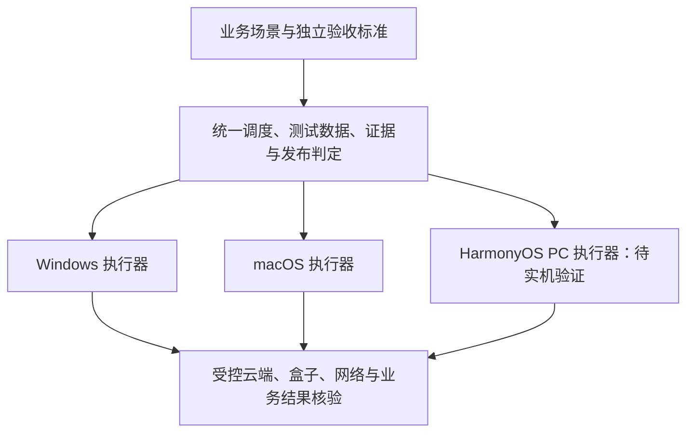

# 万象 AI 自动化测试调研

调研日期：2026-11-02。范围为 GitHub 项目及其官方文档，覆盖 Windows/macOS 客户端、各平台最终分发产物、Web 管理界面和跨服务业务回归，并为未来华为商业 HarmonyOS PC 保留独立适配路线。以下将“官方文档声明”“源码证据”“对万象的接入判断”分开；未安装候选工具、未调用外部模型、未完成候选工具的跨平台或盒子实机验证。已有配网诊断工作区改动保持不变。

## 结论与选择

**有适合的开源组件，不建议从零开发浏览器或桌面操作引擎。建议采用“共享业务场景与验收标准＋平台执行器”的跨平台体系：Windows/macOS 同时试验 Playwright Test + Test Agents 与 Midscene，未来 HarmonyOS PC 经独立适配接入同一环境编排和发布验收层。** 这是结合项目形态的建议，不是工具已经在万象上验证通过的结论。

- Playwright 负责可审查、可重复运行的 Web/Electron 回归；Test Agents 帮助探索、生成和维护测试代码。Electron 启动 fixture 必须单独验证，不能把官方浏览器 Agent 示例等同于已支持完整 Electron 应用。
- Midscene 同时验证真实 Windows/macOS 桌面、分发产物、多窗口及视觉操作。它当前已有官方桌面支持与测试框架；HarmonyOS 连接层另做 PC 适用性探测，不能直接继承手机示例的覆盖结论。
- AI 探索和视觉判断扩展覆盖面；发布阻断仍应依靠明确的业务断言、固定验收标准与实际执行证据。AI 不得通过删除断言、跳过失败流程或修改预期来“修复”测试。
- 万象需要自己补的是测试账号/盒子/网络环境、业务场景、故障注入、结果核验、版本矩阵和统一报告；现成工具无法替团队定义业务正确性。

## 跨平台架构与 macOS 验收补充

共享资产是业务场景 ID、前置状态、操作意图、正确/错误结果、服务与盒端核验、证据格式。平台执行器分别处理安装、启动、窗口、输入、系统权限和清理。相同业务流程可以在不同 UI 和系统行为下验证，不要求复用相同控件定位器、键盘快捷键或点击坐标。

| 测试层 | Windows | macOS | 未来 HarmonyOS PC |
| --- | --- | --- | --- |
| 业务场景、API 断言、报告 | 共用场景和结果契约，按平台独立出结果 | 共用场景和结果契约，按平台独立出结果 | 在产品功能适用的范围内共用 |
| Electron 应用内回归 | Playwright/Electron，经实际产物适配 | Playwright/Electron，经实际产物适配 | 先确认客户端是 ArkUI 原生、Web 容器还是其他运行时，不默认 Electron 可直接迁移 |
| AI 视觉与探索 | Midscene Desktop | Midscene Desktop | Midscene Harmony/HDC 或自定义接口作为候选，需 PC 实机验证 |
| 原生 UI 补充 | WinCore 或 pywinauto 按需选一种 | Mac2/XCTest 按需接入 | 官方 Hypium/UiTest/HDC 路线，按目标 SDK 和设备验证 |
| 交付验收 | 安装/升级/卸载、凭据、启动项、系统权限 | 实际分发容器、Keychain、登录项、TCC、签名/公证及首次启动 | 最终分发形态、权限、键鼠/窗口与硬件链按产品实现分别验证 |

Midscene 的[官方 Desktop 文档](https://midscenejs.com/platforms/desktop)明确操作 Windows/macOS/Linux 的被测桌面应用。Mac 测试宿主需分别具备 Accessibility 和 Screen Recording 权限。可用 [Appium Mac2](https://appium.github.io/appium-mac2-driver/latest/getting-started/) 补少量需要确定性控件操作的原生流程：它基于 Apple XCTest、以 macOS 应用为被测目标，当前文档要求 macOS 11.3+、Xcode 13+，3.x 以后匹配 Appium 3。[Apple XCUIAutomation](https://developer.apple.com/documentation/xcuiautomation)是其可参考的官方 UI 自动化基础；Mac2 与 iOS 驱动的支持范围不可混用。

Mac 独立验收至少包括：

- 实际发布的 .app 及 DMG/PKG/ZIP 等分发载体，首次和再次启动、签名/Gatekeeper/公证及离线情形。Apple 的[分发包测试指南](https://developer.apple.com/documentation/xcode/packaging-mac-software-for-distribution)建议在开发机之外测试实际分发容器；源码启动不等同于完成客户交付验收。
- Keychain 凭据、登录项、原生文件选择框、菜单栏、多窗口、关闭窗口与退出进程的产品约定，以及 Command 快捷键、中文输入和 Retina 缩放。
- 万象首次请求、允许及拒绝蓝牙/文件等权限的状态。Apple 的[权限重置指南](https://developer.apple.com/documentation/xcode/resetting-access-to-protected-resources-in-macos)支持按服务与 bundle ID 重置被测应用权限；测试台架应与自动化宿主自身已授予的权限分开管理。
- 按实际声明交付的架构设置 Intel/Apple Silicon runner 和升级路径；不能从工具发布了两种二进制推断万象两种产物都已验证。

首轮试点同时设置 Windows 和 Mac 测试节点，先在两端运行相同的“登录→连接盒子→打开空星图”和“N-1 数据升级”纵向旅程，分别核验各平台原生行为。未来新增平台需先探测安装、启动、截图、控件/输入、窗口、结果检查、证据和环境复位能力，再纳入发布矩阵。

发布报告按 `平台 × 系统版本/架构 × 个人/企业版 × 产物版本 × 盒端版本` 分项呈现。未接入或缺少设备的平台标记未验证/受阻；不能用 Windows 的成功覆盖 Mac，也不能把尚未适配的鸿蒙 PC 自动计为通过。仅经产品规格明确不适用的功能才标 N/A，并保留原因。

## 仓库现状：已有测试，但尚未构成全产品发布验收

下表为本地源码与 workflow 的静态审计，没有执行这些测试，也未读取远端分支保护设置。不能把测试文件名中的 `electron`、`e2e` 自动视为最终产物黑盒测试。

| 已有资产 | 源码证据 | 不能替代的验证 |
| --- | --- | --- |
| Python HTTP/WebSocket 集成旅程 | [`test_e2e_golden_path.py`](../../octop/tests/integration/test_e2e_golden_path.py):14、24 使用 `env_fake_harness` | 真实安装器、桌面入口和真实模型/盒端协作 |
| 真实 Electron 注册/登录与钱包 UI | [`registration-electron.test.mjs`](../../apps/personal-client/tests/registration-electron.test.mjs):11、[`electron-registration.mjs`](../../apps/personal-client/tests/support/electron-registration.mjs):45、54；[`credit-wallet-electron.test.mjs`](../../apps/personal-client/tests/credit-wallet-electron.test.mjs):11 | 注册测试经过真实 renderer/preload/IPC；钱包测试主要验证真实 renderer。账号、存储或钱包接口被替换；多数需 `WANX_TEST_ELECTRON=1` 才执行 |
| 真实输入、布局、IME 与焦点验证 | [`electron-spaces.mjs`](../../apps/personal-client/tests/support/electron-spaces.mjs):40、[`electron-passwords.mjs`](../../apps/personal-client/tests/support/electron-passwords.mjs):64 | 可复用的 UI 测试基础；不自动等于真实账号和后端联测 |
| 三进程本地安全深度集成 | [`device-trust-ledger-electron.e2e.mjs`](../../apps/personal-client/tests/device-trust-ledger-electron.e2e.mjs):1、72 | 真实 vault/UI/IPC 与临时 HTTPS ledger，但不启动正常产品入口；`*.e2e.mjs` 不在客户端 `tests/*.test.mjs` 的默认 glob 内 |
| Windows 最终安装器烟测 | [`package-win.mjs`](../../apps/personal-client/shell/package-win.mjs):281、290 与 [`smoke-win.ps1`](../../apps/personal-client/shell/smoke-win.ps1):24、63 | 已有 NSIS 安装→启动→覆盖→重启→卸载和 ACL/DPAPI/marker 验证；覆盖安装用同一个包，不是 N-1/N-2 带业务数据迁移 |
| BLE 协议、分片与竞态测试 | [`provisioning-gatt-discovery.test.mjs`](../../apps/personal-client/tests/provisioning-gatt-discovery.test.mjs):13、50、[`provisioning-write-lifecycle.test.mjs`](../../apps/personal-client/tests/provisioning-write-lifecycle.test.mjs):10、[`setup-runtime.test.mjs`](../../apps/personal-client/tests/setup-runtime.test.mjs):42 | 模拟物理 API/characteristic/coordinator，不能证明真实 Windows 蓝牙栈、盒端安全策略和现场 AP 协同 |

主要发布缺口：

1. [`Makefile`](../../octop/Makefile):201、222–224 的 `make all` 包含格式、后端 lint/mypy/Python pytest，**不包含两版客户端、Studio 或 dashboard Vitest 的全套验收**。数千项 Python 测试通过不能代表桌面发布链通过。
2. [`ci.yml`](../../.github/workflows/ci.yml):33、64 主要运行 Python；[`wanx-credit-desktop.yml`](../../.github/workflows/wanx-credit-desktop.yml):6、20、44–49 确有 macOS/Windows Electron 钱包测试，但触发和执行面是个人版的钱包专项，不是两版全旅程矩阵。
3. Windows 内测打包有 `WANX_QUICK_PACKAGE`、`WANX_SKIP_TESTS` 和 `WANX_SKIP_INSTALL_SMOKE`。更有价值的是 [`package-win.mjs`](../../apps/personal-client/shell/package-win.mjs):309–310 明确将 `realAccount`、`liveBoxP2P`、`boxSSO`、`upload`、`streamingChat` 标为 `unverified`；这些状态应进入发布准入，而不能只看打包 `ok:true`。
4. 没有在已查看的 workflow 中发现统一约束“个人/企业版最终安装包通过完整用户旅程后才可发布”的依赖链；这不等于远端分支保护一定未配置。
5. 现有跨仓库备份/安全集成有价值，应保留。前一轮执行出现的备份 schema 不匹配，应明确责任与处理期限；影响交付时不能以“已知失败”长期绕过门禁。

改进重点应从“再生成很多测试代码”转成“哪些用户旅程，在哪个真实环境、哪个最终安装包上，确实被执行并有独立结果证据”。

## 候选比较

| 项目 | AI 介入位置与已证实能力 | Electron / 桌面平台边界 | 部署与许可证 | 本次建议 |
| --- | --- | --- | --- | --- |
| [Playwright + Test Agents](https://github.com/microsoft/playwright) | planner 探索生成 Markdown 计划，generator 产出测试文件，healer 执行并修复测试；常规 Test Runner 承担断言、隔离及回归 | 官方 `_electron` API 仍标为 experimental；可以启动 Electron 并操作窗口。Agent 的官方示例使用 Web `page` fixture，万象需提供并实测 Electron seed/fixture | 本地或自有 CI 运行；Apache-2.0；AI 环节另需所选编码 Agent/模型 | 确定性回归基础，第一梯队 |
| [Midscene.js / Midscene Test](https://github.com/web-infra-dev/midscene) | 运行时视觉定位、自然语言操作和断言；YAML 测例配合 TypeScript 业务 Nodes；报告可查看截图、步骤和 Agent 回放 | 官方明确支持 Windows/macOS/Linux 桌面、Electron/Qt/native app；远程 RDP 针对 Windows。万象具体桌面和鸿蒙 PC 适配仍需分别验证 | 可在自有设备运行；MIT；模型推理另计，也可选择自行部署的兼容模型 | Windows/Mac 共同 AI 视觉层优先试验，第一梯队 |
| [Stagehand](https://github.com/browserbase/stagehand) | `observe` 发现可执行动作，`act` 执行，`extract` 做结构化提取；观察所得动作可以复用，适合 Web 探索与自动化 | 当前 v4 文档明确直接使用 CDP，并且没有 Playwright/Puppeteer/Patchright page interop；本次未确认官方完整 Electron/原生桌面测试适配 | MIT；可用本地 Chrome；Browserbase 托管、缓存/回放服务应与本地执行区分 | Web 备选，不与首轮 Playwright/Midscene 同时全量接入 |
| [browser-use](https://github.com/browser-use/browser-use) | 通用浏览器 Agent，可本地 Python 运行、接入自定义工具；支持保存成功过程和带变量重放 | 主要面向浏览器；本次未找到将 Windows 原生窗口、安装程序、完整 Electron 生命周期作为测试对象的官方保证 | MIT；本地/云浏览器均可；模型和托管浏览器费用独立 | 适合探索性测试助手，发布门禁需另补测试判定和报告 |
| [TestZeus Hercules](https://github.com/test-zeus-ai/testzeus-hercules) | 从 Gherkin 驱动浏览器/API 等辅助工具，提供 JUnit/HTML 和证据目录 | 官方 Windows 安装指南针对其运行环境；不能据此推断支持 Windows 原生应用或 Electron 安装包 | 自有 Python/Docker 环境；AGPL-3.0，采用前评估许可证要求 | 可做测试系统备选，但必须先核验严格判定模式，暂不优先 |
| [Shortest](https://github.com/antiwork/shortest) | Playwright 上的自然语言执行，README 指定 Anthropic Claude，并允许回调补充断言、生命周期与 API 测试 | 本次未找到完整 Electron/原生桌面支持证据；不能因基于 Playwright 就继承所有 Electron 能力 | MIT；自有 CI + 模型 API | 小范围 Web 体验备选，收益需与 Midscene 重叠程度比较 |

上述功能依据分别来自 [Playwright Agents](https://playwright.dev/docs/test-agents)、[Electron API](https://playwright.dev/docs/api/class-electron)、[Midscene 已发布版本 README](https://github.com/web-infra-dev/midscene/blob/v1.17.3/README.md)、[Stagehand observe](https://docs.stagehand.dev/v4/basics/observe)、[browser-use README](https://github.com/browser-use/browser-use/blob/main/README.md)、[Hercules README](https://github.com/test-zeus-ai/testzeus-hercules/blob/main/README.md) 和 [Shortest README](https://github.com/antiwork/shortest/blob/main/README.md)。许可证依据各仓库 LICENSE 与 GitHub 仓库元数据，不将开放 SDK 等同于所有配套云服务免费或可自托管。

## 两个首选的关键证据

### Midscene 已有官方桌面和测试框架

已发布的 [v1.17.3](https://github.com/web-infra-dev/midscene/releases/tag/v1.17.3)（2026-10-29）包含版本为 1.17.3 的 [`@midscene/test`](https://github.com/web-infra-dev/midscene/blob/v1.17.3/packages/test/package.json) 和 [`@midscene/computer-win`](https://github.com/web-infra-dev/midscene/blob/v1.17.3/packages/computer-win/package.json)。这不是仅出现在 main 的未来计划。

[桌面环境文档](https://midscenejs.com/platforms/desktop) 明确支持 Electron 和原生桌面。Windows 普通应用无需额外设置，但 UIPI 会阻止低权限测试进程操作管理员窗口；macOS 需要辅助功能与录屏权限；RDP 需相应主机和 FreeRDP。它能操作屏幕，不代表自动提供盒子复位、蓝牙射频、Wi-Fi AP 或安装升级环境。

[Midscene Test 文档](https://midscenejs.com/midscene-test/overview) 提供 YAML 用例、TypeScript 自定义业务 Nodes、生命周期清理、重试/超时、并发隔离、步骤报告与 `summary.json`。业务 Nodes 可以准备测试账号、检查公开 API 的业务结果、回收测试资源，适合在万象实现跨 UI/API/盒端的业务测试。

运行时视觉推理仍有费用与波动。[缓存文档](https://midscenejs.com/caching) 明确 DOM 定位缓存仅适用于 Web，失效可退回模型，查询和 `aiAssert` 结果不缓存；不能把缓存宣称为桌面回归完全不调用模型。[数据隐私说明](https://midscenejs.com/data-privacy) 表明页面与截图会发给所选模型服务，应使用合成测试数据并核对模型侧数据政策。不要将官方通用 benchmark 成功率当作万象覆盖率或预算。

### Playwright Agents 适合产出测试，不能替代验收标准

[官方 Agents 文档](https://playwright.dev/docs/test-agents) 的三个角色分别产生测试计划、代码和修复，并要求 seed test 建立环境。建议将 AI 产出的测试计划与代码进入正常评审，固定业务预期后再用于 CI。healer 的修改应以 PR/diff 展示；禁止自动修改成功条件来让版本过关。这是对万象的流程建议，不是工具默认保证。

[Electron API 文档](https://playwright.dev/docs/api/class-electron) 说明：Electron 支持仍实验性；`nodeCliInspect` fuse 关闭可能导致启动超时；原生 `dialog` 不会被浏览器自动拦截，示例采用 main-process stub。模拟对话框适合可重复的组件/集成回归，但安装包发布验收另需真实桌面路径，不能用 stub 结果替代。

[v1.64.1 发布说明](https://github.com/microsoft/playwright/releases/tag/v1.64.1)（2026-10-14）修复了打包 Electron 首个窗口偶发丢失问题，说明应固定并验证工具版本，而不是默认任何 Playwright 版本都可靠。不要为让测试可控而放宽正式安装包的安全配置。

## 其他候选的采用注意事项

### Stagehand

[v4 quickstart](https://docs.stagehand.dev/v4/first-steps/quickstart) 支持自有本地 Chrome；[observe 文档](https://docs.stagehand.dev/v4/basics/observe) 明确可以复用发现的动作，但 v4 没有 Playwright page 互操作。GitHub `releases/latest` 当前返回的是 v3 server 子组件发布，不足以确定主 SDK npm 最新版本；PoC 应锁定确切 SDK 包、匹配版本文档，再评估迁移成本。不能复制旧版“往现有 Playwright page 直接加 Stagehand”的接法。

### browser-use

[官方 README](https://github.com/browser-use/browser-use/blob/main/README.md) 提供本地/云执行和历史重放，并明确：页面变化可导致重放中途停止，之前动作可能已经发生；保存的快照和结果仍可能含敏感数据。对支付、绑定、删除等流程，必须先有独立测试环境和幂等策略，不能靠模型自动重试保证安全。它是浏览器 Agent，不是已经为万象定义好断言、测试数据和发布门禁的测试系统。

### Hercules 的“绿灯”必须审计

[官方可靠性文档](https://github.com/test-zeus-ai/testzeus-hercules/blob/main/docs/core_loop_and_reliability.md) 承认：严格判定和严格退出码选项默认关闭；未运行确定性断言时，结果仍由 planner 陈述决定；某些失败可以在默认模式下保留绿色结果。文档还说明新增可靠性示例使用 scripted mock LLM 与本地页面验证，不能当作真实模型可靠性证明。

因此若试用，需要显式启用严格退出码/判定，确保真正执行独立断言，并用人为植入的已知故障证明 CI 一定变红。不要照收“零维护”宣传作为发布保障。

## 补充执行器、API 工具与完整平台

### Windows 原生界面：WinCore 与 pywinauto 二选一做试点

[Appium WinCore Driver](https://github.com/appium/appium-wincore-driver) 是 Apache-2.0 项目，当前 README 明确 Windows 10+ / Appium 3、UI Automation、Root 桌面会话、窗口附着与录屏；[API 文档](https://github.com/appium/appium-wincore-driver/blob/main/API.md#webview-and-cdp) 还说明 Electron/CDP 路径。已核对发布 [v3.3.2](https://github.com/appium/appium-wincore-driver/releases/tag/v3.3.2)（2026-10-29）。适合试验安装器、系统文件对话框、托盘和外部窗口；这里的支持是文档证据，尚非万象实测。虽然旧 Windows Driver 的迁移说明提到 Appium 4，WinCore 自身当前 README 明确的是 3，试点先按一致的版本约束执行。

[pywinauto](https://github.com/pywinauto/pywinauto) 是 BSD-3-Clause 的 Python Win32/UIA 自动化库，适合以较小接入成本补系统窗口测试。它不是 AI 测试平台；可让 AI 帮助生成脚本，最终由固定断言执行。不要同时引入多套原生驱动以增加维护成本。

[旧 Appium Windows Driver](https://github.com/appium/appium-windows-driver) 已明确 deprecated；不应照旧教程新建 WinAppDriver 底座。[pywinauto 远程执行说明](https://github.com/pywinauto/pywinauto/blob/master/docs/remote_execution.txt) 指出交互桌面、CI agent 运行方式和 RDP 锁屏会影响 GUI 操作；Windows runner 需按真实交互桌面配置，不能默认普通 service/SSH 环境就能验收。测试程序也不能承诺跨越 [UAC/UIA 完整性级别限制](https://github.com/MicrosoftDocs/win32/blob/docs/desktop-src/WinAuto/uiauto-securityoverview.md)，不能通过关闭这些边界制造通过结果。

[UI-TARS Desktop/SDK](https://github.com/bytedance/UI-TARS-desktop/blob/main/docs/sdk.md) 和 [Agent S3](https://github.com/simular-ai/Agent-S/blob/main/gui_agents/s3/README.md) 可作视觉探索备选；前者 SDK 标 Experimental，两者都不直接提供万象的业务断言、盒子复位和发布规则。首轮已有 Midscene 时不必再同时引入一套通用 computer-use Agent。

### Schemathesis：补 API 黑盒与状态组合，无须每轮调用 AI

[Schemathesis](https://github.com/schemathesis/schemathesis)（MIT）从 OpenAPI/GraphQL 等 schema 生成边界输入和有状态请求序列，并支持自定义业务 checks、失败重放与报告。万象已有 OpenAPI，适合补请求字段、资源生命周期、错误响应和跨用户权限边界。它是自动生成/属性测试工具，不能把它包装成 AI Agent，也不能用接口通过替代 UI 旅程。涉及真实写入与删除，只对可复位测试环境运行；认证及业务不变量仍由团队定义。

### Keploy：API 录制回放候选，先核清开源/账户/部署边界

[Keploy](https://github.com/keploy/keploy) 的开源仓库为 Apache-2.0，提供流量录制与回放。[当前安装文档](https://keploy.io/docs/server/install/) 已有原生 Windows x64 和 Apple Silicon 支持，不能继续按旧印象说只能用 WSL；但当前分发文档要求 `record/test` 登录免费账户且有使用额度，native 支持的协议范围也有限。[Windows 文档](https://keploy.io/docs/installation/windows-installation/) 还说明 HTTPS 录制会添加 CA，下载路径包含 enterprise 二进制。应单独核清所选版本的源代码、二进制许可证及账户要求，不能从仓库许可证推导所有分发功能都可完全离线使用。

其回放 mock 适合快速复现接口回归，不等于真实依赖联通；也不能替代 SQLite 本地写入、AEAD/BLE 或证书钉扎链路验收。首轮优先现有接口测试与 Schemathesis，Keploy 后续按明确录制需求再试验。

### 完整自托管平台 Suitest：方向匹配，但 Electron 关键环节尚缺

[suiflex/suitest](https://github.com/suiflex/suitest)（Apache-2.0，仓库创建于 2026-05）提供用例管理、执行、证据、需求关联和 BYO LLM，功能形态接近“测试团队使用的系统”。但不能仅凭 README 的 desktop 支持声明采用：

- [Desktop 设计文档](https://github.com/suiflex/suitest/blob/main/docs/DESKTOP_TESTING.md) 明确 `electron-mcp`、`computer-use-mcp` 需要外部二进制，仓库不实现也不包含它们。
- [当前 Roadmap M14](https://github.com/suiflex/suitest/blob/main/docs/ROADMAP.md) 将 M14-1/M14-2 标为未完成、config-only，并说明默认 desktop 路由缺少执行程序会在 spawn 时失败。
- Roadmap 顶部的现行契约要求运行/MCP 已配置并验证 workspace LLM；历史 ZERO 等里程碑文字不能覆盖现行契约。

因此它可以作为测试管理 UI 的比较对象或后续集成候选，尚不能当作“开箱即用验收万象 Electron＋Windows＋盒子”的系统。本次并未进行安装、安全或可运维性审计，也未证明其全部 Web/API 功能稳定。

## 万象应建立的测试闭环（建议）

1. **需求与业务场景库**：测试人员维护期望结果、前置数据和失败条件；AI 结合需求、历史缺陷和界面探索提议遗漏场景。将计划作为可评审文档，而不是从实现反推所有预期。
2. **确定性回归**：关键业务写成固定 Playwright/API/协议测试，适合每个 PR 运行。测试通过真实入口驱动操作；后台查询只用于独立验证结果和诊断，不能替 UI 完成应该被测试的关键步骤。
3. **视觉与探索测试**：Midscene 运行真实桌面和难定位 UI，夜间执行更广的探索和视觉断言；AI 新发现的问题沉淀成稳定回归。AI 自己说成功不能覆盖确定性断言失败。
4. **真实产品与盒端联测**：Windows/Mac 分别运行分发产物安装、旧版本升级、多窗口、存储、网络恢复和蓝牙配网；未来鸿蒙 PC 采用相同验收层次。盒子/AP/电脑需可恢复到已知状态，没有这层基础设施便覆盖不了硬件和交付问题。
5. **统一证据与发布判定**：同次运行保留版本、用例、步骤截图/视频、UI 日志、服务端请求关联、盒端结果与清理结果；区分产品失败、基础设施失败、模型不确定和跳过。保留首次失败，重跑通过不自动抹掉不稳定性。

这层编排可以自建，但首轮无需建设通用 SaaS 平台。先做能够驱动现有测试、Windows/Mac 平台执行器和受控盒端环境的薄层，保留未来平台接入边界，验证实际收益后再考虑场景管理界面。

### 最小自建范围与运行层次

| 执行时机 | 运行内容 | 主要工具/资源 | 判定要求 |
| --- | --- | --- | --- |
| 每个 PR | 现有单元/集成、关键确定性 UI、API 契约/权限断言 | 现有测试 + Playwright + 按需 Schemathesis | 关键用例失败须阻断；不能只按改动文件选择而漏掉常驻 P0 回归 |
| 夜间 | 更长业务旅程、AI 视觉/探索、断网/慢响应、版本组合 | Midscene + staging + Windows/macOS runner | 模型不确定、基础设施失败、产品失败分别报告，失败不自动删断言 |
| 发布候选包 | 安装、旧数据升级、两版核心旅程、真实盒配网与连接 | 与待发布包 SHA-256 一致的安装产物 + 原生 UI 执行器 + BLE/盒子/AP 台架 | 必选项未执行、跳过、环境阻塞均不能当通过 |

最小交付物先保持为：版本化用例清单、环境/数据准备脚本、执行器适配、统一 JSON/JUnit/HTML 结果与证据目录、CI 准入检查。可复用现有 GitHub Actions 与报告机制，不必新增外部数据库服务、账号系统和复杂 Dashboard。详细设计采用嵌入式 QA SQLite 持久化租约和预算，M1 单机、M2 单控制点；见[技术方案](wanx-cross-platform-ai-testing-design.md)。

每次运行至少关联：安装包哈希、客户端个人/企业版及版本、OS/工具/模型版本、盒端/云端版本、用例 ID、首次结果及重试结果、失败截图/视频和脱敏日志、资源清理状态。业务步骤由 UI 执行，公开 API/文件/盒端状态只作独立核验；不得直接调用内部方法替 UI 完成要测试的动作。测试资源和账号必须属于专用环境，真实支付只用测试服务/沙箱，盒子复位只对可丢弃的测试设备执行。

AI 的主要工作：从需求和历史缺陷补场景、探索界面、生成/修复测试草稿、整理失败证据。测试人员维护和审核业务预期，开发维护环境、数据节点和关键断言。控制端自托管不等于模型推理自动留在内网：截图、日志的模型路径与保留策略需按选定部署明确。

## 万象首批高风险旅程

建议先覆盖下列场景，再依据缺陷和产品使用频率扩展；这是风险排序，不是已实现的用例或已测通过的清单。

| 优先级 | 用户旅程 | 关键验收结果 |
| --- | --- | --- |
| P0 | Windows/Mac 普通用户全新安装、中文/空格路径、首次启动 | 各平台最终分发产物正常运行；分别核验 ACL/DPAPI、Keychain/TCC、签名和目录行为 |
| P0 | N-1/N-2 升级到候选包，保留真实格式的旧 profile/应用数据 | 会话、数据和内置应用可继续使用；不是用同一新包覆盖自身作替代 |
| P0 | 注册/登录、多个保存账号、退出、重启、凭据损坏 | 页面与实际会话/存储一致；身份切换不继承前一账号权限 |
| P0 | Windows/Mac 各自真实蓝牙栈 + 测试盒配网/认领 | 成功、错密码、AP 不存在、策略拒绝均得到正确结果；不能仅以传输 `completed` 判成功 |
| P0 | 云端目录→P2P/relay→SSO→断网/引擎退出→恢复 | 恢复后业务实际可用，过期和撤销不会降级绕过 |
| P0 | 最终包启动 Studio/星图，空数据与已有数据分别打开 | 实际窗口、空间列表、内容可见可用；不能只验进程存在或握手消息 |
| P0 | 上传→搜索/读取→流式对话→切换会话→重启恢复 | UI、真实后端记录和文件结果一致，流式内容及数据持久化正确 |
| P0 | 无权限/只读/过期/撤销成员尝试写入与保持长连接 | 真实拒绝、无副作用；活跃 HTTP/SSE/WS 和应用按约定截止收敛 |
| P1 | 钱包测试服务创建订单→到账→重复回调→账号切换 | 余额、订单、幂等结果与测试回调一致，不执行生产扣款 |
| P1 | 中文 IME、Tab/Enter、DPI缩放、原生文件框、多窗口焦点 | 可操作、无遮挡、输入和焦点不丢失；个人/企业版分别执行 |

资源不足时，先在 Windows 和 Mac 两端用“登录→连接测试盒→打开空星图”与“N-1 数据升级”两个纵向切片验证工具适配；配网另设真实硬件轨道，不把模拟蓝牙冒充硬件通过。鸿蒙 PC 在实际产品和设备具备后先执行能力探测，再接同一批适用业务场景。

## 试点验收标准（建议，不是已实现成果）

选择一组覆盖登录、盒子发现/认领、应用加载、文件操作、更新/重启和权限拒绝的代表流程。测试用例先写出独立预期，至少包括成功、业务失败和环境异常。

- 能在实际 Windows 与 macOS 分发产物上分别从启动运行到业务最终结果，并自动生成可追溯证据；不以单一平台成功代表跨平台完成。
- 对已知缺陷或人工植入的故障必须失败；不能只证明健康版本“能点完”。
- 把 UI 成功反馈与公开 API/文件结果/盒端持久状态交叉核对，明确最终一致性的等待截止时间。
- 在固定环境重复运行，分别记录首次通过率、重跑通过率、人工介入次数、误报/漏报、模型调用费用和总耗时；先测本项目，不采用厂商 benchmark 推算。
- 在用例超时、窗口崩溃、电脑离线、模型失败时有明确失败结果和清理证据；资源未恢复不能继续复用污染环境。
- AI 修复只能提出受审查的测试/定位器变更，验收语义、安全断言和正式应用权限保持原要求。

建议先在同一环境将关键场景连续运行 20 次，记录首次通过率和每次费用，而不是用重试后的绿灯计算稳定性；将全部预设故障、历史有问题的包作为反向样本，必须全部拦截。具体通过率、运行时间与费用上限待试点测量后由团队确定。本次不提供未经测量的覆盖率或人力替代承诺。

## 维护状态与核验边界

2026-11-02 读取 GitHub 仓库 API，六个候选均未归档。观察到的最近 push：Midscene 11-02、Playwright 11-02、Stagehand 10-30、browser-use 11-02、Hercules 10-29、Shortest 08-06；这只是活动信号，不代表稳定性或交付保证。元数据可分别在各项目的 `https://api.github.com/repos/<owner>/<repo>` 核对。没有以星数排序。

本次是源码/文档调研，没有安装第三方依赖、运行真实 AI 测试、增加 CI、测试客户账号/盒子或生成分发产物。下一步先做 Windows/Mac 双平台适配 PoC，并将鸿蒙 PC 能力探测单列，再决定是否建设万象测试编排系统。

## 鸿蒙 PC 官方能力核查（2026-11-02 补充）

用户补充的“鸿蒙 PC”应按华为商业 HarmonyOS 电脑目标看待，不能直接等同于 Android 手机、OpenHarmony 开发板，或运行在 Windows/macOS 上的开发工具。华为的[鸿蒙电脑开发入门](https://developer.huawei.com/consumer/cn/multidevice/pc/get-started/)明确采用 DevEco Studio、ArkTS/ArkUI，并要求考虑键鼠和大屏交互；这份资料不构成现有 Electron 客户端可原样运行的承诺。未来万象的鸿蒙产品形态（ArkUI 原生、Web 容器或其他受支持运行时）应先确定，再选择测试驱动。

### 已找到的一手能力与证据边界

| 领域 | 确认的能力 | 尚不能据此保证 |
| --- | --- | --- |
| 华为测试工具链 | [官方测试服务入门](https://developer.huawei.com/consumer/cn/testing/get-started/)提供 Hypium UI 自动化、Studio UI 测试，并说明命令行构建/签名/安装和流水线运行测试 | 页面面向 HarmonyOS 应用总体，未给出每个工具/接口对所有商业鸿蒙 PC 版本的适用矩阵 |
| 官方 PC 验证路径 | [电脑适配指南](https://developer.huawei.com/consumer/cn/multidevice/pc/adapt)建议模拟器验证布局和基础交互、远程真机验证安装/启动/核心流程/窗口、本地真机验证键鼠与实际硬件 | 模拟器或云端真机不能代替本地蓝牙、AP、盒子及真实外设联测 |
| 鸿蒙电脑远程真机 | [官方云调试](https://developer.huawei.com/consumer/cn/agconnect/cloud-adjust)明确列出鸿蒙电脑和 MateBook Fold，可上传签名 debug/release 应用包并获取日志、Shell 及模拟操作 | 交互式云调试不等同于已验证可被万象 CI 自动租用的无人值守设备 API；也未证明可接入万象本地 BLE 盒子 |
| UiTest 桌面相关能力 | [OpenHarmony 官方 UiTest 指南](https://github.com/openharmony/docs/blob/master/zh-cn/application-dev/application-test/uitest-guidelines.md)明确有键鼠、窗口、多屏截图/控件树；触控板示例直接覆盖 PC/2in1 场景 | OpenHarmony 上游代码可证明组件能力，不能证明相同 API 在指定华为商业 PC 固件、SDK、权限和签名模式下全部可用 |
| hdc 连接层 | [OpenHarmony 官方 hdc 文档](https://github.com/openharmony/developtools_hdc/blob/master/README_zh.md)区分开发机 client/server 与目标设备 daemon，并说明主机工具可运行于 Windows/Linux/macOS | “PC 端支持 Windows/Mac”描述的是控制主机，不是对被测 PC 应用平台的支持；hdc 也不是 Android adb |

华为文档中心的 [Instrument Test](https://developer.huawei.com/consumer/cn/doc/harmonyos-guides/ide-instrument-test) 与 [Hypium Python 指南](https://developer.huawei.com/consumer/cn/doc/harmonyos-guides/hypium-python-guidelines)本次读取返回无可读正文，未将第三方镜像、论坛回答或手机示例当成商业 PC 全量兼容的证明。[DevEco Testing 官方 FAQ](https://devecotesting.huawei.com/userPortal/help?jobType=100000102)描述 Windows/Mac 客户端、HDC 设备发现和开发者模式/USB 调试，也不能单凭“有 Windows/Mac 客户端”判断被测鸿蒙 PC 的适配程度。

### Midscene 与 Appium 的鸿蒙路线

[Midscene 的 HarmonyOS 官方文档](https://www.midscenejs.com/platforms/harmonyos)确认 `@midscene/harmony` 通过 HDC 操作 HarmonyOS NEXT 应用和系统界面，支持截图、动作、查询和视觉断言；示例以手机设置和 USB 设备为主。其[设备实现](https://github.com/web-infra-dev/midscene/blob/main/packages/harmony/src/device.ts)使用 `MobileInputPrimitives` / `createDefaultMobileActions`，虽已有键盘输入能力，本次未找到其明确承诺商业鸿蒙 PC 的完整鼠标、多窗口、安装/升级、系统权限弹窗覆盖。应将它作为现成连接层候选做 PC 实机探测，不把“支持 HarmonyOS”自动写成“已覆盖鸿蒙 PC”。

华为[2025 年 12 月开发者月刊](https://developer.huawei.com/consumer/cn/monthly/202512)提到可通过开源 appium-harmonyos-driver 复用跨端测试资产；[该驱动仓库](https://github.com/zhihu/appium-harmonyos-driver)提供 Hypium/HDC 相关桥接。这是第三方项目的一手实现资料和华为指向的生态路线，不是 Appium 官方已经验证商业鸿蒙 PC 全场景的保证。仍需对目标 PC 的控件树、窗口、键鼠、生命周期和结果判定做试点。

### 万象接入建议与必须实测的最小范围

统一维护“登录、连接盒子、打开空间、上传、流式对话、权限拒绝”等业务验收合同，鸿蒙 PC 增加独立的平台适配器：优先探测官方 Hypium/UiTest/HDC；必要时通过 Midscene 的[自定义接口](https://midscenejs.com/integrate-with-any-interface)实现截图、尺寸和动作映射。这里是可行的工程扩展方向，不是已经存在且验证通过的万象驱动。

将平台能力显式登记为支持、未验证、受限或不适用，不静默降级：

1. 指定一台真实商业鸿蒙电脑、OS/API/SDK 版本、签名和调试模式，先验证安装、启动、截图、控件树、点击/文字/组合键、窗口移动/缩放及多屏坐标。
2. 独立验证正式应用安装/升级/卸载、文件选择器、凭据/权限提示、休眠恢复；测试 HAP 能运行不代表普通最终分发包已完成交付验收。
3. 蓝牙授权、发现/重连、真实 Wi-Fi 和“电脑—云端—盒子”状态一致性只在本地真机台架确认；测试工具能点击按钮并不证明底层外设操作完成。
4. 验证失败退出码、超时、证据采集与资源复位；AI 完成状态不得覆盖固定业务断言失败。

上述商业 PC 适配尚未实机验证。本轮可确认的是：官方已有鸿蒙电脑开发/真机验证路径，上游 UiTest 有桌面操作能力，也有现成 HarmonyOS AI/自动化连接层；不能确认“同一份 Playwright 或手机脚本即可完整验收鸿蒙 PC”。
