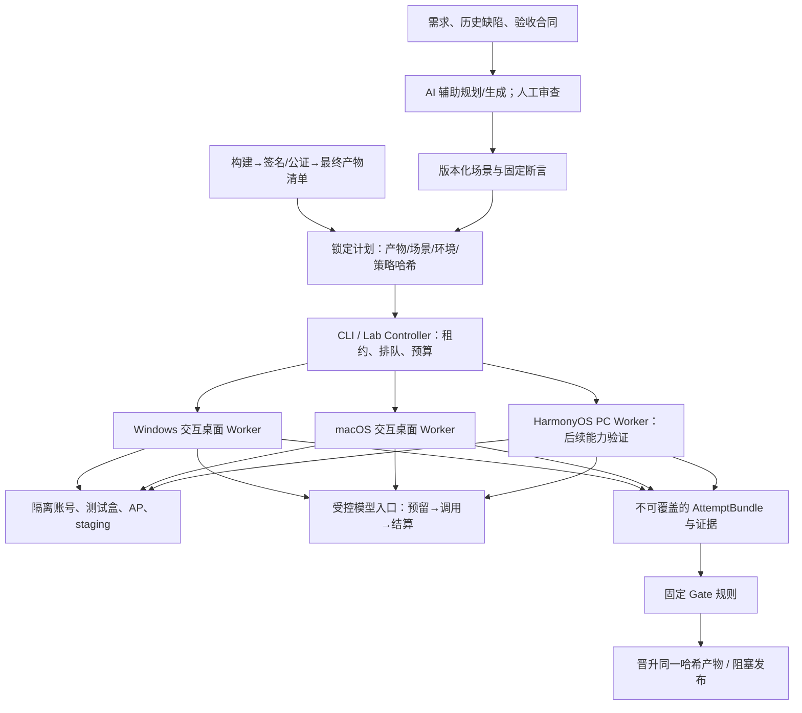

# 万象跨平台 AI 辅助自动化测试技术方案

版本：设计稿 v1.1 · 日期：2026-11-02 · 状态：待按里程碑实施。

本文将已讨论的方向细化为工程方案：Windows/macOS 首期同时建设，未来适配商业 HarmonyOS PC；固定脚本承担高频回归，AI 用于测试资产生成、少量视觉检查、探索和失败归因。本文不是已上线系统的说明，也不代表候选工具已经通过万象实机验证。所有标为“拟建”的目录、命令、配置和 Interface 均尚未实现。

配套材料：[工具调研与平台支持证据](wanx-ai-testing-research.md)、[仓库接入清单](wanx-ai-testing-integration-inventory.md)。本轮仅新增方案文档，已有配网诊断改动保持不变。

## 1. 核心决策

| 决策 | 方案 | 原因 |
| --- | --- | --- |
| 执行基础 | Playwright Test/Electron 处理应用内确定性回归；保留并整合现有 Node/pytest/Electron 测试 | 复用现有资产，避免重复建设；新工具不替代已有协议、权限和深度集成测试 |
| AI 视觉 | Midscene 小范围接入，正式执行锁定工具/模型版本 | 用于难稳定定位的桌面区域、视觉检查和探索，控制调用范围和费用 |
| 系统原生 UI | Windows 按需 WinCore；macOS 按需 Mac2/XCTest；保留 pywinauto 为 Windows 试点替选 | 不给每个场景同时维护三套驱动；经对照试点决定实际接入项 |
| 鸿蒙 PC | 独立 Adapter，优先探测 Hypium/UiTest/HDC；必要时接自定义视觉接口 | 产品运行时和商业 PC SDK 能力尚需确定；不预设现有 Electron 产物可迁移 |
| 首期产品形态 | 独立测试包＋CLI＋CI 工作流＋专用交互桌面 runner＋受控盒子台架 | 先完成可信执行闭环，不先开发通用测试 SaaS 或复杂管理界面 |
| 持久状态 | 本地 PoC 用单进程嵌入式 QA SQLite；多节点阶段由唯一 Lab Controller 管理租约和预算 | 并发预算和设备租约需要原子状态；不增加外部数据库服务，不使用产品数据库 |
| 发布判定 | Gate Module 以固定规则计算，不依赖模型判断 | 禁止缺测、缺证据、重试掩盖失败或 AI 改预期造成假绿 |

首期默认假设：有可独占的 Windows 与 Mac 测试节点、隔离 staging、测试账号及可复位测试盒；视觉推理先使用可计量的按量 API，供应商凭证只在受控预算入口持有。若要求推理不出内网，替换模型 Adapter 并重新测量效果与成本，不改变场景、执行结果和发布判定的契约。模型部署偏好仍可调整。

## 2. 目标、范围与非目标

### 2.1 交付目标

1. 每个候选版本有可追溯的“用例 × 平台 × edition × 产物”结果，能说明哪些真实执行、哪些模拟、哪些未验证。
2. 对安装升级、保存密码、空星图、配网失败、连接恢复等历史缺陷建立能够抓住坏版本的回归。
3. Windows/Mac 从首轮开始验证相同业务旅程，并单列系统行为差异。
4. 测试失败可自动留下足够证据；超时、取消和资源失联后能停止后续操作并隔离污染环境。
5. 高频脚本回归的测试执行层不调用视觉模型；所有运行时视觉模型请求受预算、次数和期限约束。
6. 测试绑定最终签名、公证及打包后的产物；发布晋升同一份产物，不在测试之后重新构建。

### 2.2 首期覆盖

- 个人版与企业版客户端，以及随包交付的 Studio、星图和相关本地入口。
- 现有 Python、bridge、dashboard、Studio、Node/协议、真实 Electron 测试的显式执行清单。
- Windows/Mac 正常产品入口、最终分发产物、N-1 数据升级，以及受控 staging 的业务旅程。
- 真实盒子、蓝牙、Wi-Fi 与网络恢复设独立硬件轨道，先覆盖最小代表组合。
- 鸿蒙 PC 先交付能力探测报告，不提前宣称完整平台支持。

### 2.3 暂不建设

- 通用 RPA 引擎、自己的视觉基础模型、自动替代所有人工验收的系统。
- 多租户 SaaS、复杂权限管理后台、全量线上流量录制平台。
- 对生产账号扣款、客户盒子复位、生产数据修改或不受约束的自主探索。
- 为自动化放宽正式应用的权限、证书校验、CSP、签名或本地授权要求。

## 3. 现状与接入原则

仓库已有真实 Electron UI、Windows 安装烟测、HTTP/WebSocket 集成和跨仓库安全/备份验证。主要缺口是持续执行、最终产物、旧数据、真实外部依赖与发布门禁尚未统一。详见接入清单与调研报告。

- `make all` 继续保留，但其 Python ship bar 不能代替桌面、dashboard、Studio 与硬件验收。
- `WANX_TEST_ELECTRON` 等显式开关、`*.e2e.mjs` 等默认 glob 外测试纳入登记，必选项未执行就是缺测。
- 现有同包覆盖安装烟测保留；补真正 N-1 应用创建数据后升级至候选包的旅程。
- 已知的跨仓库 schema 漂移必须处理或登记为阻塞，不用“历史失败”永久放行。
- 复用现有测试时保留真实性标签，不将注入 fake coordinator、mock 账号或模拟蓝牙的结果计入真机覆盖。
- 两版按产品能力选择用例：企业版最终包当前排除个人版本地身份/恢复模块，不能机械套用全部个人版场景。共同旅程覆盖两版；本地身份专属场景只进入声明支持它的 edition。适用性来自受审查的产品 capability 清单，不来自 Worker 临时跳过。

| 等级 | 执行对象 | 能证明什么 |
| --- | --- | --- |
| T0 | 模块/协议＋模拟依赖 | 分支、数据结构、竞态、错误映射与否定规则 |
| T1 | 真实进程/UI＋模拟后端 | renderer/preload/IPC、布局、焦点和交互接线 |
| T2 | 正常产品入口＋真实 staging | 多进程与后端业务协作、账号和真实数据结果 |
| T3 | 最终分发产物＋真实 OS | 安装升级、凭据、系统权限、签名及客户入口 |
| T4 | 最终产物＋真实盒子/蓝牙/AP/网络 | 硬件链路及电脑—云—盒子的状态一致性 |

T0/T1 通过不填补 T3/T4 的缺口。功能上正确的负向旅程，例如明确拒绝未授权写入，整体结果仍可为 PASSED；不能把预期内的业务错误等同于测试失败。

现有套件以 `legacy-suite` 形式显式适配：固定文件列表、对应运行时和必选 test 名称/数量，解析经验证的 TAP/JUnit 等结果，拒绝 required 全 skip。普通 Node/pytest 输出的测试数量不冒充“业务断言执行次数”。新 T2–T4 场景通过受控 assertion registry 产生具名断言回执；Gate 核对 ID 和执行结果，不能只接收模型或第三方 runner 自报的总数。

## 4. 总体架构与部署



### 4.1 运行角色

- **CI/CLI**：选定执行 profile、建立锁定计划、发起运行、上传报告、请求 Gate 判定。
- **Lab Controller**：首期唯一分配点；维护 QA SQLite journal、资源 kit 和预算；多节点阶段提供小型受控 HTTPS 任务/心跳与模型代理 Interface。它不承载产品业务，不直接读写客户数据库。
- **Worker**：在专用交互桌面中运行测试；持有 run 范围短期凭证，验证计划与产物、获取租约、执行、采证、清理和回报。
- **平台 Adapter**：隐藏安装、启动、窗口、权限检查、原生驱动和回收差异；Playwright、Midscene、WinCore/Mac2 是其内部 implementation。
- **Gate Module**：只读取已锁定的预期和实际证据，计算准入；不启动应用，不调用模型，不修改失败结果。

### 4.2 简化路线

M1 本机 PoC：同一 CLI 串行执行，用嵌入式 SQLite 管理本机预算/租约；不承诺跨机器日预算。M2 多节点：迁移到唯一 Lab Controller，统一预算入口和资源分配，再对外宣称具备全台架总预算与互斥管理。

首期不做控制点自动高可用。Controller 失联时停止分配新资源；Worker 到租约期限停止新动作并清理。恢复后先 reconcile，再恢复排队，不能直接接管未知状态的桌面或盒子。

M2 Controller 的持久状态最少包含资源/租约、run/attempt、预算账户/modelCall journal。使用事务和唯一 ID 防重复领取/结算；controller 数据位于受控 QA 目录，不用网络共享文件锁。Worker 控制连接采用受控 HTTPS、节点登记和短期 run 凭证，只能领取/回报其任务及请求被批准模型。M1 尚无远端控制入口，不声称已实现这套跨节点保障。

### 4.3 最小状态存储

以下表属于独立 QA 账本，不进入 Octop 产品迁移：

| 表 | 关键内容与约束 |
| --- | --- |
| candidates / plans / runs | releaseCandidateId、产物集合、前序候选/修复依据、plan digest、完整预期清单、profile/policy、产物引用、phase；同一 plan 内容不可原地替换，跨 run 失败历史关联候选 |
| attempts | run/target/case/variant/revision/attempt 身份、首次/重跑关联、outcome、资源/成本处置和 bundle digest；attempt 身份唯一 |
| resources | kind、平台能力、generation、健康状态、隔离原因；不保存账号密码 |
| leases / lease_resources | ownerRunId/attemptId/generation、有效期限和 recovery 身份；每个资源至多一个 active lease，整个 kit 一次事务全取或全不取 |
| budget_accounts | daily/run/case 额度及 spent/reserved/unsettled 互斥余额；scope 与币种唯一标识 |
| model_calls | 每个物理 attempt 的唯一 ID、reservation、实际模型/价表、发送和结算状态、供应商 ID；结算按状态比较更新，重复回调幂等 |
| events | run/attempt/递增 seq、事件类型与内容摘要；相同 seq 相同内容可重传，不同内容必须拒绝 |

资源分配和预算预留在单写入者的 SQLite 事务中检查、更新并提交；同步驱动如被采用，隔离在受控账本执行进程，不阻塞 GUI/网络回调。驱动选择、持久化/崩溃恢复和 Windows 文件行为在 M1 契约测试中验证。金额用整数微元或明确的定点单位存储，预留向上取整，禁止用浮点累计后判断是否超预算。

清单采用明确的规范化 JSON 编码和 SHA-256，生产/消费双方使用同一版本规则（拟采用 RFC 8785 的安全子集）；拒绝重复键、非有限数值和超出支持范围的整数。原始 YAML 只在编译计划时解析，不以 YAML 文本空白作为业务身份。Controller 重启先恢复 journal 和未结算风险，不将 ACTIVE 资源或未知费用自动归零。

## 5. Module、Interface 与平台适配

首期将 seam 放在“执行锁定计划”，不先发明一套覆盖所有操作系统控件的通用点击 DSL。

| Module | 对外职责 | 内部负责 |
| --- | --- | --- |
| Plan | 将目录、矩阵、产物和策略编译成不可变 LockedPlan | 校验、依赖选择、适用性、hash、必选项展开 |
| Resource | acquire/heartbeat/release/reconcile kit | 互斥、generation、健康检查、复位与隔离 |
| Execution | probe/execute/reconcile | 平台安装、真实 UI、驱动、截止时间、采证与清理 |
| Budget | reserve/settle/markUnknown | 原子账本、价表、模型白名单、并发额度 |
| Evidence | 接收并封存 AttemptBundle | schema、内容哈希、脱敏、归档和完整性 |
| Gate | evaluate(plan, bundles, policy) | 缺测、失败、真实性、成本/资源状态及产物匹配规则 |

下面为拟建 TypeScript Interface 示意，相关类型由测试包维护，不是现有产品导出：

```ts
interface ExecutionAdapter {
  probe(): Promise<Capabilities>;
  execute(
    plan: LockedPlanRef,
    lease: ResourceLease,
    signal: AbortSignal,
  ): Promise<AttemptBundle>;
  reconcile(sessionId: string, lease: ResourceLease): Promise<RecoveryResult>;
}
```

Interface 契约必须包含：

1. `probe` 报真实平台/架构/OS、产物类型、交互桌面、截图、输入、原生 UI、签名校验、BLE、fixture 复位能力及其验证时间；unknown 不当成 supported。
2. `execute` 只接受本 Worker、当前 generation 的有效租约和可核验计划；运行一次 attempt，不在内部无限重跑整个用例。
3. 新动作执行前校验租约、取消和绝对截止时间；Deadline 不能因重连、重规划或重试被续长。
4. 错误返回明确分类，不通过换 mock、换目标盒子或跳步骤满足能力缺口。
5. 始终尝试有界 finalization；不能因截图/日志/清理失败抹掉原始产品失败。
6. `reconcile` 用公开查询和已记录的操作 ID 确认效果；结果未知时不得猜测成功或重放写入。

执行期限用本机单调时钟计算；UTC 时间用于关联、审计和展示，不用 NTP 可调整的墙钟续长执行期限。跨机器不直接比较 monotonic 数值：Controller 返回受限租约时长，Worker 保守计算本地截止并校验 generation。普通运行检测到休眠/恢复或时钟异常即停止新动作、重新验证租约/环境；有意测试休眠的场景要显式定义外部唤醒和恢复子流程，不能假定睡眠期间心跳和输入仍有效。

### 5.1 平台矩阵

| 目标 | 应用内 | 原生/视觉 | 独立验收 |
| --- | --- | --- | --- |
| Windows | Playwright/Electron | Midscene；WinCore 按需 | NSIS、升级/卸载、DPAPI/ACL、启动项、原生文件框、真实 BLE |
| macOS | Playwright/Electron | Midscene；Mac2/XCTest 按需 | 实际发布容器、Keychain、TCC、登录项、签名/公证、窗口/退出语义、真实 BLE |
| HarmonyOS PC | 由最终产品运行时决定 | Hypium/UiTest/HDC 探测；Midscene/custom interface 候选 | 商业 PC 指定 SDK/固件、键鼠/窗口/多屏、权限、生命周期和外设 |

共享场景描述“登录、连接盒子、打开空间、上传”等业务意图；执行步骤用受审查的 TS handler，必要时按平台分支。不同 UI 不强行共用定位器；Control/Command、关闭窗口/退出进程、路径和原生对话框均遵循各平台产品约定。

首期最低基础单元是 Windows×个人/企业、macOS×个人/企业。每个仍声明支持并交付的架构/OS 版本进入支持矩阵；如果继续交付 Mac Intel、Windows ARM64，必须补相应证据或明确交付状态，不能用另一架构通过代替。鸿蒙 PC 暂列 UNVERIFIED，只有产品规格明确不适用的项可标 N/A 并记录原因。

例如本地身份管理声明为个人版能力，企业版不将该场景登记为 required；共同资源权限场景仍覆盖两版各自的受支持授权方式。盒端策略及客户端能力不匹配时应测试明确拒绝/指引，不能为了“认领成功”替旧路径添加本地授权标记。

## 6. 场景目录与锁定计划

### 6.1 场景合同

每个场景包含：稳定 ID、需求/缺陷 ID、业务负责人、优先级、edition/平台适用性、真实性要求、前置数据、版本化 handler、独立断言、清理策略、AI 策略和执行期限。团队审核期望结果；不能仅由生成实现的 AI 根据当前实现反推正确性。

同一业务场景可以有不同执行变体，例如 renderer-mock 与 packaged-staging；身份采用 `caseId + variantId + revision`。PR 的模拟变体和 RC 的真实变体分别登记，不能用同一 caseId 的低真实性结果填充高真实性缺口。所有变体在计划编译时确定，执行中不降级。

拟建场景配置示例，字段是本测试包的合同，不冒充 Midscene 原生 YAML：

```yaml
schemaVersion: 1
id: WX-APP-EMPTY-001
variantId: packaged
title: 空星图空间首次打开可用
owner: qa-applications
priority: P0
editions: [personal, team]
platforms: [windows, macos]
requiredTruth: T3
handler: applications.open-empty-starlink
handlerRevision: 1
evidenceContract: ui-packaged-v1
fixtures:
  account: staging-owned-box
  data: empty-starlink-space-v1
assertions:
  - id: starlink-window-visible
    handler: ui.starlink-window-visible
  - id: empty-space-usable
    handler: business.empty-space-usable
cleanup: fixtures.restore-app-space
ai:
  mode: disabled
timeoutSeconds: 300
```

`handler` 必须在版本化目录中登记；配置不接受任意 shell、任意 URL、内联可执行代码或未登记模型。视觉变体以独立 ID/版本声明；固定脚本失败不能运行中悄悄改成 AI 步骤而仍计入确定性覆盖。

### 6.2 LockedPlan

计划固定：source commit、测试代码/场景目录/策略版本及摘要、每个目标的最终产物和旧版本产物、支持矩阵、固定环境版本、资源需求、必选断言、工具 lockfile、模型/价表和费用限制。矩阵展开结果本身作为预期清单；Gate 不从实际执行结果反推“应该测哪些”。

以下为**仅用于说明结构的样例清单**，哈希是占位示例，不能用于实际准入：

```json
{
  "schemaVersion": 1,
  "planId": "qa-rc-example",
  "profile": "release",
  "sourceCommit": "aaaaaaaaaaaaaaaaaaaaaaaaaaaaaaaaaaaaaaaa",
  "catalogRevision": "qa-catalog-v1",
  "policyRevision": "release-policy-v1",
  "targets": [
    {
      "platform": "windows",
      "arch": "x64",
      "edition": "personal",
      "artifactRef": "artifact://qa/example/windows-personal.exe",
      "artifactSha256": "aaaaaaaaaaaaaaaaaaaaaaaaaaaaaaaaaaaaaaaaaaaaaaaaaaaaaaaaaaaaaaaa",
      "requiredCases": [{
        "caseId": "WX-APP-EMPTY-001",
        "variantId": "packaged",
        "truthLevel": "T3",
        "evidenceContract": "ui-packaged-v1",
        "requiredAssertionIds": ["starlink-window-visible", "empty-space-usable"]
      }]
    },
    {
      "platform": "macos",
      "arch": "arm64",
      "edition": "personal",
      "artifactRef": "artifact://qa/example/macos-personal.dmg",
      "artifactSha256": "bbbbbbbbbbbbbbbbbbbbbbbbbbbbbbbbbbbbbbbbbbbbbbbbbbbbbbbbbbbbbbbb",
      "requiredCases": [{
        "caseId": "WX-APP-EMPTY-001",
        "variantId": "packaged",
        "truthLevel": "T3",
        "evidenceContract": "ui-packaged-v1",
        "requiredAssertionIds": ["starlink-window-visible", "empty-space-usable"]
      }]
    }
  ],
  "environmentRevision": "staging-fixtures-v1",
  "budgetPolicy": "pilot-budget-v1"
}
```

样例只展示两个 target；实际 release 计划必须按该版本产品支持矩阵加入全部必选 edition/架构与 T4 场景。运行前将清单规范化并计算 plan digest；控制端和 Worker 均校验。通过受控存储获取产物，下载后重新校验大小、hash 与签名身份。

启动后还需验证实际执行程序路径、进程归属、包内 buildId/version 和安装内容摘要，防 Electron 单实例机制附到已有旧进程。测试账号/profile 隔离但产品安全行为保持原约定。普通场景中的非预期自动升级会改变被测对象，应停止并记录产物漂移；升级场景则明确绑定 from/to 两个产物和重启后的实际进程身份。不能仅凭窗口标题或启动命令声称正在测试候选包。

### 6.3 需求覆盖与变更维护

QA 在 M0 建立“需求/缺陷 → 产品能力 → 场景变体 → 平台/edition → 独立断言”的登记表，作为目录的一部分维护。覆盖率的分母来自经评审的需求及支持矩阵，不来自当前已有脚本数量；分别展示已登记、已自动化、实际执行和实际通过，手工验证保留单独记录。

- 每次功能 PR 声明受影响的需求 ID、接口/数据/权限变化及对应回归；AI 可以建议映射，业务负责人确认。无可用自动化的项登记 owner、风险和补齐阶段，不能以“AI 未发现影响”省略。
- P0 常驻集固定执行；认证、schema、更新器、公共 IPC/SDK 等共享路径变化触发扩展集。无法可靠判断影响时执行完整适用集。减少矩阵、删除断言、放宽性能阈值或更新截图基线都需可审查 diff 和 QA 确认，不能伴随失败自动接受新基线。
- 每个逃逸到客户的缺陷补一个能在已知坏版本或受控故障样本上验红的回归，再证明修复版通过；保留复现数据和版本范围。由 QA 每个发布周期检查未覆盖需求和长期隔离用例。

为控制组合数量，分开登记必测基础矩阵和扩展兼容矩阵。核心旅程覆盖所有已承诺的基础目标；语言、缩放、输入法、主题、多屏、网络档位等扩展维度按风险或成对组合安排夜间运行，涉及变更的组合进入 RC。组合抽样不表示全部组合已验证，N/A 必须来自产品能力定义。

跨版本兼容另建具名表，由客户端、盒端和后端负责人共同维护：候选客户端×最低支持盒端/bridge；仍受支持旧客户端×新云端；随包应用与既有应用数据的支持边界。每行声明“应可用”或“应明确拒绝”、版本范围、对应场景和最低真实性，并由 Plan 展开必选组合。认证、协议和迁移边界必须有具名场景，不能用成对抽样替代；“全部最新版本”通过不证明客户旧组合可用。

## 7. 测试环境、账号、旧数据与硬件

### 7.1 环境隔离与真实性

- PR 的模拟后端与 staging 明确分开；报告必须携带 dependencyMode，不允许 mock 被归入 real-service 轨道。
- 账号、盒子、AP、数据空间有清晰 ownerRunId 和回收策略。fixture bootstrap 复用现有测试部署/管理命令；缺少的管理能力列为实施依赖，不默认新增生产 HTTP 后门。
- 测试过程中应由用户真实入口执行关键业务操作；公开状态查询、受控测试服务和文件结果用于独立核验及采证，不代替被测 UI 写入。
- 大模型业务对话分两条轨道：固定响应验证前端/流式协议，少量真实模型验证业务接入。模型费用单列，不能把 mock 结果写成真实 LLM 通过。
- 语言、服务器时区、输入法和网络档位在 fixture 中固定；日期显示预期遵循产品的服务器时区，不随测试宿主本地时区猜测。

### 7.2 旧数据升级

在目标机器同一 OS 用户下安装 N-1，使用旧应用真实入口创建账号/保存凭据/应用空间与样例数据，记录基线，再用候选分发产物升级。N-2 在夜间或发布扩展矩阵覆盖。

不能把另一台 Windows 的 DPAPI 密文复制过来冒充客户旧数据，也不能将 Mac Keychain 当普通 profile 文件复制。升级后的会话、数据、权限、内置应用和重启结果分别验证。N-1 包、创建数据的步骤和期望摘要均固定在计划中。

升级故障按阶段定义，M2 准备样本，M3 将产品支持范围内的关键项纳入门禁：

| 阶段 | 故障样本 | 必须核验 |
| --- | --- | --- |
| 下载/校验 | 断网、截断、hash/签名错误、候选撤回 | 不执行无效包；现有版本和数据仍可用 |
| 退出/文件替换 | 文件锁、空间不足、安装器终止 | 不误报完成；识别实际版本和混合安装，恢复后验证包完整性及数据 |
| 首启/迁移 | 首启崩溃、迁移中断、OS 重启 | 不提前记成功；通过持久状态和受支持恢复步骤验证一致性 |
| 完成确认 | 安装完成但确认回报丢失 | 先核验进程/buildId、数据与业务结果，不盲目重复安装 |

每项冻结故障位置、from/to 产物、数据不变量、期限和恢复证据；不以固定等待若干秒后杀进程代替已确认的故障阶段。缺乏可控注入点的场景登记能力缺口，不能伪称已测试。

### 7.3 台架 kit 与互斥

kit 可包含交互桌面、指定盒子、AP/网络故障注入器、专用账号与 profile。视觉或原生输入按**整台交互桌面独占**，不能按窗口并行抢键鼠；共享同一盒子或 AP 的任务也互斥。仅相互隔离的浏览器 context、进程与数据才允许另行声明可并发。

租约至少含 `leaseId / generation / ownerRunId / attemptId / resourceIds / expiresAt`；Worker 每次新物理动作前验证 generation。心跳频率与期限示例为 5 秒/30 秒，实际按台架测量调优。

TTL 到期不意味着旧动作已停止。回收顺序是停止新请求→取消驱动任务→终止并确认旧进程树/输入代理退出→查询盒端 job/连接是否收敛→恢复基线→健康探测。无法确认某一步就隔离 kit，不马上出租。fencing 无法撤销已经提交的 Wi-Fi、认领、升级或支付写入。

旧租约失效后，旧 Worker 只能停止自己明确拥有的本地进程/输入任务，不能继续用旧 generation 复位共享盒子、AP 或账号。Resource Module 确认旧执行已静止后签发当前代 recovery 租约，才允许 reconcile 和共享 fixture 复位；控制端不可达则保持隔离。测试结束清理与租约恢复走同一授权规则，避免 cleanup 成为迟到写入来源。

专用 Windows/Mac Worker 必须有可用交互会话。锁屏、休眠、失焦和远程连接变化作为环境事件记录；不能因自动化宿主缺权限而将产品错误或通过状态猜出来。应用首次/拒绝权限用独立快照测试，自动化宿主权限单独配置。

### 7.4 最终分发包的可自动化性试验

M1 首条旅程必须使用候选工具驱动真实打包应用，并在 Windows/Mac 分别验证：能否启动正确进程、访问必要 UI、穿过原生对话框、完成独立断言及有界退出。记录 Electron 配置、运行参数、系统权限和实际使用的驱动；开发模式可运行不代表正式包可运行。

若 Playwright 附着要求正式包不具备的调试能力，应用内相关测试保留在 T1/T2，T3 使用系统辅助功能或受控视觉驱动。不得通过放宽正式包安全配置来满足测试。对使用自动化启动参数的正式包，另保留按客户正常方式启动的安装/启动旅程，分别报告两者。

工具选择设停止条件：代表旅程不能稳定完成、无法采集关键结果、计量通路无法拦截或需要不接受的产品改动时，记录缺口并更换相应 Adapter；不先把所有场景迁入该工具。M1 验证通过后才确认 M2/M3 工期。

## 8. 状态、错误、重试与恢复

| 记录 | 拟定状态 | 说明 |
| --- | --- | --- |
| Run phase | QUEUED→PREPARING→RUNNING→FINALIZING→FINISHED | phase 只描述执行进度，不等同成败 |
| Attempt outcome | PASSED / FAILED / ERROR / BLOCKED / CANCELLED / SKIPPED | 与执行原因、预期断言及真实性绑定 |
| Resource disposition | CLEAN / QUARANTINED / UNKNOWN | 与用例结果独立，记录是否可安全复用 |
| Release verdict | READY / NOT_READY | 固定规则输出，并列出所有拒绝原因 |

- **FAILED**：独立业务断言失败，例如 UI 成功但后端实际未写入。
- **ERROR**：runner、驱动、采证等执行异常，无法得到可信业务结论。
- **BLOCKED**：缺资源、能力、预算、依赖准备或必要权限，测试未完整执行。
- **SKIPPED**：计划中显式未执行；必选项出现即不准入。
- **CANCELLED**：用户/调度取消；不转换为通过。

业务 PASSED 但清理失败时保留业务结果，另记资源 QUARANTINED 和 finalization failure；该 bundle 不能作为完整 release 证据。测试结果与 runner 进程退出码双向核对，缺少结果不能从 exit 0 推导成功。

P0 正式回归默认不自动整例重试。只读状态轮询必须有固定截止时间；它不是无限失败重跑。确需重跑时生成新的 attempt、干净 fixture 和独立证据，保留首次失败；失败后通过标 flaky，不能覆盖成首次通过。

正式验收按稳定 `releaseCandidateId` 聚合跨 run 历史，Controller 维护候选产物集合与全部计划/attempt 的关联。Gate 查询完整历史，不能只接受调用方选出的绿色报告；新 run、新 planId 或删除本地文件不能重置首次结果。同包同场景的诊断重跑通过仍保留 flaky 和阻塞。产品/测试/环境缺陷修复后，需由 QA 确认修复依据、影响范围及前序失败处置，创建关联前序的修订计划或替代候选并重新验证；不得通过任意更改 case revision、候选 ID 或将失败改判为环境问题绕过。该处置只允许证明问题已修复，不能把未修复失败豁免成通过；首次记录永久保留。

认领、Wi-Fi、删除、升级等写操作超时后先 reconcile；未确定结果不重新点击。取消/失联后进入 FINALIZING，先采最低限度证据，再有界清理。资源仍不明时标 UNKNOWN 并隔离。

## 9. AI 使用与成本控制

### 9.1 四类费用分别核算

| 类别 | 时机 | 控制方式 |
| --- | --- | --- |
| 测试编写/维护 AI | 需求变化、生成或修复草稿 | 代码评审与独立预算；普通脚本执行不重复消耗该模型费用 |
| 运行时视觉 | 声明的视觉检查点与有界探索 | 统一模型入口、请求前预留、次数/模型/输出/时间限制 |
| 失败分析 AI | 规则归类后必要时分析脱敏证据 | 每次失败单独限额；分析不改测试结果或发布判定 |
| 被测万象的业务模型 | 真实对话验收 | 专用测试账号/配额单列；不能混入“视觉测试费用”或无限调用 |

PR 常驻回归默认 `AI disabled`。夜间只对明确场景开视觉或探索；release 只运行已审查的视觉检查点，必要的关键业务断言仍由确定逻辑核验。像素截图对比可本地执行，但动态区遮罩和阈值须版本化；仅在语义视觉检查有额外价值时调用模型。

### 9.2 请求前预算 Interface

```text
admit(policy, actualModel, requestBounds)
    → 原子 reserve(daily, run, case)
    → 发送一个物理 HTTP attempt
    → settle(actualUsage) 或 markUnknown(reservation)
```

MVP 仅开放已适配、可拦截计量的模型协议，例如受控 OpenAI-compatible 视觉入口；订阅登录、外部编码 Agent 与其他模型通道未完成拦截前，不能宣称受到同一硬预算控制。

每个物理请求都有本地唯一 modelCallId，关联 run/case/step/attempt、实际 provider/model、请求体摘要、价表 revision、预留额、usage 与供应商 requestId。重试、模型 fallback、解析失败后的重发分别 reserve，不按一个 UI 步骤只算一次。

预算规则：

1. 唯一账本原子检查并预留 daily/run/case 三层额度；`spent + reserved + unsettled + newReservation` 不得超过各层上限。多节点不得各自认为拥有完整日额度。
2. 预留输入、输出及该供应商计费项的保守上界。图片 token 依据具体模型规则估算，不能按 JPEG 字节换算；无法可靠收紧时用模型上下文上限和最高适用档价保守预留。不能建立上界的通道先不进入硬预算模式。
3. 限制实际模型白名单、输入图数/尺寸、输出上限、并发、请求数、重规划轮数和 wall-clock deadline。Default/fallback 也必须通过网关校验，高价升级需在计划显式允许。
4. usage 返回后结算；缺失、超时、中断、取消标 USAGE_UNKNOWN，不记 0 元，不立即退回预留。未知金额从 reserved 转入 unsettled，两桶互斥，不重复相加。对账后再释放余额；重复 usage 不重复结算。
5. 超限拒绝新模型请求，原因 BLOCKED_BUDGET；必选检查未完成会阻塞发布。模型成本证据不完整也不能写成“0 费用正常完成”。
6. 本地 abort 不保证供应商停止已发送请求的推理计费。网关价表/请求上界约束不等同于云账户账单绝对封顶，需独立账户配额、专用 key 与账单对账。
7. Worker 只有 run 范围入口凭证，不持供应商长效 key。显式配置所有模型 slot 并拒绝越过白名单的 SDK fallback。

账本状态为 `RESERVED → DISPATCHED → SETTLED/UNSETTLED`；只有确认未发送的 RESERVED 才能转 RELEASED。模型请求的发送与取消状态由入口统一登记，不能由 UI 超时猜测“没有发送”。已发且用量未知必须继续占风险额度，不能因跨日或重启清零。结算后 spent 记录实际费用、预留差额退回；超出预留则记预算上界违约并停止该通道的新请求，排查计量/价表。

RC 默认采用 `settled-required` 成本证据策略：必选 attempt 即使业务断言已完成，但仍有 USAGE_UNKNOWN/UNSETTLED，也保留业务 PASSED 并输出 Release NOT_READY，待对账闭环。夜间可以完成报告并保留估算上界，但不将其自动晋升为 RC 证据。

Midscene `onLLMUsage` 是事后遥测，`agent.metrics` 也不能替代预算准入；源码会将部分缺失计量字段按 0 累计，平台必须保留“未知”状态。缓存可减少部分规划，Web XPath 定位缓存不能当作桌面定位缓存；`aiAssert/aiQuery` 不缓存，保留真实验收。相关来源见第 17 节。

### 9.3 试点参数与估算

以下仅为拟定试点配置，需通过实测修订，并非保证这些额度足以完成全部场景：

```yaml
schemaVersion: 1
id: pilot-budget-v1
currency: CNY
limits:
  dailyAmount: 50
  runAmount: 10
  caseAmount: 1
  modelConcurrency: 1
  physicalCallsPerCase: 20
  replansPerTask: 5
  maxOutputTokens: 1024
  requestTimeoutSeconds: 30
  caseDeadlineSeconds: 300
routes:
  default: approved-vision-model
  planning: approved-vision-model
  locate: approved-vision-model
  insight: approved-vision-model
allowModelUpgrade: false
onUnknownUsage: hold-reservation-and-stop-ai
onBudgetExceeded: block-unfinished-case
```

`approved-vision-model` 是逻辑槽，实施时映射到固定供应商/地域/模型版本、价表和输入图像限制；未配置这些信息必须拒绝启动。网关禁止与配置不一致的实际模型。请求超时不续长整例 deadline，已有 case 进入固定脚本清理时不依赖模型继续花费。

费用估算按各物理调用求和：`Σ((inputTokens×inputPrice + outputTokens×outputPrice) / 1_000_000 + 其他费用)`，其中价格统一为元/百万 token，其他费用先转换为元；按供应商规则拆分缓存和 reasoning，避免将已包含在输出中的 reasoning 再收费一次。

量级算例：当前北京 qwen3-vl-plus 的单请求输入≤32K 档为输入 1 元/百万、输出 10 元/百万。若一个场景累计输入 10 万、输出 5000，则约 0.15 元；100 场景×2 平台×每天 10 轮全用视觉约 300 元/天；同等单次用量下仅 10% 的执行量使用视觉约 30 元/天。若再对个人/企业版分别全量运行，次数相应增加。**这是算术示例，不是万象实测，不含测试机、工程投入、真实业务模型和存储费用。** 实际超过单请求档位须换用对应价格。

## 10. 证据、报告与发布准入

### 10.1 AttemptBundle

每个 attempt 写入独立目录，最终封存 index/digest，不覆盖历史：

```text
artifacts/acceptance/<runId>/<targetId>/<caseId>/<variantId>/<attemptId>/
  result.json
  steps.ndjson
  assertions.json
  platform.json
  artifact-verification.json
  fixture-receipts.json
  cleanup.json
  budget.json
  screenshots/
  video/
  logs/
  traces/
  evidence-index.json
```

最小结果示例同样使用占位 hash：

```json
{
  "schemaVersion": 1,
  "runId": "run-example",
  "caseId": "WX-APP-EMPTY-001",
  "variantId": "packaged",
  "attemptId": "attempt-1",
  "targetId": "macos-arm64-personal",
  "truthLevel": "T3",
  "artifactSha256": "bbbbbbbbbbbbbbbbbbbbbbbbbbbbbbbbbbbbbbbbbbbbbbbbbbbbbbbbbbbbbbbb",
  "outcome": "PASSED",
  "assertions": {"required": 2, "executed": 2, "passed": 2},
  "resourceDisposition": "CLEAN",
  "evidenceComplete": true,
  "ai": {"physicalCalls": 0, "amount": 0, "usageState": "NOT_USED"}
}
```

真实 bundle 还需包含 plan/case/handler revision、系统与工具版本、box/cloud environment revision、时间/截止、每条断言 actual/expected、首次结果及复跑关联、worker/lease generation、进程和盒端 job 的关联与脱敏策略。用 UTC 时间和单调耗时并存，记录 UI 日期断言使用的服务器时区。

`evidenceComplete` 和断言计数只是展示摘要，不是 Gate 的可信输入。证据合同随计划锁定：

| Evidence contract | 必选内容 |
| --- | --- |
| legacy-suite-v1 | 明确套件/测试名、实际执行/跳过/失败结果、运行时与退出码、原始解析输入及摘要；不伪造原生 assert 调用次数 |
| ui-packaged-v1 | 平台、实际运行程序/进程/edition/build 身份、来源分发产物校验、逐步记录、具名断言 ledger、合同指定的可读截图、fixture 和 cleanup 回执；使用 AI 时须 budget 状态 |
| hardware-journey-v1 | ui-packaged 内容＋盒端 job/公开状态、网络/AP 操作和复位回执、电脑—云—盒端关联；不记录秘密凭据或原始敏感帧 |

Gate 从合同要求的文件/事件 ID 及其内容重新计算完整性和断言结果；空目录、不可解码图片、重复一条断言凑数、缺实际结果、伪造 summary 都失败。文件 hash 只证明归档内容身份和完整性，不证明恶意 Worker 没有造假；首期信任经审查的 runner/测试代码和受控节点，不能把摘要校验称为硬件远程证明。

失败时立即收集客户端轮换日志（含存在的 `.previous`）、服务端关联和盒端公开诊断，不让高频后台日志覆盖关键窗口。原始 frame、明文密码、私钥、恢复材料和长期 token 不入通用报告。UI 测试使用合成数据；trace/HAR 可能含请求头和表单，必须检查脱敏后才上传。包含敏感内容且无法可靠脱敏的证据限制在隔离台架，并令公开 evidence bundle 标明缺失原因，不上传未处理文件。

默认拟定保存期：PR 14 天、夜间 30 天、发布证据/manifest 180 天；失败长视频可单独压缩或缩短保留，截图与必要日志必须可定位。生命周期和访问权限在实施时按存储环境落实，不把保存期当已启用配置。

run 根目录另存 `locked-plan.json`、产物来源 `acceptance-manifest.json`、汇总 `results.json`、Gate 输出 `readiness.json` 和 `report.html`。汇总文件用于检索展示；Gate 仍从计划和已封存的逐 attempt 内容计算，不信任汇总布尔值。

### 10.2 Gate 固定规则

Gate 接收 LockedPlan、所有 required target/case 的 AttemptBundle 和固定 policy，依次检查：

1. 计划、测试代码、policy、场景 revision 与证据一致；没有缺 target、缺用例或零测试。
2. 最终产物 hash/大小/签名身份与被测产物和发布清单一致；旧版本升级源也匹配。
3. 必选用例和断言实际执行，满足声明的最低真实性；无 mock 结果冒充 staging/硬件。
4. 所有 required target/case/断言均 PASSED，无 FAILED/ERROR/BLOCKED/SKIPPED/CANCELLED；P0 还要求首次通过，首次失败后重跑绿不自动过关。P1 若已列为 required，其失败同样阻塞；optional 的观察性结果单列且不计入已覆盖必选范围。
5. 必选证据完整、可读取且内容 digest 正确；进程退出码与结果不矛盾。
6. finalization 和资源状态可接受，无 UNKNOWN/QUARANTINED 的未闭环影响。
7. AI 必选步骤未因预算而缺测；RC 按 settled-required 策略确认所有必选 attempt 无 USAGE_UNKNOWN/UNSETTLED，即使业务断言通过也不省略成本证据检查。未授权模型和未计量通路未被使用。
8. 每个声明支持的平台/edition/架构分别有结果，鸿蒙未验证不纳入已支持通过率。

输出 READY 或 NOT_READY，并列出 reason codes，例如 MISSING_TARGET、MISSING_ASSERTION、ARTIFACT_MISMATCH、TRUTH_LEVEL_TOO_LOW、FIRST_ATTEMPT_FAILED、EVIDENCE_INCOMPLETE、RESOURCE_UNKNOWN、BUDGET_BLOCKED、COST_UNSETTLED。汇总报告可区分产品失败与环境受阻，但两者都不冒充“可发布”。

先签名、公证/装订和封装最终产物再测交付层。测试后重签名、重新封装或重新装订改变摘要时，需要新的计划和受影响层验证；发布只晋升测试通过的同一份 blob。首期不实现自动例外放行通道；团队现有人工例外决定需独立记录责任人、原因和期限，不能篡改为测试 PASSED，也不能把未实现的例外接点当作已通过 Gate。

### 10.3 证据有效期与依赖漂移

180 天是归档保存期，不是验收结果可用于发布的期限。M0 由 QA 和发布负责人制定版本化 freshness policy，分别规定离线安装、真实云端和硬件旅程的最大证据年龄；实际 release 计划必须携带该 policy、完整依赖清单及可接受版本范围，缺失时不得准入。第 6.2 节的 JSON 是结构节选，不是可直接发布的完整 schema。

运行开始/结束记录实际探测的云端部署、盒端固件、bridge、应用、OS、驱动和 fixture revision；只有声明的 environmentRevision 而无实际证据不算核验。运行期间相关依赖变化使受影响场景失效，跨版本升级场景则按其显式 from/to 合同判断。无法获得必要版本的场景登记为未验证依赖。

Gate 和最终推广接点都核验证据年龄、候选/策略身份和当前目标环境；过期返回 EVIDENCE_EXPIRED，相关依赖超出计划返回 ENVIRONMENT_DRIFT，重跑受影响集合。有效期内发生漂移也不能复用旧结果。MVP 默认不跨候选复用证据；未来需要复用时必须显式证明产物、场景、依赖和策略兼容。

推广记录绑定候选、plan/bundle digest、目标渠道/环境、判定时间和期限；发布入口在实际晋升时重新验证这些约束，不能只读取一份曾为 READY 的 report.html。部署状态无法被原子锁定时要明确该限制：推广前复核、部署后执行最小业务烟测，漂移触发停止后续批次和受控恢复；不宣称消除了全部检查与使用之间的竞态。数据迁移的恢复仍服从产品支持范围。

## 11. CI 与发布接入

| 轨道 | 触发/环境 | 必选执行 |
| --- | --- | --- |
| PR | 普通 CI、隔离依赖；必要时受控人工触发实验台架 | 现有检查＋两版高风险常驻集；确定性 UI/API。改动影响分析只能加选，不能删除 P0 常驻项 |
| Nightly | 受保护工作流＋专用交互 runner/staging | 两 OS×两 edition 的扩展旅程、少量视觉探索、恢复/权限组合、硬件台架排队 |
| RC | 受保护发布环境＋固定最终签名产物 | T3 安装与 N-1 旧数据、T4 配网/连接、业务核心旅程、完整 Gate 判定 |

拟建 `.github/workflows/wanx-acceptance-{pr,nightly,release}.yml`，具体脚本和现有包装入口见接入附录。普通 fork/未受信任 PR 不直接在携带台架和模型凭证的持久 self-hosted runner 执行；不以 `pull_request_target` 检出外部代码获得实验室权限。正式实验室任务只使用受控测试代码 revision 和范围受限的 staging 凭证。

起步用 Actions concurrency 加 Worker 本机独占锁，台架 kit 排队；多节点阶段由唯一 Controller 统一租约，Actions 只提供触发/等待/证据展示。不要依赖两个独立 workflow 的临时工作目录作为共享设备锁。

所有轨道在 `always` finalization 保存结果；上传失败使证据不完整，不能只 warn 后发布。正式发布 job 必须依赖 Gate READY，并验证将要发布的每份文件摘要。普通 `make all` 或单项钱包 workflow 的绿色状态不能替代 release Gate。

M1 即接通受控 CI 触发→双平台代表切片→证据上传→纯 Gate 的观察检查，验证交互会话、排队、取消和报告可达性；先不用于正式推广。运行时 AI 关闭的计划记录成本状态 NOT_USED，不依赖模型预算入口建成；只有启用 AI 的计划需要计量与视觉能力验收。M3 才把经过验证的必选集合接入正式发行门禁。

现有发行登记/推广接点位于 Admin，不能仅写一条新的 Actions workflow 就宣称所有正式发布入口已被强制约束。M0 核对固定版本 Admin 的实际登记 Interface 和权限；M3 用坏 manifest、缺证据、NOT_READY 和 hash 不匹配验证推广拒绝。具体接点未核实前只输出候选验收报告，不自动执行正式推广。

拟建 CLI 命令形态（当前不可执行）：

```text
qa plan --profile pr|nightly|release --artifacts <manifest> --out <locked-plan>
qa run --plan <locked-plan> --worker <worker-id>
qa reconcile --run <run-id>
qa report --run <run-id>
qa gate --plan <locked-plan> --evidence <bundle-index>
```

## 12. 首批场景与断言

| ID | 优先级/最低轨道 | 旅程 | 独立结果与失败样本 |
| --- | --- | --- | --- |
| WX-INSTALL-001 | P0/T3 | 普通用户全新安装与首次启动 | 真实最终容器、签名、进程/窗口、路径/权限正确；损坏包或缺依赖必须失败 |
| WX-UPGRADE-001 | P0/T3 | N-1 创建旧数据→升级→重启 | 凭据/空间/文件/内置应用继续可用；用曾出现 schema/文件替换问题的样本验红 |
| WX-AUTH-001 | P0/T3 | 多保存账号登录→退出→重启 | UI 与实际身份一致，错误/损坏凭据不继承会话 |
| WX-CLAIM-001 | P0/T4 | 真实蓝牙配网/认领成功与失败 | 电脑/云/盒端状态一致；错密码、AP 缺失、授权拒绝得到对应结果，传输 completed 不等于成功 |
| WX-CONNECT-001 | P0/T4 | 目录→P2P/relay→SSO→断网恢复 | 恢复后业务实际可用，租约/权限变化不被旧缓存绕过 |
| WX-APP-EMPTY-001 | P0/T3 | 空星图首次打开 | 窗口及空间确实可用；不能只看进程或消息握手 |
| WX-STUDIO-001 | P0/T3 | 启动随包 Studio、已有空间 | 实际窗口、工作区和一次受控业务交互成功 |
| WX-FILE-CHAT-001 | P0/T2/T3 | 上传→读取/搜索→流式对话→重启 | 文件 hash/后端记录/可见消息及持久化一致；真实模型另列子轨道 |
| WX-AUTHZ-001 | P0/T2，发布补T3/T4 | 只读/撤销成员尝试写入及保留连接 | 真实拒绝且无副作用，HTTP/SSE/WS 在约定截止收敛 |
| WX-WALLET-001 | P1/T2 | 沙箱订单→回调→到账→重复回调 | 订单、余额和幂等一致，拒绝生产扣款资源 |
| WX-DESKTOP-001 | P1/T3 | IME/缩放/多窗口/原生文件框/登录项 | 各 OS 的输入、窗口、权限与持久设置按产品约定工作 |

每条拆分明确成功、业务失败、环境异常子用例，避免在一个长脚本中“部分成功即通过”。先选 WX-AUTH、WX-APP-EMPTY、WX-UPGRADE 两 OS 的纵向切片打通，再补真实盒端轨道，不等全部场景齐备才验证工具。

### 12.1 性能、后台行为与长时间运行

仅检查页面“能打开”会漏掉后台请求放大、内存持续增长和长时间连接失效。M1 加入短时基线采集，M2 在夜间扩展稳定性运行；M0 由桌面开发与 QA 确认指标定义和阈值，尚未建立基线的指标明确标观察项，不能声称已有性能门禁。

| 场景 | 采集与断言 | 首期安排 |
| --- | --- | --- |
| 冷启动、登录、打开星图/Studio、配网 | 从用户动作到可交互或明确业务终态的端到端耗时；分阶段耗时辅助定位 | M1 固定节点采基线，M3 按评审后的上限验收 |
| 钱包打开/关闭、窗口隐藏、切账号、退出登录 | 按真实接口类型和触发来源统计请求率、并发、重复订阅、停止/降频行为；关闭页面后是否仍需后台刷新由产品合同定义 | M1 短时回归，M2 夜间扩展 |
| 多次登录/开关窗口/连接与断网恢复 | 主进程及子进程 CPU、内存、句柄/文件描述符、残留进程、连接数与日志增长；断言恢复后业务可用 | M2 建议先 30–60 分钟；稳定后扩展 4–8 小时夜间运行 |
| 更新下载中断、安装失败、迁移中断 | 从受控 N-1 基线注入故障，确认数据可恢复及明确错误；重启后验证实际版本与数据 | M2 准备可复位样本，M3 将更新相关必选场景纳入 RC |

这些时长是试点参数。性能基线须绑定相同硬件、OS、网络、采集开销和数据规模；保留原始样本数、分位数及资源曲线。小样本不能宣传稳定的 p95/p99，单次抖动也不能直接归因为产品回归。建议门限采用明确的绝对上限及经评审的相对退化容差；变更门限须版本化，不能拿当前慢版本覆盖基线。长稳测试不要求逐帧调用视觉模型，优先采本地指标和事件截图。

此前日志中的 `credit.payment.status` 不能作为实际支付查询次数的唯一依据：[measureCreditRequest](../../apps/personal-client/account/index.mjs) 将多种积分路径默认映射到该 step，仅对部分创建、关闭和 catalog 路径另命名。因此需要按脱敏路由模板、method、触发来源、窗口状态及关联 ID 建立计数；现有日志缺字段时列为可观测性依赖。`outcome: completed` 只能说明所测操作完成，配网还应独立校验 job 终态、错误码及盒端联网结果。不能据这份日志直接断定存在四重支付轮询或配网成功。

升级失败恢复遵循产品实际支持的合同：若数据库格式不支持降级，应验证拒绝旧程序写入和受支持的备份恢复路径，不把“安装旧包”当成通用回滚。故障注入仅使用专用台架和可恢复数据。

## 13. 测试系统自身验收

| 反向测试/注入 | 必须得到的结果 |
| --- | --- |
| 必选文件未匹配、0 tests、默认 skip | Gate NOT_READY，准确列缺项 |
| runner exit 0，但断言失败或未执行 | NOT_READY，不依赖退出码盲判 |
| required P1 已执行但 FAILED | 同样 NOT_READY，不只检查 P0 |
| Windows 通过，Mac 或企业版缺失 | 缺 target 阻塞，不用整体通过率覆盖 |
| UI 成功，真实后端写入失败 | 业务断言 FAILED |
| 测试后的分发包被重新打包/签名 | ARTIFACT_MISMATCH |
| 候选包正确，但附着旧实例/错误 edition 或运行中换版 | 运行身份不匹配，停止并 NOT_READY |
| 第一轮失败、第二轮成功 | 保留两轮，标 flaky，不覆盖首次失败 |
| run A 失败，换 run B/planId 后只提交绿色报告 | 读取候选完整历史，不能绕过首次失败或未处置问题 |
| 同包测试后换云端/盒端版本，或证据超过有效期 | ENVIRONMENT_DRIFT / EVIDENCE_EXPIRED；不得凭归档仍存在放行 |
| 仅全部最新组合通过，缺必选旧版兼容组合 | 列出缺失组合，阻断对应支持声明 |
| 校验失败仍安装，迁移中断却提前记成功 | 对应升级故障断言 FAILED，保留恢复证据 |
| 截图上传失败、必要日志缺失 | EVIDENCE_INCOMPLETE |
| summary 声称完整，但空图片/重复断言/缺必选 ledger | 重新核验合同后拒绝，不信任 summary |
| 锁屏/焦点被抢、驱动权限不足 | 明确环境错误及证据，不由 AI 猜通过 |
| Worker 在 Wi-Fi 写入后掉线 | 先 reconcile，不重复写；不明则隔离 kit |
| 旧 generation 的迟到动作 | 拒绝新动作；已发出的效果独立核对 |
| 旧 cleanup 在新 session 后迟到 | 无当前 recovery 租约的共享资源复位被拒绝 |
| NTP 回拨、普通运行休眠/恢复后缓存租约仍在 | 不延长 deadline，停止新动作并重新验证 |
| cleanup/进程树退出确认失败 | QUARANTINED，不出租污染资源 |
| 两并发请求抢剩余预算 | 原子预留，仅允许符合额度的请求发出 |
| usage 缺失、超时、取消、重复回调 | 未知费用不归零/退款，重复 usage 不重复结算 |
| 最后断言已 PASS，但最后一次模型 usage 缺失 | 业务 PASS 保留；RC 因 COST_UNSETTLED 未闭环而 NOT_READY |
| 模型 fallback 超白名单、自动多次重试 | 请求被拦截；所有实际发出 attempt 独立记账 |
| 预算不足而检查未完成 | BLOCKED_BUDGET，必选场景阻塞发布 |
| AI 提议删断言或改成功预期 | 仅形成待评审 diff，不直接修改用例/准入 |

工具适配 PoC 每条代表场景至少在 Win/Mac 各重复 20 次，记录首次通过率、耗时、人工干预和模型费用；用于阻断发布的固定 P0 切片要求这轮重复验收全部通过，并抓住全部预设坏样本。20 次实验不是未来可靠性的统计保证，出现不稳定必须先归因并整改。

## 14. 拟建文件与仓库依赖

```text
tests/acceptance/                    # 独立 dev-only Node/TypeScript 测试包，拟建
  package.json / package-lock.json
  scenarios/                        # 审核后的合同/矩阵/fixture 引用
  src/
    plan/ runner/ platform/          # 平台 Adapter 与执行状态机
    journeys/                       # 审查后的业务 handler，复用既有测试入口
    environment/ assertions/        # 账号/盒子/公开业务核验
    evidence/ ai/ budget/ policy/    # 证据、模型入口、账本和 Gate
  specs/                            # 执行系统自身的正反测试
  scripts/                          # CLI 与现有检查接入
.github/workflows/
  wanx-acceptance-pr.yml             # 拟建
  wanx-acceptance-nightly.yml        # 拟建
  wanx-acceptance-release.yml        # 拟建
```

根 npm scripts 仅添加显式入口，不在未验证前悄悄改变现有 `npm test` 或 `make all` 语义。新测试依赖留在测试包，产品安装产物不打入测试控制端或调试入口。仓库 `infra/api/cli` 既有模块规则保持不变；跨服务验证通过公开协议或现有测试部署入口。

依赖版本通过 lockfile 和工具能力验证锁定；Playwright Electron 仍有实验性约束，Midscene/平台原生驱动升级要先跑 Adapter 契约与代表旅程。兄弟仓库 OS/bridge/业务 schema 版本写入环境清单，不依赖其工作区 HEAD 随时变化。正式候选引用可追溯 commit/包/镜像摘要。

## 15. 分期实施、职责与完成标准

下列为资源齐备时的工程估算，不是交付承诺；M0 后按实测速度调整。建议 1 名测试自动化开发、1 名桌面/集成开发、1 名 QA 共同推进，运维/盒端负责人提供兼职支持。

| 阶段 | 主要任务 | 完成标准 | 初步投入 |
| --- | --- | --- | --- |
| M0 基线与准备 | 清点需求/测试/skip/兼容矩阵，确定 staging/账号/节点/测试盒；冻结 3 个纵向场景、有效期及性能指标 | 每个必选项有 owner、真实性、命令、资源；现有失败有处理结论 | 1–2 开发人日＋QA/运维配合 |
| M1 双平台闭环 | 独立包、LockedPlan、两个 Adapter、证据与纯 Gate；无运行时 AI；最小 CI 观察检查 | 两 OS×两 edition 的正式包代表切片可执行；缺测/坏包/失败能报红；本机独占、崩溃清理/隔离和证据上传通过 | 初步 4–6 开发人日，按首条真实旅程实测重新估算 |
| M2 受控 AI 与台架 | Midscene 指定检查点、预算入口、持久账本、资源租约/隔离；真实盒子轨道 | 预算、迟到动作、取消、未知效果和证据失败的反向验收通过 | 6–10 开发人日 |
| M3 发布准入 | 最终签名产物、N-1 数据升级、关键旅程、三轨 CI 与发布依赖 | RC 只晋升同 hash 产物；Win/Mac/两 edition 无缺项；关键 P0 全部通过 | 4–6 开发人日 |
| M4 扩展 | N-2、更多架构/网络组合、视觉探索质量优化、鸿蒙 PC 探测 | 每个新增平台/能力有契约测试与真机证据；预算收益可衡量 | 鸿蒙产品/SDK/设备明确后另估 |

原 v1.0 对 M0–M3 最小代表闭环估算为 15–24 开发人日，QA 准备另约 8–12 人日，两名开发与 QA 协作、环境及时可用时约 3–5 周。v1.1 补充的兼容边界、升级故障和长稳矩阵需在 M0 按实际必选数量单独估工；不能将原估算解释为全量覆盖承诺。M1 正式包工具试验完成后重新确认排期。硬件采购、证书/账号、staging 不可用、历史缺陷修复和鸿蒙移植不包含在原估算内。

容量也在 M1 实测：按平台计算 `每日桌面占用分钟 = Σ(各场景准备＋执行＋采证＋复位分钟) × 执行频次`，加上诊断重跑、维护和隔离余量。Windows 与 Mac 分开计算，整桌面独占和共享盒子/AP 会限制并发。若目标 PR/RC 时限无法满足，优先调整扩展集运行频次或增加节点，不削减已声明的必选集合。报告同时记录排队时长、执行时长、人工介入分钟和总费用，以便评估投入收益。

职责：QA 拥有业务预期和场景优先级；自动化开发拥有执行/证据/Gate；桌面开发拥有平台生命周期和可测性缺口；盒端/后端负责人提供受控 fixture 与公开核验信号；发布负责人维护支持矩阵和准入策略。AI 是辅助执行/编写工具，不拥有最终验收预期或例外放行权。

### 15.1 可直接拆分的实施任务

| 任务 | 依赖 | 交付与验收 |
| --- | --- | --- |
| QA-001 需求登记/能力矩阵 | 无 | QA 与各端负责人固定需求映射、两版/OS/架构、跨版本组合、现有套件/skip、专有能力及已知失败 |
| QA-002 合同与 Plan | QA-001 | schema、case/variant/证据合同、canonical hash；缺字段/未知 handler/错误矩阵拒绝 |
| QA-003 既有套件接入 | QA-002 | Node/pytest/Vitest/Electron 解析 Adapter；required 全 skip/0 tests/退出码矛盾必红 |
| QA-004 双平台执行 | QA-002 | Windows/Mac probe、安装启动、实际进程身份、独占桌面、取消与清理；两版代表切片 |
| QA-005 证据与纯 Gate | QA-002/003 | 自动化开发负责合同重算、候选跨 run 历史、有效期/漂移，以及缺证据/错 hash/required P1 等反向测试 |
| QA-006 旧数据升级 | QA-004/005 | 桌面开发与 QA 创建 N-1 基线，核验成功升级、分阶段中断及产品支持的恢复路径 |
| QA-007 Kit 与恢复 | QA-004 | 盒子/AP/账号租约、generation/recovery、失联隔离；不重放未知写操作 |
| QA-008 模型计量预算 | QA-002/005 | 受控模型入口、事务账本、每次请求 reserve/settle/unknown；并发和 fallback 反向测试 |
| QA-009 有界视觉 | QA-004/008 | 少量已审查 Midscene 检查点和失败分析，记录实际费用/效果；不改验收语义 |
| QA-010a 最小 CI 观察检查 | QA-003/004/005 | 自动化开发在 M1 打通受控触发、双平台切片、取消、上传及纯 Gate；不依赖 AI |
| QA-010b 正式发行接点 | QA-010a/006/007；启用 AI 时另依赖 008/009 | 发布负责人在 M3 接最终产物、目标环境与判定有效期，验证 Admin 拒绝不合格/过期证据及部署后烟测 |
| QA-011 扩展与鸿蒙探测 | 基础闭环完成＋真实产品/设备 | 新平台 capabilities、原生驱动与对应契约/旅程证据；无证据保持 UNVERIFIED |
| QA-012 性能与长稳 | QA-001/004；真实盒端依赖 007 | 桌面开发与 QA 在 M1 采短基线，M2 扩展长稳和请求放大检测；M3 只将阈值已审查的必选指标设为门禁 |

QA-005 的纯 Gate 可与 QA-004 平台工作并行；QA-008 账本可与 QA-007 台架并行。正式 release 准入必须等待相关链路集成和反向验收，不以各 Module 的单元测试全部通过代替完整旅程。

实施进展除用例通过率外，还应报告需求覆盖缺口、首次失败/重跑情况、预设坏样本检出数、人工介入、证据缺失和每条有效回归的成本。AI 探索发现的问题先固化为可复现草稿，经 QA 确认再进入常驻集；探索过程中“没发现问题”不计入既定需求覆盖。暂无法自动化的关键项保留明确人工验证记录和责任人，不能混入自动化通过率。

## 16. 前置依赖与待确认事项

| 事项 | 当前处理 | 不满足时 |
| --- | --- | --- |
| 实际交付的 OS/架构/edition 清单 | M0 从发布配置确认；两 OS 两 edition 为最低基础 | 不声称未执行平台已验收 |
| Windows/Mac 交互测试节点与权限 | 专用、可复位、可保留升级用户环境 | 原生 UI/T3 标 BLOCKED |
| 隔离 staging、测试账号、沙箱支付、可丢弃盒子/AP | owner 和复位方法登记，禁止拿客户资源替代 | 对应 T2/T4 缺测阻塞相关准入 |
| 视觉模型 API/内网部署偏好、地域与预算 | 默认受控按量 API；参数示例待试点修订 | 未完成计量适配的模型通道不启用 |
| 正式签名、公证及最终产物报告 | 复用现有正式打包校验链 | unsigned-internal 不能当正式交付证据 |
| 兄弟仓库版本与已知 schema 失败 | 固定依赖 revision 并修正/验证 | 不用全套中的已知失败长期豁免 |
| 鸿蒙 PC 产品运行时、固件/SDK 与真机 | 先能力探测；不预设 Electron 或手机驱动兼容 | 明确 UNVERIFIED，单独估算 |

本方案阶段只完成设计和文档核查。实施后必须按第 13 节证明系统能够发现预设缺陷、停止无界操作、保留证据，并安全恢复下一次运行，才适合承担发布准入。

## 17. 一手依据

- [Playwright Test Agents](https://playwright.dev/docs/test-agents)、[Electron 实验支持与原生对话框限制](https://playwright.dev/docs/api/class-electron)。
- [Midscene Desktop](https://midscenejs.com/platforms/desktop)、[Midscene Test](https://midscenejs.com/midscene-test/overview)、[自定义 Interface](https://midscenejs.com/integrate-with-any-interface)。
- [Midscene metrics/onLLMUsage/createOpenAIClient](https://midscenejs.com/reference/)、[缓存边界](https://midscenejs.com/caching)、[模型配置](https://midscenejs.com/model-config)。
- 固定 v1.17.3：[metrics 缺失值处理](https://github.com/web-infra-dev/midscene/blob/v1.17.3/packages/core/src/agent/metrics.ts)、[模型 fallback](https://github.com/web-infra-dev/midscene/blob/v1.17.3/packages/core/src/ai-model/models/model-fallback.ts)、[OpenAI caller 重试配置](https://github.com/web-infra-dev/midscene/blob/v1.17.3/packages/core/src/ai-model/service-caller/openai/openai-client.ts)。
- [阿里云模型价格](https://help.aliyun.com/zh/model-studio/model-pricing)：本文的量级示例以 2026-11-02 核对的北京 qwen3-vl-plus 对应档为依据，部署时重新固定价表。
- [WinCore](https://github.com/appium/appium-wincore-driver)、[Mac2](https://appium.github.io/appium-mac2-driver/latest/getting-started/)、[Apple 分发包验证](https://developer.apple.com/documentation/xcode/packaging-mac-software-for-distribution)、[Mac 权限场景复现](https://developer.apple.com/documentation/xcode/resetting-access-to-protected-resources-in-macos)。
- [华为电脑适配与分层验证](https://developer.huawei.com/consumer/cn/multidevice/pc/adapt)、[官方测试服务](https://developer.huawei.com/consumer/cn/testing/get-started/)、[OpenHarmony UiTest PC/2in1 能力](https://github.com/openharmony/docs/blob/master/zh-cn/application-dev/application-test/uitest-guidelines.md)。商业鸿蒙 PC 的具体适用边界详见配套调研，不从上游或手机示例推定完整兼容。

本文中的架构、策略、目录、参数和排期是面向万象的设计建议；工具能力声明以上述官方资料与已核对源码为依据，采纳前仍需平台实测。
