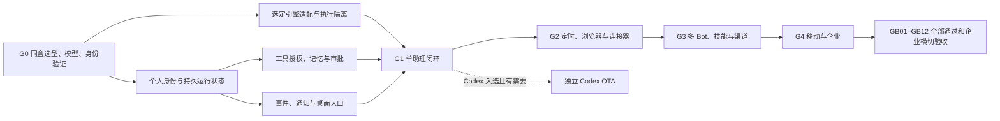

# WANX Personal Agent 开发计划

**状态**　待评审

**日期**　2026-11-11

**最近修订**　2026-11-12；纳入 G0 执行器对照、单一生产引擎决策及条件工期。保留 PA-000 至 PA-020 的稳定编号。

**代码基线**　`5ef0fbcd`

**配套文档**　[Personal Agent 技术方案](2026-11-11-personal-agent-technical-design.md)

本文规划从盒端单助理到多 Bot、移动端与企业能力的交付顺序。阶段、估算和发布阈值均为评审提案。基线描述来自仓库源码。本次只编写方案，文中的验证命令由对应任务实施后执行。

## 首个可发布版本

用户从万象个人版向自己的助理提交一次任务，选择允许读取的空间或星图仓库。盒端以 G0 选定的单一执行器完成新增的长期任务，客户端显示进度。普通聊天继续使用现有原生对话。遇到指定写操作时，用户可查看具体目标和内容，再批准或拒绝。窗口关闭后可重新查看同一次运行、产物或失败原因。

两个候选都须使用任务级隔离和受控工具网关。Codex 路线额外要求只读沙箱且原生审批策略保持 `never`。WANX 工具网关独立验证用户批准的业务动作，批准只授权该次调用，无法提升执行器权限。首版至少提供一项真实读取工具和一项可审批的写入工具。建议分别选择「检索已授权资料」和「将摘要保存至指定个人空间文件夹」。由产品、空间服务负责人在阶段 0 确认目标接口及授权支持。拟写入文本、目的文件夹和覆盖行为须出现在确认页面。

只有阶段 1 通过验收，才能向选定用户开放这条流程。阶段 2 增加定时、事件触发与外部服务，阶段 3 增加多个助理及渠道，阶段 4 交付移动和企业体验。选定执行器默认随 WANX 盒端镜像发布。Codex 路线可另行评审独立 OTA。

产品目标是完整对标 Grok Bot。G1 验收单助理首版，最终产品签收逐项检查配套技术方案 §2 的 GB01–GB12 和企业治理。任何阶段上线都只声明该阶段实测过的功能。

## 应用边界与联调验收

空间、星图作为基础能力分别验收。Personal Agent 作为普通应用使用它们，也可在用户授权后调用平级应用。以下要求纳入既有任务，按能力开放阶段验收。

| 任务 | 交付与验收 |
| --- | --- |
| PA-002 / PA-005 / PA-008 | 登记调用方和提供方的应用身份、公开操作、版本、授权范围及返回的操作编号。优先使用现有受信接口。验证由对话入口启动也只获得 Personal Agent 自身权限。 |
| PA-010 / PA-014 / PA-015 | 知君的私人记录、AI 浏览器登录态和工坊项目分别由提供方管理。测试授权调用、拒绝、撤权、缺少兼容接口四条路径，并验证应用可独立使用。 |
| PA-006 / PA-011 / PA-013 | 创建一条由半人马环承接的周期任务，在两个入口检查相同的计划编号和状态，从原应用暂停后对话反映结果。重投同一事件只运行一次、只发送一条对应通知。应用不可用时保留待核实状态。 |

## 工程归属及现状

| 范围 | 基线与拟交付位置 |
|---|---|
| 运行服务 | 拟在 `server/personal-agent/` 建立独立 Python 项目，含 API、授权、SQLite、执行队列、事件和运维入口。网关经私有 UDS 访问服务。Codex 入选时，盒内托管 Node runner 位于该项目 `runner/`。图执行器入选时，采用已验证的原生公开契约或独立的受控 Python worker。选定执行链的依赖随同一 WANX 镜像交付。 |
| 原生 Codex | Builder 已实现 worker、thread 复用、冻结配置和取消。先提取有固定契约的共享运行组件，再由两个消费者分别挂接业务策略。参考 [Builder 原生调用](../../apps/builder/docs/builder-native-app-server-20261024.md)、[版本锁定](../../apps/builder/package.json)。 |
| 原生图执行器 | Octop 已使用 LangGraph，仓库锁定 LangGraph 1.2.11 与 Deep Agents 0.7.9。优先验证现有公开入口能否提供任务级控制与工具约束，缺少合适入口时仅做薄原型。普通对话的闭环不能代替长期任务资格验证。[架构](../../octop/docs/architecture.md) · [依赖锁](../../octop/uv.lock) |
| 身份与客户端 | 复用 Bridge 验证过的数据身份和已有会话授权。个人版本地信任身份的当前助理能力报告将知识、空间、渠道、附件设为关闭，必须逐项打通和验收。[身份入口](../../apps/personal-client/shell/ai-dialogue.mjs) · [能力分支](../../apps/builder/integration/team-client/assistant-service.mjs) |
| 模型与供应商 | 对话默认模型与 Codex 可用模型分别解析。现有对照测试向合成供应商发出 Chat Completions 和 Responses 请求。[派发测试](../../octop/tests/integration/test_application_default_dispatch.py) |
| SDK 与协议 | 公共 SDK 与 App Kit 合同只在 [host-sdk](../../apps/personal-client/host-sdk/) 维护。团队客户端消费构建物。发布流程按 [客户端发布说明](../release/wanx-client-release-and-update-flow.md) 走。 |
| 产品已有能力 | 知君提供带证据来源的记忆召回，星图提供知识检索授权，半人马环和 Cron 支持任务跟踪与调度。现有审批和渠道可复用交互及身份确认。选定执行器的工具调用和运行结果仍需逐项接入上述服务。 |

## 依赖与并行安排



工程经理维护依赖与工作量。任务采用稳定 ID，拆任务以原 ID 为前缀。代码评审、验收记录和故障案例引用同一 ID。阶段 0 先冻结 provider、owner、权限和运行事件四组契约。之后运行层、服务端和客户端可用相同向量并行开发。

下文路径均相对仓库根目录。`shared/packages/wanx-codex-runtime/` 为拟议的共享包名。涉及共享包的验证范围包括 Builder 和新服务。移动端、企业控制面和外部连接器的最终仓库由相应任务确定。

阶段 0 先建立含 pytest 的最小验证项目与锁文件，PA-005 在同一项目接入正式服务。下列函数可在仓库根目录的 shell 中定义。带 `pa` 的用例、共享包路径和 runner 用例均为拟新增交付物，验收时须随实现一并提供。各运行目标使用临时数据库、合成用户和测试供应商。生产密钥、真实客户资料与个人 Codex 登录信息不进入测试过程。

```sh
pa() { uv run --project server/personal-agent pytest -c server/personal-agent/pyproject.toml -q "server/personal-agent/tests/$1"; }
runner() { node --test "server/personal-agent/runner/tests/$1"; }
sdk() { node --test "apps/personal-client/tests/$1"; }
```

## 阶段 0　证实版本能力与安全边界

### PA-000　本地信任扩展与后台委托可行性

**负责人**　OS 网关、Bridge authority、native gate、安全　　**依赖**　无。

- **基线**　`data-v1` 的固定 audience 为 `octop`、`semantica`、`semantica-mcp`、`clipboard`。child hop 现有 `clipboard → octop` 和 `semantica-mcp → semantica` 两类，持久任务证明限于已登记的 Semantica 服务 UID。[数据证明与 taskproof](../../shared/contracts/local-trust/data-v1.md) · [盒端 gate 配置](../../server/bridge/docs/local-trust-runtime.md)
- **产物与范围**　安全评审一份可协商的协议扩展，包含 `personal-agent` audience、固定工具路由和目的 audience、独立的后台任务委托证明、生命周期、签发/检查与撤权效果。登记非 root 服务 UID。冻结不随业务快照回退的恢复代次签发/登记方、单活动实例约束及目标盒恢复映射。在隔离镜像验证 OS 网关、Bridge broker、native gate 到资源执行端的完整授权链，记录旧端拒绝新能力的行为。
- **验收**　先创建待授权任务，再以任务 ID、委托 ID、revision、scope hash 和 challenge 绑定可信 broker 的确认登记；renderer 布尔值及其他任务的委托均不能代替确认。重复确认只返回同一结果，迟到确认不能复活已取消任务。外部 session token、其他服务 taskproof、过期父操作均不能启动新运行。客户端离开后只允许明确授权的任务在有效委托下访问固定资源。撤权、owner/epoch 变化、authoritative broker 失联、恢复时无法确认权限，均停止后续工具与结果投递。旧 token 不转发，不由服务自行离线续命。
- **验证**　`pa test_native_delegation_contract.py`。`uv run --project server/bridge pytest -c server/bridge/pyproject.toml -q server/bridge/tests/test_local_data_gateway.py`。由 OS 负责人提交目标镜像中 kernel peer UID、固定路由、一次性准入及撤权的双端观察结果。
- **决策**　G0 未证明后台委托时，不进入后台任务实现。只可单独评审有实时在场授权的前台实验。不得对外承诺 G1 的离线继续或调度能力。

### PA-001　同盒比较 Codex 0.160.1 与原生图执行器

**负责人**　运行层与 Octop 接口负责人、QA　　**依赖**　无。与 PA-003 联合提交候选资格。

- **产物与范围**　在拟建 `server/personal-agent/runner/tests/` 与 `docs/verification/` 记录锁定二进制的来源、校验值、体系结构、传输及有效协议。覆盖握手、创建/恢复 thread、发起/中止 turn、事件终止与子进程清理。
- **验收**　使用仓库固定的 Codex 0.160.1，在拟支持的盒端镜像和架构跑受控任务。分别记录可用、需 WANX 实现、无法支持的项目。原生暂停批准、工具调用与进程重启恢复均需独立证据。验证 Linux user namespace、任务级文件挂载、IPC 和网络隔离；枚举实际启用的内置命令、文件、搜索及托管工具，证明非准入能力已禁用或被执行层拒绝，不能以 read-only/never 推断。注入 turn/start 已接受但 ACK 丢失、与取消同时发生的场景，证明可封禁旧代理并排空进程。目标架构无法提供等价的经审查隔离或工具限制时，对该架构报告能力不可用。
- **图执行器**　在同一目标盒、相同权限下优先调用现有公开接口。公开接口不能表达所需生命周期时，在拟建 `server/personal-agent/tests/probes/` 用固定版 Deep Agents + LangGraph 实现一条薄测试流程。记录实际试验路径、固定依赖及授权、检查点、取消/恢复和工具隔离结果。两候选均执行跨 owner、撤权、未批准写入、未授权出网、预算绕过和未知结果禁止重放等负例，任一硬门槛失败则该候选无生产资格。
- **统一样本**　QA 与产品在测试前冻结样本、重复次数、最低完成率及可接受的性能和费用上限。同盒交错运行相同的资料、指令、允许工具及故障脚本，报告按模型分层的任务通过数/总数、可用模型矩阵、首事件与总耗时、峰值内存/CPU、每个成功任务的模型用量与费用，以及接入/升级所需工时。核对引用是否有效、追加是否进入原任务、批准后是否只生成一份目标文件、回执丢失能否停在核实状态。共同支持的相同 provider/model 用于横向比较。仅一方通过的模型计入覆盖率，不能把另一个模型的成绩填到该格。
- **验证**　`pa test_engine_comparison.py` 生成逐任务结果与失败原因，附双方目标盒记录。Codex 另跑 `runner protocol-01601.test.mjs`。`node --test apps/builder/tests/codex-host-probe.test.mjs`。合成协议 fixture 与真实二进制的结果分开记录，缺固定组件或关键断言被跳过时，该候选标为未验证。

### PA-002　身份、权限与首版写入选择

**负责人**　身份工程师、个人版负责人　　**依赖**　无，可与 PA-001 并行。

- **产物与范围**　以 [本地信任数据协议](../../shared/contracts/local-trust/data-v1.md) 为输入，在 `server/personal-agent/tests/` 建立 principal、盒子、客户端授权、会话生命周期的测试向量，并列出本地信任与账户模式可用能力。
- **验收**　两个 owner、两台盒子及撤销后的授权在同一示例中得到可区分的结果。明确一个具备真实写入授权和去重约定的目标操作及提供方。如果目标尚无受控写接口，列入 PA-009 的接口开发范围。
- **验证**　`pa test_identity_vectors.py`。用测试身份走完整空间或星图授权，分别记录读、写、撤销后的状态码。

### PA-003　按候选验证模型协议、工具调用与费用归属

**负责人**　模型网关工程师　　**依赖**　PA-001 提供可调用的候选，先逐项验证，再汇入 G0。

- **产物与范围**　在 `server/personal-agent/providers/` 设计个人 Agent 独立用途的模型解析，冻结 Admin 新设备与旧设备的默认项协商规则，沿用 Bridge 的受管 provider 与租约检查。冻结每次运行的完整 provider/model、受信路由目的地与策略版本、协议和计费用途，定义来源数据的出域联合授权。为 PA-008 冻结逐请求 call_id、并发/额度预留、未知用量与权威账单核对合同；G0 用合成代理验证，G1 再接入持久实现。
- **验收**　覆盖仅 Chat Completions、可用 Responses、Responses 被供应商拒绝、租约失效和手选模型。分别记录实际设备默认项与手选 `deepseek-flash` 的完整 provider/model、协议、同轮工具调用及结果续答。Codex 路线要求 Responses 和工具资格。原生/图路线使用其实际适配的协议，可接受通过同样工具闭环的 Chat Completions。记录各路径成功或上游拒绝和原因。普通对话默认项不自动迁移。缺少合格默认项时保留草稿并显示等待配置。不可用时返回可操作错误并提供获授权的合格候选，切换后重新确认。同名模型别名改绑供应商不得绕过出域授权；混合来源、工具结果及摘要在送往选定引擎的模型前逐一校验，目的地或权限变化使旧上下文失效。
- **验证**　`pa test_model_eligibility.py`。`uv run --project octop pytest -c octop/pyproject.toml -q octop/tests/integration/test_application_default_dispatch.py`。记录捕获到的合成请求路径、模型标识和调用次数，禁止静默换模型产生扣费。

**G0 出口**　安全和 OS 负责人签认 PA-000 后台授权、撤权及目标架构隔离，身份和产品负责人签认 owner 与工具范围。模型负责人交付 PA-003 的实测矩阵。运行和 QA 负责人提交可复跑的同盒结果以及各候选的安全缺口。缺少真实授权或隔离证据的路径不得进入灰度。只具备在场证明时依 PA-000 处理。

**生产选型**　Codex 是新增长期任务的优先验证对象。两个候选按 GB01–GB12 逐项列出实现责任、接口与缺口，任何必需功能均须有可行接入路径，G0 留存可行性记录，完整体验按后续阶段实测。先淘汰未通过共同安全门槛、最低完成率或资源费用上限的候选，再按产物质量与任务完成率、可用模型（单列 `deepseek-flash`）、时延、资源、费用及集成成本排序，评审前冻结指标优先级。结果相当时选择增量维护成本较小者，记录版本、测试证据和理由。只实施并发布一条生产执行链。两者都不合格时停止灰度、登记阻断项，重测 G0 后再立项。任何实现均支持由服务端持久保存待确认动作，获批后受控执行并续跑。

## 阶段 1　单助理可交付闭环

### PA-004　提取受支持的共享 Codex 运行组件

**负责人**　运行层、Builder 或原生接口维护者　　**依赖**　G0 完成选型。以下共享包工作限 Codex 路线。

- **产物与范围**　从 `apps/builder/codex/` 提取协议连接、事件解析、超时和子进程回收至 `shared/packages/wanx-codex-runtime/`，声明 API、锁定依赖与打包方式。项目文件操作、访谈和构建授权由 Builder 保有。
- **验收**　Builder 与 Personal Agent 各自以包的公开 API 驱动同一套测试。盒端安装包能在仓库外启动，Personal Agent 不需要导入 `wanx_studio` 私有模块或引用 Builder 的 `node_modules`。
- **验证**　`npm --prefix shared/packages/wanx-codex-runtime test`。`node --test apps/builder/tests/codex.test.mjs apps/builder/tests/codex-runtime-env.test.mjs`。

图执行器入选时，本任务改为锁定 PA-001 已证明的公开接口或最小图适配包，在 `server/personal-agent/executors/` 提供正式契约，验证安装、版本兼容和可替换边界。用 `pa test_graph_executor_contract.py` 在目标镜像验证。跳过 Builder 抽包及 Node 包验证，重新估算 G1。

### PA-005　服务骨架、身份与协议

**负责人**　盒端服务、Bridge、OS 制备维护者　　**依赖**　PA-000、PA-002。

- **产物与范围**　`server/personal-agent/{pyproject.toml,uv.lock}`、服务入口与 SDK 合同。在 OS 制备工程、`server/bridge/` 和 `shared/packages/local-data-gate/` 落地 PA-000 的 UID 注册、私有 UDS、协商、固定路由、任务准入和撤权观察；接入可信恢复代次、单实例准入，并将私有数据库、rollout 和产物登记到固定备份资源 profile。共享协议变更须回归已有四个 audience 和所有消费方。
- **验收**　请求体提供的 owner 无法提升权限。跨 owner 获取运行、恢复、读产物、提交审批均被拒绝。账户切换后旧订阅不能收到新账号数据。未安装私有路由、UID 不符或不支持协议的旧盒端报告能力不可用。网络扫描只观察到既有盒端网关入口，Personal Agent 自身无新增公网端口。
- **验证**　`pa test_auth_contract.py`。`npm run build:app-kit`。`npm run test:bridge`。

### PA-006　运行记录、SQLite 事务与 outbox

**负责人**　盒端服务　　**依赖**　PA-005。

- **产物与范围**　`server/personal-agent/` 的迁移、运行仓库、事件仓库与 outbox 投递器。为提交设置幂等键、为事件分配单调序号，状态变更与待投递事件在同一事务提交。
- **验收**　重复提交只建一个任务，授权成功后只启动一个初始运行。客户端用游标补齐漏收的事件。任务终态与动作结果分开保存：撤权或取消后可幂等记录可信的迟到回执，但不得恢复任务、追加外部查询或向无权会话投递结果。持久保存 stop_intent，因取消而待核实的动作查明后只收敛至 cancelled，不排队继续；本人再发起则建新任务。物理清理前继续计入并发资源。杀进程后恢复时区分未开始、执行中、等待批准及外部效果不明的动作。数据库不可写时禁止新外呼，不退化为内存状态。
- **验证**　`pa test_run_recovery.py`。`pa test_outbox_replay.py`，包括事务前后、取消后回执晚到、磁盘满和投递回执前后的故障注入。

### PA-007　选定执行器与运行生命周期

**负责人**　运行层　　**依赖**　PA-003、PA-004、PA-006。

- **Codex 路线产物**　`server/personal-agent/runner/` 与 Python 调度适配器。把标准运行事件与 Codex thread/turn 标识相关联。owner 是隔离上界，按 task/context_epoch 提供实际文件、进程、IPC 与出网隔离；执行器只见本任务的 CODEX_HOME、rollout、工作根和私有通道。Codex 运行只读，仅挂接获准 MCP。限制并发、耗时和输出量。
- **验收**　每个任务拥有独立 Codex thread 和工具通道，会话只聚合展示；同一任务的续轮串行执行，追加指示显式绑定任务 ID。验证同一会话两个并行任务及同一 routine 的两个实例不会串入对方上下文或工具结果。首轮和续轮都使用冻结模型及正确 owner。取消后及时回收子进程。用户中途追加指示、暂停、继续有顺序化事件和可见结果，已完成工具不被重放。进程死亡后只恢复由 PA-001 证明可恢复的工作，否则持久给出中断/结果待核实状态。模型调用不得被透明重复提交。
- **验证**　`runner lifecycle.test.mjs`。`pa test_runner_crash.py`，并在目标架构运行一次合成多轮任务。同时验证跨 owner 以及同一 owner 的高低权限任务之间，文件、rollout、进程、socket 和代理令牌均不能互访。`runner control-ack-loss.test.mjs` 覆盖 start/steer/interrupt ACK 丢失：持久保存控制意图，进入 execution_unknown，先封旧模型/工具通道并查实或终止旧执行，不自动 start 第二轮或提前释放资源。userns 或沙箱策略无法应用时验证失败关闭。

图执行器入选时，以选定接口的运行/检查点标识对接相同事件契约，用独立进程或经验证的宿主隔离替代 Codex thread、rollout 与 Node runner。用 `pa test_graph_lifecycle.py` 和 `pa test_graph_control_loss.py` 验证相同的并行任务隔离、追加、取消、控制确认丢失、旧 worker 排空、断点恢复及禁止重复外呼。执行 PA-006/007 共有故障用例，并交真实目标盒记录。

### PA-008　工具网关与每次调用授权

**负责人**　权限、工具服务、模型网关　　**依赖**　PA-002、PA-003、PA-005、PA-006。

- **产物与范围**　`server/personal-agent/tools/` 建立注册表、输入校验、授权范围、资源绑定、调用回执与审计。runner 通过受控协议调用。模型只获得该次任务允许的工具。`providers/` 与持久存储实现 PA-003 定义的逐请求准入、owner/task 并发预留、token/次数/费用限额和 model_calls 归因记录；所有候选的调用都要经过该准入点，包括框架内建重试。
- **验收**　授权限定所有人、资源、操作、期限和任务。伪造工具名、跨目录穿越、已撤销范围、网页或文件内指令要求扩权均被拒绝。能力目录只装载已审核技能，默认工具集中关闭任意 Shell 和任意文件访问。每个模型请求都验证当前任务、代次和出域策略；并发不能超额占用预算，断流/取消/usage 缺失不假定免费，重复回执不重复归因。托管扣费只由 QeeToken 完成，Admin 读投影，个人服务不重复扣款。
- **验证**　`pa test_tool_authorization.py`。`runner tool-sandbox.test.mjs`（Codex）或 `pa test_graph_tool_sandbox.py`（图执行器）。`pa test_model_admission_budget.py` 覆盖两个任务竞争同一预算、上游拒绝/余额不足、迟到或重复用量、进程重启后的未结算预留，以及循环模型调用达到上限；调用结果未知时冻结 run 新外呼，并验证执行器内建重试不能穿透；同时检查审计日志不含凭据或文件正文。

### PA-009　批准、外部写入与恢复

**负责人**　服务、客户端　　**依赖**　PA-006、PA-007、PA-008。

- **产物与范围**　`server/personal-agent/approvals/`、目标工具与客户端审批页。冻结动作、目标、内容摘要和频次/费用，记录批准者、有效期与当前权限，创建可查询的外部操作标识。
- **验收**　用户关闭窗口再打开仍可批准或拒绝。动作先持久化稳定 ID；发送前在同一数据库事务以 CAS 校验当前授权和 fencing、消费一次性批准并标记 dispatched，仅获权 worker 可以发出调用。重复点击不重复派发；外部幂等与核实能力按连接器验收，不承诺跨系统恰好一次。已换账号、动作变更、批准超时或撤权均阻止后续执行。外部服务确认状态不明时进入核实流程。
- **验证**　`pa test_approval_recovery.py`。`sdk personal-agent-approvals.test.mjs`。故障注入覆盖两个 worker 竞争批准、批准消费与 dispatched 事务失败、标记后尚未发送即崩溃、写成功但回执丢失，以及撤权后的可信迟到回执。dispatched 无回执一律待核实，不能自动重发。

### PA-010　个人记忆与授权知识

**负责人**　知君/星图、服务　　**依赖**　PA-005、PA-008。

- **产物与范围**　`server/personal-agent/context/` 接入星图与空间的仓库/文件夹授权及引用。知君启用且提供兼容接口时，按调用授权追加记忆召回。绑定用户、bot、会话及访问范围，给出来源、授权时间和可撤销入口。示例依据 [知君来源区分](../../octop/src/octop/infra/agents/memory/zhijun_recall.py)。
- **验收**　合成用户只能读取选定范围，引用能定位。记忆区分用户原话、已确认理解和推断。写入个人记忆需符合既有确认策略。用户显式记住、纠正、删除或撤销后，下次调用使用新状态。旧引擎 thread 的已注入上下文按技术方案失效或重建。
- **验证**　`pa test_memory_scope.py`。`pa test_context_revocation.py`。本地信任、普通账户分别验证，无法提供的能力在 UI 中明确说明。

### PA-011　桌面入口、产物和 WANX 通知

**负责人**　个人客户端、服务　　**依赖**　PA-005、PA-006。最终联调依赖 PA-007、PA-009、PA-010。

- **产物与范围**　`apps/personal-client/{shell,local-ui,host-sdk}/` 与服务端运行事件 API。界面包含任务提交、进度、补充要求、暂停/继续、取消、待确认、结果及产物打开动作。历史会话标注原执行引擎，保留原生会话兼容入口。通知消费 WANX 自有 outbox，按账户、盒子和事件 ID 去重。
- **验收**　关闭客户端后任务可继续。回来可从游标重放并打开正确结果。离线、盒端能力缺失、模型不兼容有明确反馈。切换账号时界面、红点、附件访问和审批一起切换。落实技术方案 §9.3 的来源/能力/开关路由表，同 ID 不同来源不串历史；关创建开关或回退不把未完成的长期任务转给另一引擎重发，保留可用的取消和核实入口。
- **验证**　`sdk personal-agent-desktop.test.mjs`。`sdk personal-agent-notifications.test.mjs`。`sdk personal-agent-engine-routing.test.mjs` 覆盖旧会话、原生普通聊天、选定的长期任务来源 × 支持/旧盒端 × 创建/停止开关。图执行器路线仍按业务来源和运行 ID 区分普通聊天与长期任务。`npm run test:client`。

### PA-012　发布包、可观测性与首版验收

**负责人**　发布、QA、运维　　**依赖**　PA-007 至 PA-011。

- **产物与范围**　`server/personal-agent/deploy/`、盒端镜像装配、脱敏指标、运行手册与 `docs/verification/` 验收记录。写明二进制版本、校验值、架构、模型用途、事件及数据库版本。按 OS 备份合同纳入跨数据库/rollout/产物快照、目标 owner 映射、恢复代次和恢复入场门禁，独立记录 RPO/RTO、配额、低水位及审计预留空间的实测阈值。
- **验收**　从干净镜像启动，以受控账号完成「已授权检索→列明引用→请求保存→批准一次→收到结果→重启后打开」。再走拒绝、撤权、丢确认回执和离线重连。按 owner 配额统计耗时、运行量及模型用量。
- **验证**　`pa test_personal_agent_acceptance.py`。`pa test_release_compat.py`。`pa test_backup_restore_safety.py` 覆盖 T0 备份→T1 写入成功→恢复 T0、替换盒 owner 映射、克隆卷重复启动，以及旧审批/trigger/outbox 不自动复活。`pa test_storage_pressure.py` 覆盖 WAL/产物配额、数据库写失败与磁盘满时外部结果待核实。对受影响组件运行仓库级检查，并在每种宣称支持的架构留存实际运行记录。

**G1 出口**　产品、QA、身份和发布负责人签认 PA-012 的成功/故障记录及恢复/容量阈值。越权读取、未经授权的模型出域、未批准写入、重复外部写入、绕过模型预算、错误身份收到通知均为阻断项。G1 是第一版发布决定点。

## 阶段 2　定时和事件自动化、浏览器接管与连接器

### PA-013　定时和事件触发

**负责人**　任务服务　　**依赖**　G1。

- **产物与范围**　`server/personal-agent/triggers/` 将 Cron、订阅事件和手动提交统一转换成有身份的运行。维护时区、暂停/恢复、到期、并发与漏跑策略，明确计划创建和运行时各自检查的权限。
- **验收**　事件幂等键包含 owner、routine ID、routine revision、source instance ID 和 source event ID，消费游标按消费者隔离；同一事件在同一规则下只触发一次，在两个 owner 或两条规则下分别触发一次。定时实例按 owner、routine、revision 和计划时间去重。夏令时切换、盒端离线后重启、互相重叠的运行均有确定结果。无人在场时需要人工确认的操作停在待确认状态。
- **验证**　`pa test_scheduled_events.py`，使用可控时钟和重复到达的合成消息。

### PA-014　浏览器工具与用户接管

**负责人**　浏览器、客户端　　**依赖**　G1。

- **产物与范围**　受控浏览器适配器、隔离的 session 与接管入口。对允许的站点使用浏览和读取。登录、验证码和待确认的外部提交交给用户，保存可重开任务状态。
- **验收**　使用本地测试网站走「只读检索→登录接管→交回→确认提交」。会话凭据不经模型，可撤销授权并关闭浏览器，切换账号不能复用站点登录态。
- **验证**　`pa test_browser_handoff.py`。`sdk personal-agent-browser-handoff.test.mjs`。

### PA-015　两至三个可交付连接器

**负责人**　集成、权限　　**依赖**　G1。与 PA-013/014 并行。

- **产物与范围**　`server/personal-agent/connectors/`、授权/撤销页和连接器契约测试。候选为邮箱、日历与文档，评审后优先选两项，记录具体供应商、授权范围和第三项准入条件。
- **验收**　每项至少含一个真实用户场景、一个拒绝/撤销场景和失效重连。建议先做邮箱查找/起草、日历查空闲/建预约，分别验证阅读权限与审批后的写入。测试使用合成账户或供应商 sandbox。
- **验证**　`pa test_connector_contracts.py`。`pa test_connector_revocation.py`。供应商未提供可用测试租户时，只能计入协议验证，不能算作连接器发布验收。

开工前冻结组合及对应 G2 场景。若选邮箱，邮件场景要求该连接器同时提供已审批发送及可核实回执，不能只验收查找/起草；若不选邮箱，采用下述日历/文档等价场景，技术方案中的邮件场景作为示例保留。

**G2 出口**　QA 按已冻结组合验收：邮箱组合走「定时触发→检索已授权资料及第二连接器的日历空闲或文档内容→向本人补问→邮件草稿→确认后投递并核实回执」；日历/文档组合走「定时触发→查询空闲与资料→向本人补问→生成文档→确认后发布文档并创建预约」，分别展示两项服务的结果或回执，部分成功不冒充整体成功。工作流跨一次服务重启，并验证浏览器人工接管、外部副作用审批、凭据撤销与事件去重。产品签认当前支持的连接器/能力矩阵。

## 阶段 3　多个 Bot、技能及渠道

### PA-016　Bot 隔离、配置与版本化技能

**负责人**　Agent 平台、产品　　**依赖**　G2。

- **产物与范围**　`server/personal-agent/{bots,skills}/`、个人版 Bot 管理界面。提供创建、暂停、删除、技能版本与工具权限声明。成功任务可生成供本人审核的技能草稿，分享时剥离个人数据和授权。按 Bot 限制记忆、连接器、预算和工作目录。
- **验收**　同一用户的两个 Bot 默认互相隔离。技能升级显示新增权限，撤销后停止后续调用。并发 Bot 不共享执行上下文或检查点，迁移后可关联历史记录。Bot 委派创建可取消的子任务，其授权、预算和截止时间受父任务约束。
- **验证**　`pa test_bot_skill_isolation.py`。`sdk personal-agent-bots.test.mjs`。

### PA-017　消息渠道双向路由

**负责人**　消息网关、客户端　　**依赖**　PA-016。

- **产物与范围**　`server/personal-agent/channels/` 接入 [现有渠道绑定](../../apps/builder/integration/team-client/assistant-channels.mjs)。优先选两种经验证的渠道，将入站身份、渠道会话和 Bot 绑定。普通聊天仍走原生对话；显式委托的长期任务进入 WANX 服务、绑定选定引擎与 run ID。图路线沿用公开渠道传输接口并验证来源分流，跳过 Codex 专属事件转换。按渠道能力投递完成/失败、待审批链接。
- **验收**　同一群聊有多位用户，私聊有多个 Bot 时仍能路由正确。审批与本人身份绑定。普通消息不创建长期任务，重复回调、离线重投、解绑均可安全处理。按渠道提供实际可用动作表。
- **验证**　`pa test_channel_routing.py`。`pa test_channel_delivery_receipts.py`，再用隔离测试租户进行收发验收。

**G3 出口**　产品确认用户可配置两个具有不同能力的 Bot，分别从两个渠道触发任务，收到正确且可追踪的结果。安全评审检查串号、串 Bot、共享凭据和审批冒领用例。

## 阶段 4　移动、语音及企业治理

### PA-018　移动入口与语音交互

**负责人**　移动、语音　　**依赖**　G3。

- **产物与范围**　移动客户工程或现有移动宿主适配层、盒端推送、音频输入输出适配器。明确目标平台、离线行为、录音保存策略与推送 token 的 owner 绑定。
- **验收**　测试手机可通过语音发起、打断、查看转写并确认高影响操作。移动和桌面看到同一运行。通知隐藏敏感正文，遗失设备可撤销登录和推送授权。
- **验证**　`pa test_mobile_session.py`。`pa test_voice_interrupt.py`，移动 QA 另交平台版本、真机和弱网验收记录。

### PA-019　企业治理与托管运维

**负责人**　企业平台、基础设施、安全　　**依赖**　G3，可与 PA-018 并行。

- **产物与范围**　租户策略、角色、配额、审计导出、保留/删除和受控连接器策略。企业控制面仓库、职责和部署形态在开工前评审，和个人身份使用独立作用域。
- **验收**　启用/撤销组织成员、权限改动、组织导出及删除有审计记录。跨租户、个人空间与组织空间数据越界用例全部拒绝。重启、配额耗尽和容量耗尽时保留已确认动作的回执。
- **验证**　`pa test_enterprise_policy.py`。`pa test_tenant_data_lifecycle.py`。在约定并发和代表性数据量下做恢复及容量演练。

**G4 出口**　移动负责人签认真机语音和弱网报告。企业负责人、安全、运维共同签认数据保留、恢复、审计、租户隔离与服务等级目标。与目标客户逐工作流验收，外部产品功能变化另行评审。

## 完整产品对标的开发责任与签收

下表与[技术方案 §2](2026-11-11-personal-agent-technical-design.md)使用相同的 GB 编号。带字母的子项继承父任务的责任人和目录，括号内列出额外依赖。产品负责冻结逐项用户场景，QA 在 `docs/verification/` 保留每项的支持平台、版本、实际用户操作、审计回执及失败用例。原有 G2/G3 的首批连接器、渠道验收可先上线，未交付项仍留在本表。

| 产品合同 | 实施任务、交付物与完整签收场景 |
| --- | --- |
| GB01 消息协作与产物 | PA-011a、PA-017（依赖 PA-007/009）支持带附件提交、线程内补充与提问。重开后检查、修改、导出产物并交接许可版本，在桌面与已绑定渠道打开同一结果，未获授权的接收方无法访问。 |
| GB02 个人记忆 | PA-010、PA-016，在隔离的两个 Bot 上验证记住、召回、看来源、纠正、删除和撤销。跨会话检验显式共享与私有记忆边界。 |
| GB03 持久电脑、浏览器与命令 | PA-014a、PA-016（依赖 PA-007/012）交付持久工作区、浏览器观察/接管和隔离终端。重启后重开文件并继续限定命令，按授权在任务或 Bot 间交接文件和站点会话。测试未经授权的目录、网络、命令被拒和凭据不向模型披露；单列盒子断电期间可用性。 |
| GB04 应用、插件/MCP 与工坊委派 | PA-015a、PA-016（依赖 PA-008/009）交付插件/MCP 安装、授权、撤销、受控的工坊委派。验证插件读写和子任务的输入授权、状态、产物回传、取消及撤权；工坊不能借父任务扩大权限。 |
| GB05 审批、Vault 与结账 | PA-009a、PA-015b（依赖 PA-009/014）交付本人可查看和修改的 Auto Review 规则、Vault 凭据保管与受信表单。验证已授权低风险规则可自动放行，超范围或高风险升级本人审批，规则撤销立即阻止后续自动放行。用测试商户逐步验证安全登录、报价、规则判定、本人审批、结账和回执。改金额/收款方需重新审批，超限、撤权、重复提交和回执丢失均有确定结果；检查模型和日志不可见凭据。 |
| GB06 技能 | PA-016a 交付从已完成任务生成技能、本人审核、编辑、发布、复用与停用。换版新增权限必须重批，第二个 Bot 使用已分享技能时需独立授权。PA-019 核验团队成员接收更新与撤下技能后的行为。 |
| GB07 定时与事件 | PA-013、PA-015 验证日程、消息、应用事件和 webhook 均能触发已授权任务，编辑、暂停、恢复和重复事件符合规则，离线补跑不重复产生外部写入。 |
| GB08 主动性 | PA-013a、PA-016/017（依赖 PA-010/011/013）交付主 Bot 可配置的观察范围、主动建议、频率与安静时段。验证用户接受后开始工作、拒绝、静音和停用四种结果。主动建议涉及对外动作时仍执行 PA-009。 |
| GB09 多 Bot 与团队协作 | PA-016 先按 G3 验同一 owner 多 Bot。团队子项 PA-016b 在 G4 的 PA-019 团队身份与策略通过后单独签收，不作为 G3 前置。PA-016b交付成员邀请/撤销、共享 Bot、主助理、群组、模板和委派。复制模板并让两个成员跨 Bot 分工完成一次任务，保留各自审批和审计，退出成员无法再读或运行。 |
| GB10 Slack、Teams、X | PA-017a（依赖 PA-016/017）为三个目标平台逐一交付已登记应用、账号绑定及能力表。在 Slack/Teams 线程发起任务并由本人审批，在 X 提及后转入本人任务，公开回复仅展示获准信息。核验归属、重投及解绑。平台限制和未获资格单列，第三个渠道未验收时不签完整对标。 |
| GB11 会议 | PA-018a（依赖 PA-014/015、PA-017 与团队身份）交付预约/取消参会、会议加入/退出、参与者告知与同意、会中按名响应、转写及会后原任务的纪要与行动项。逐会议平台用测试会议验证拒绝录制、撤回、结果可见范围与删除。 |
| GB12 移动语音 | PA-018 在目标移动平台真机验证语音发起、追加、打断、审批、安全输入和按 Bot 管理推送。弱网重连后仍关联原任务，桌面能打开同一产物，能撤销遗失设备。 |
| 企业治理（横切） | PA-019a 联合 GB03/04/09/11 负责人验证成员生命周期、受管电脑、私网连接和代理网络、推理策略钩子（允许/拒绝各一例），对渠道、Vault、会议和支付回执检查隔离、保留/删除、预算与审计导出。 |

**完整对标签收**　产品与 QA 按 GB01–GB12 逐项签认，身份/安全签认企业横切和敏感操作，渠道/支付/会议负责人提供对应平台的可复现记录。使用拟新增的 `pa test_product_parity.py` 验证各项合同，另附真实目标端与合成租户、测试商户或测试会议的演练记录。未验证、供应商限制或只交付替代渠道的项目标为缺口。待所有项关闭后才签署完整对标结论。

## 验证追踪与阶段适用范围

技术方案 A01–A19 是行为合同；下表分配最低实现责任与发布门槛。跨阶段的条目先验收当前开放范围，后续新能力必须扩充用例，不能沿用旧报告直接宣告通过。

| 行为编号 | 开发任务 | 最早发布门槛与范围 |
| --- | --- | --- |
| A01、A15 | PA-001、PA-004、PA-007 | G1；Codex 验固定二进制与 thread/turn ACK；图路线改验锁定组件、运行/检查点控制确认。两者均验失联封禁、进程排空与无二次执行 |
| A02、A06 | PA-006、PA-009、PA-012 | G1；关闭客户端、崩溃及首个写工具的结果核实 |
| A03、A04、A13、A14 | PA-000、PA-002、PA-003、PA-005、PA-007、PA-008、PA-010 | G1；身份、每任务隔离、资料与模型出域；G2 增补浏览器和外部凭据 |
| A05、A09 | PA-009、PA-010、PA-011 | G1；审批、知识和记忆；新连接器按同一合同回归 |
| A07、A12、A19 | PA-006、PA-011、PA-012 | G1；持久事件、脱敏与会话路由；G2/G3 增补触发与渠道 |
| A11、A16、A18 | PA-000、PA-005、PA-006、PA-012 | G1；镜像升级、旧快照/替换盒恢复及容量；如 Codex 入选且启动 PA-020，另验独立升级 |
| A17 | PA-003、PA-008、PA-012 | G1；逐模型请求准入、并发预留与账目归因 |
| A08、A10 | PA-013、PA-014、PA-015 | G2；自动化、接管及双连接器工作流 |

PA-016 至 PA-019 的阶段用例在 G3/G4 扩展到 Bot、渠道、移动和租户。每份验收记录标注本次覆盖范围、未开放能力、目标架构及实际执行命令；仅 fixture 通过不替代真实引擎或目标设备验收。

## 可选工作流　引擎独立 OTA

### PA-020　Codex 独立分发和回退

**负责人**　发布、安全、运行层　　**依赖**　G1，仅在 Codex 入选且产品需要脱离整机镜像更新时启动。图路线跳过 PA-020，依 PA-012 验证镜像内锁定依赖升级及恢复。

- **产物与范围**　单独的签名清单、架构映射、下载校验、双槽、试运行与健康回执。以 [盒端 OTA 契约](../../../centuarai-os/deployment/box_ota_contract.py) 与 [盒端 OTA 流程](../../../centuarai-os/docs/box-ota.md) 为依据评审组件包类型、信任根、回滚和版本兼容约定。镜像继续携带已验收默认引擎。
- **验收**　签名错误、协议不兼容、断电或更新失败时可回到上一版。在途运行使用原版本直至安全退出。遇到不可恢复的旧 thread，以可见中断结束，不重放已执行动作。
- **验证**　`pa test_engine_ota_recovery.py`。`runner version-compat.test.mjs`。每个宣称支持的目标架构各做一次安装、断电与回退演练。

## 人员与工期

估算单位为净人周，含实现、评审、回归和灰度准备。日历时间假定核心配置为 2 名盒端/运行层、1 名客户端、1 名集成、1 名 QA/发布，并由身份、安全、模型、知君和星图维护者按里程碑参与。人员未排定，区间不是交付承诺。

| 交付范围（阶段 2–4 仅计基础范围） | 净人周 | 预计日历时间 | 主要变量 |
|---|---:|---:|---|
| 阶段 0 | 5–9 | 3–4 周 | 含同盒执行器对照新增的 1–2 净人周、1 日历周，以及后台委托和目标架构验证 |
| 阶段 1（Codex 入选） | 22–34 | 6–9 周 | 共享运行层抽取、本地信任写接口、进程中断恢复 |
| 阶段 2 | 15–25 | 4–7 周 | 浏览器隔离条件、连接器注册及测试租户 |
| 阶段 3 | 13–22 | 4–6 周 | 第二渠道审核、技能权限变更设计 |
| 阶段 4 | 28–50 | 8–14 周 | 需另配移动和企业工程师。平台、语音成本和企业策略范围 |
| 独立 OTA | 6–12 | 2–5 周 | 另计签名基础设施、双架构打包及中断恢复演练 |

若 Codex 入选，首个可发布单助理约 **27–43 净人周，9–13 日历周**。阶段 0–4 原范围的顺序窗口约 25–40 周，仅涵盖表中基础任务。完整对标扩展增加了持久电脑、插件、工坊委派、Vault 与结账、主动提醒、团队协作、第三渠道和会议等工作。产品冻结 GB 子项后由各负责人按平台资格、隔离成本、测试租户和外部审查周期重估并排期，完整对标签收日期待定。若图执行器入选，先按 PA-003、PA-004、PA-007 的接口、隔离与运维差异重估 G1，再给首版交付窗口。独立 OTA 不计入该区间。G0 后重估协议工作量，G2 前按已选连接器和授权周期更新排期。

### 首版工作量拆分与关键路径（Codex 入选）

| 工作簇 | 净人周区间 | 主要交付责任 |
| --- | ---: | --- |
| PA-000 至 PA-003 | 5–9 | OS/身份、运行层、模型负责人；G0 验证而非仅设计签字 |
| PA-004、PA-005 | 3–5 | 运行层与盒端服务；共享包、受信入口、恢复代次 |
| PA-006、PA-007 | 5–8 | 盒端服务与运行层；存储、任务隔离、控制失联恢复 |
| PA-008、PA-009 | 6–9 | 集成、模型与权限；逐请求预算、出域、审批和动作核实 |
| PA-010、PA-011 | 4–6 | 集成、客户端及记忆维护者；上下文、交互和历史路由 |
| PA-012 | 4–6 | QA/发布与各实现负责人；跨组件故障、容量、灾备及镜像资格 |
| 合计 | 27–43 | 含本轮补强项；属于待 G0 实测修正的工程估算 |

首版关键路径是 **G0 → PA-005 → PA-006 → PA-007/PA-008 → PA-009 → PA-011 最终联调 → PA-012 发布资格**。PA-004 在 G0 协议结论稳定后并行提取；PA-010 和客户端视图使用合同向量并行开发，最终验收等待实际工具和运行层。QA 从首轮协议向量开始，不在最后才介入。G0 未通过时只允许可撤销的合同/fixture 准备，不将其记为生产资格已通过。

关键路径窗口初估为：G0 3–4 周；服务入口和共享包准备 1 周；持久状态及执行集成 1.5–2 周；工具与预算联调 1.5–2 周；审批及动作恢复 1–1.5 周；桌面收口 0.5–1 周；最终设备资格 0.5–1.5 周，合计 9–13 周。此处是前后相依的收口窗口，各工作簇的编码、评审和故障用例准备在窗口前并行推进，不能把它当成每项任务各自独占的工期。

排期按 5 名核心成员约 70% 可投入本项目估算，每周约 3.5 有效人周；身份、安全、OS、模型与记忆维护者须提前保留联合评审和联调窗口。第 1 周必须拿到目标盒/镜像、固定二进制、合成身份、模型测试配置及首个读写接口负责人。设备和跨仓签核缺位、供应商资格失败、任一支持架构需要额外隔离开发或故障验收返工，均由负责人重估关键路径；不得以减少隔离或跳过测试维持日期。上述人周区间不提供独立风险储备，等待时间和新增范围另计；G0、G1 前各更新一次带负责人和日期的排期。

## 发布、灰度和回退

| 步骤 | 责任与执行条件 |
|---|---|
| 准备 | 发布负责人锁定镜像、服务、协议和 SDK 版本，记录升级前数据库备份与恢复演练。新事件和数据库变更先采用旧版可读的形式，破坏性迁移排入单独窗口。 |
| 内部验证 | QA 在合成账户与目标盒端完成 G1 主流程和故障注入。产品/运维确认支持范围与工单归属，由发布负责人开启内部开关。 |
| 小批自愿试用 | 按盒子和 owner 启用，先验证受控只读任务，再开放经审批的写工具。建议观察至少一个完整日周期和足量代表性运行。低流量时延长观察期。 |
| 扩展灰度 | 比对相邻批次的成功率、首个事件延迟、积压年龄、费用、撤权结果和疑似重复副作用。基准和阈值在首批前按架构、模型分别登记。安全和质量指标满足后由发布负责人逐批扩大。 |
| 暂停 | 越权读取、错误身份通知、未授权写入或重复外部动作出现任一条，立即停新任务与有副作用工具。其余异常按灰度前约定的错误率或延迟阈值暂停。值班人保留脱敏 run ID、操作回执与审计证据。 |
| 回退 | 服务负责人停止触发和新创建，隔离待核实的外部动作，排空或显式中断在途任务。发布负责人切回上一验证过的服务/引擎。保留现有数据库与 outbox，先核实各操作回执再恢复投递，避免重发。旧服务无法读新格式时维持只读并使用已演练的前向修复。关开关不切换任务引擎；若需要恢复旧业务快照，改走技术方案 §14.1 的维护/恢复代次流程，禁止启动旧批准、trigger 或 outbox。 |
| 复开 | QA 重跑受影响阶段的验收，身份/安全负责人核对涉及的 owner 和外部动作，产品确认用户可见的恢复结果。值班负责人解除受影响批次开关并追踪复发。 |

首轮评审由产品冻结 GB01–GB12 对照基线、平台清单与外部验收负责人，并确定首发盒端架构与身份模式、两候选的协议、允许的测试供应商及计费归属，以及可审批的第一个落盘动作。三项分别决定 PA-001、PA-003 和 PA-009 的验收环境。
