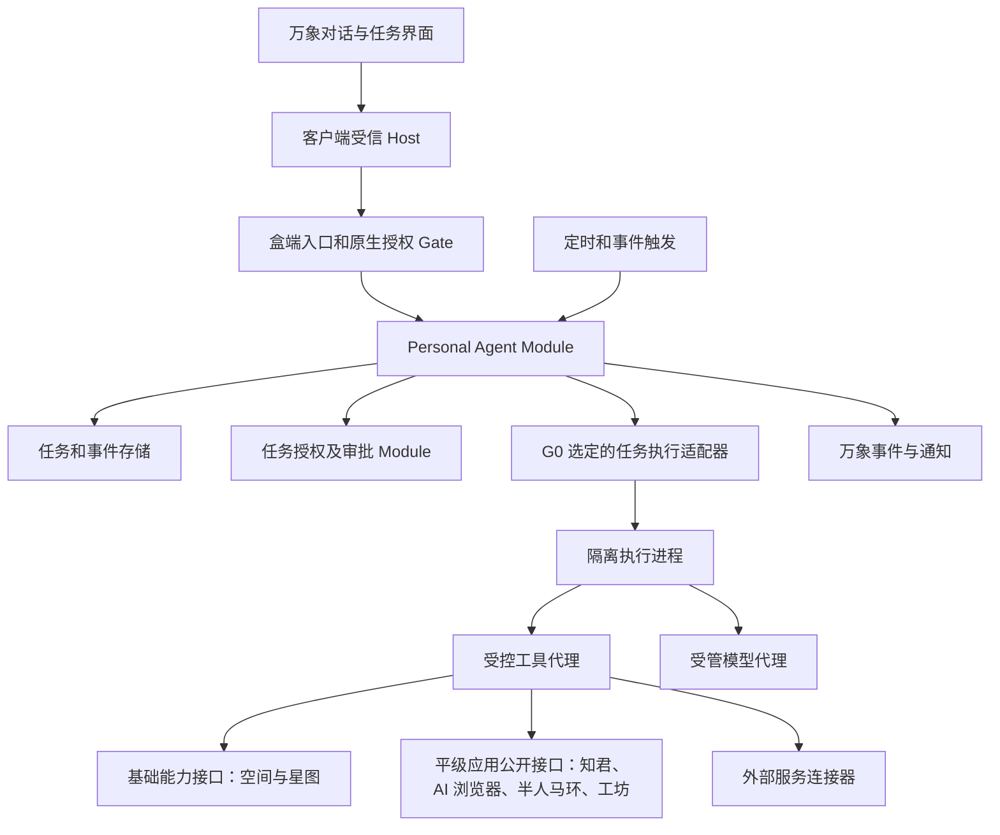
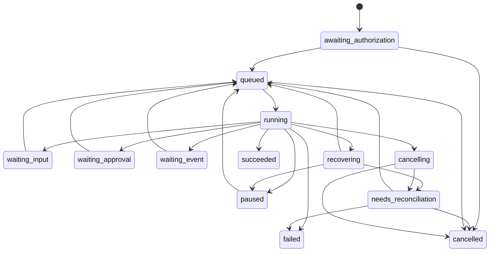

# 万象 Personal Agent 技术方案

日期：2026-11-11。状态：待评审。源码基线：`5ef0fbcd59e2938babbebfdd6913bdf8cd8c63cf`。配套文档：[开发计划](2026-11-11-personal-agent-development-plan.md)。

最近修订于 2026-11-12。开源选型依据各项目官方文档和仓内锁定版本。目标盒上的两种执行器对测属于待开发的 G0 工作。

普通对话沿用现有盒端服务。新增的“交给助理办理”任务由万象持久管理，优先验证工坊已使用的 Codex app-server，同时用原生执行路径或 Deep Agents + LangGraph 做同盒对照。万象管理用户身份、个人记忆、任务状态、工具授权、审批、产物和通知。第一阶段交付一个可以在客户端关闭后继续工作、在盒子重启后安全恢复的个人助理；后续增加跨应用办事、事件自动化、多 Bot 和移动语音。

本方案定义待开发的目标行为。下文的接口、数据表和新增目录均为拟议设计；现有能力单列出处，不表示已经完成个人代理集成或设备验收。以 Grok Bot 的用户可见功能作为产品验收基准。万象选择盒端实现，但需要逐项证明用户能完成对应工作。

## 1 产品范围与关键决策

**产品层级。** 空间与星图是万象基础能力，分别管理文件和知识资源。Personal Agent、知君、AI 浏览器、半人马环、工坊属于平级应用，均以自己的应用身份和用户授予的范围访问基础能力。万象对话可提供 Personal Agent 的快捷入口，入口位置不改变其应用身份。用户仍可独立打开和使用其他应用。

**应用间调用。** Personal Agent 保存本人交办的目标、步骤、应用返回的操作编号和结果引用。每个提供能力的应用决定公开哪些操作、接受哪些调用方、如何执行和撤销。例如知君按授权返回可分享的记忆，AI 浏览器负责登录态和人工接管，半人马环负责它所接受计划的调度，工坊负责项目和构建。应用原始记录由提供方维护。Personal Agent 仅在授权范围内查询或请求修改同一条记录。接口缺失、应用未安装或权限撤回时，相关步骤显示不可用，其他应用和独立步骤仍按各自条件运行。

### 1.1 用户场景

阶段 2 的完整场景：用户要求每周五结合已授权的星图和空间资料，生成下周客户拜访简报；缺信息时询问本人，完成后通知；邮件先保存为草稿，确认后才能发送。阶段 1 先交付手动触发的资料检索、审批后保存及通知闭环。

该场景要求任务、记忆和授权持续存在，但不要求模型持续推理。等待时间或外部事件时释放 Codex 进程和执行资源，到期重新校验权限后唤醒。关闭客户端不取消已明确委托的任务；盒子断电时无法继续执行，恢复联网、授权和模型能力后再处理待恢复工作。

### 1.2 决策表

| 事项 | 方案 |
| --- | --- |
| 核心执行 | G0 对比 Codex 与原生/图执行路径，首版选一个承担新任务。模型推理经设备受管代理 |
| 产品状态归属 | 万象数据库是任务、授权、审批、记忆索引和结果的权威来源；选定引擎保存执行检查点（Codex rollout 或图检查点） |
| 服务布局 | 拟新增 `server/personal-agent/` 独立 Python 项目。选 Codex 时增加 Node runner，同一 WANX 镜像组合交付，经私有 UDS 与受信入口通信 |
| 用户入口 | 先个人客户端与本人已授权资源；团队版适配复用协议，但共享团队 Bot 另行验收 |
| 既有对话 | 保留兼容读取与旧执行路径；会话记录 `engine`，不将旧原生线程 ID 冒充 Codex thread ID |
| 执行权限 | 首版 Codex read-only 加受控 MCP；状态、文件、IPC 和代理按 task/context_epoch 隔离；文件写入和外部动作走工具网关，生产不启用任意宿主 Shell |
| 持续执行授权 | 新增明确、可撤销、有限期的任务委托；交互会话或平台模型租约均不能替代它 |
| 模型策略 | 个人 Agent 使用独立、按能力验证的模型默认配置；当前普通对话模型不自动迁移为 Codex 模型 |
| 引擎交付 | 首版固定 Codex 版本随 WANX 镜像升级；Codex 独立 OTA 是后续独立工作流 |
| 引擎替换 | 统一任务控制和事件接口。每个任务固定执行器，回放测试与真实引擎分别验证 |

### 1.3 开源方案和架构取舍

用户问“这份材料讲了什么”时，当前聊天服务已经能组织对话、模型和工具。用户要求“从两份资料做简报，缺信息问我，确认后存到指定空间”时，需要把执行委托、询问、审批、产物和回执保存在盒端。前者继续使用已有链路。后者可以采用开源执行循环，万象负责跨应用的身份、授权、任务记录和交付。现有聊天代码通过原生服务执行 turn，仓内锁定了 Deep Agents 0.7.9 和 LangGraph 1.2.11。[盒端聊天处理](../../octop/src/octop/infra/gateway/process/processor.py) · [依赖锁](../../octop/uv.lock)

| 候选与开源许可 | 模型与工具接入 | 状态及个人助手能力 | 盒端集成、隔离与维护 | 对万象的建议 |
| --- | --- | --- | --- | --- |
| Codex app-server，Apache-2.0 | 工坊已接受管 Responses、工具事件、后续轮次追加和中断，运行中 steer 另做探针。需逐模型验证工具回传 | thread/turn 适合开放式多步任务和工作产物，业务审批、记忆和定时由万象持有 | 已锁定 0.160.1，可复用协议和进程管理。每任务沙箱、原生工具约束及进程资源开销仍须实测 | 首选对测对象。若在真实工具任务上有收益且首发模型可用，沿用工坊部署经验。[官方协议](https://learn.chatgpt.com/docs/app-server) · [源码许可](https://github.com/openai/codex) |
| 现有原生执行路径，或直接组合 Deep Agents + LangGraph，相关项目 MIT | 优先用现有受信接口。独立 SDK 可使用匹配提供方的工具调用适配器，须验证实际模型 | Deep Agents 提供多步工具循环。LangGraph 提供显式步骤、中断和检查点，适合固定的检索、补问与保存流程 | 已有 Python 依赖。需验证任务级身份、可恢复控制和隔离。单独持久化图状态时，业务动作仍引用万象唯一回执 | 最有价值的替代。原生接口满足合同就直接复用，接口不足才建薄图原型。首版只生产化一条路径。[Deep Agents](https://github.com/langchain-ai/deepagents) · [图检查点](https://docs.langchain.com/oss/python/langgraph/persistence) |
| DeepSeek Harness（DSH），MIT | 可组合模型适配器、工具注册和 agent loop，WANX 已有开发用 ACP 接入 | 有会话和控制接口，跨进程委托身份须由宿主传递 | 本仓钉住开发依赖 0.2.1-rc.2。现有 WANX 隔离探针限 macOS，Linux 盒端资格空缺。上游标为开发者预览 | 备用执行器。若受管 DeepSeek 路由在前两者受限，再投入 Linux 适配成本。[官方项目](https://github.com/deepseek-ai/deepseek-harness) · [本仓探针](../../apps/builder/tools/probe-dsh.mjs) |
| OpenHands Software Agent SDK，MIT | Python SDK，可接自定义工具、MCP 和工作空间 | 提供会话持久化与动作确认，偏软件工程任务 | 可本地嵌入或用远程沙箱。新增工作空间、部署和权限适配，与工坊现有职责重合 | 工程自动化成为主需求时再评估。[SDK 文档](https://docs.openhands.dev/sdk) · [SDK 许可](https://github.com/OpenHands/software-agent-sdk) |
| OpenClaw，MIT | 自托管 Gateway 连模型、工具、渠道与终端 | 有会话路由、渠道、定时和工作空间，适合从消息渠道启动完整助理 | 引入 Gateway 后须明确谁管理渠道绑定、账号、会话、升级和撤权，还需验证盒端资源 | 若产品改为优先交付多渠道独立助手，值得整体试点。现阶段保留万象既有入口。[官方架构](https://docs.openclaw.ai/concepts/architecture) · [产品与许可](https://github.com/openclaw/openclaw/blob/main/docs/index.md) |
| Hermes Agent，MIT | 支持多模型及自定义端点，提供消息网关 | 跨会话记忆、从经验生成技能、定时与渠道交付接近个人助手产品 | 须将记忆写回、技能生效和定时投递接入知君、审批和预算，避免两套记录分别生效 | 优先作为长期记忆与技能体验的对照。若愿意整体采用其个人助手宿主，再做整机评估。[官方项目与许可](https://github.com/NousResearch/hermes-agent) |

以上许可对应列表中的开源组件。发行时记录实际制品版本、许可证、NOTICE 和所带依赖。模型 API 费用、供应商服务条款与盒端 CPU/内存消耗分别评估。表中的接入判断属于架构推断，性能以 G0 设备测量为准。

### 1.4 G0 如何选出首版执行器

用同一台目标盒、同一受信工具、相同资料和预算对比 Codex 与原生/图执行路径。两边支持同一 provider/model 时固定同一版本做配对测试。另列实际产品默认模型及用户已手选成功的 `deepseek-flash`，按完整供应商路由分别验证默认解析、手选、工具往返和后续轮次。不支持某协议计入模型覆盖缺口。若只能使用不同模型，报告“引擎＋模型”组合成绩，避免把模型差异算到执行器上。

先测四种可观察结果：引用是否能回到原文，补充要求是否落入正确任务，批准后是否只生成一个目标文件，写入已成功但回执丢失时是否停下来核实。再注入断线、取消、撤权和同一用户跨任务越权。每个组合记录成功数/样本数、工具调用次数、耗时分布、冷启动、进程组峰值内存及每个成功任务的实际或待结算费用。产物质量按固定样例核对遗漏和错误引用，记录无法归因的失败。

每个候选还须对 §2 的十二组能力逐项说明由引擎、万象或外部适配器承担，哪些已有稳定接口，哪些需要新增服务。重点检查能否在人离线时释放执行资源、保留待办，能否把浏览器交给本人、从其他 Bot 接回产物，以及在手机审批后继续原任务。G0 检查架构可行性，真实渠道、会议和手机各在对应阶段签收。若一条路线使必需功能无法实现且没有可行适配，即使首版任务得分较高也淘汰。

首发先满足首选设备、目标模型、隔离、预算、审批与故障恢复要求。仅一方通过就选该方。均通过时优先比较实际产物和完成率，效果相当则选盒端资源与后续维护成本较低者。均未通过则保留现有对话，记录阻断项再试。单次任务创建时持久化引擎与版本，结果未知时继续沿原执行器核实。

后续章节给出 Codex 候选的具体实施细节。若 G0 选择图执行器，把下文引擎专用的 thread、rollout、Node runner 和 Responses 探针分别换成受控图会话、持久检查点、隔离执行进程和选定模型协议探针。万象继续统一持有动作审批、资料出域、预算、回执、通知和备份授权，客户端使用同一任务合同。此分支无需为个人助理提取共享 Codex 包或开发独立 Codex OTA。

## 2 Grok Bot 功能对照与交付边界

对标基线为 2026-11-12 核对的 Grok Bot 官方使用与管理文档。以下每行是一组产品验收，均为待交付目标。G1 只签收首个单助理。完整对标时，每组须拆到官方具体操作，登记万象入口、复现步骤、适用平台、测试结果和已知差异。外部服务尚未授权、只能演示模拟数据、只能在内部工具调用的功能均保留为缺口。

| 编号 | Grok Bot 用户能力 | 万象的端到端验收 | 阶段 / 开发责任 |
| --- | --- | --- | --- |
| GB01 | 消息协作、文件和结果 | 附材料发起任务，中途补充要求，关掉客户端，再打开时能检查、修改、导出或交接产物 | G1 PA-007/011/012，协作交接 G3。[协作](https://docs.x.ai/grok-bot/chat-and-collaboration) · [文件](https://docs.x.ai/grok-bot/files-and-results) |
| GB02 | 跨任务记忆、工作记录及来源 | 新任务能找到上次采用的偏好与资料，用户能追问来源、更正或删除，再次执行使用新状态 | G1 PA-010，跨 Bot 授权 G3 PA-016。[工作方式](https://docs.x.ai/grok-bot/how-grok-bot-works) |
| GB03 | 持久电脑、文件、终端、浏览器观察与人工接管 | 关闭桌面后盒端继续工作，跨任务经授权复用文件和登录态，查看现场、接管后交回，在隔离工作机完成命令行操作。盒子断电期间的可用性须单列 | G2 PA-014，跨 Bot 交接 G3 PA-016。[电脑与应用](https://docs.x.ai/grok-bot/computer-and-apps) |
| GB04 | 应用、插件、自定义 MCP、委派编码并取回结果 | 安装并撤销一个自定义工具，完成跨应用任务，委派一次开发工作至工坊，将产物带回原对话。逐供应商登记连接器覆盖 | G2 PA-015，协作委派 G3 PA-016。[工作方式](https://docs.x.ai/grok-bot/how-grok-bot-works) |
| GB05 | Auto Review、本人规则、Vault、安全登录/结账 | 同一规则下低风险动作自动放行、越界动作转本人批准、撤销规则后旧许可失效。用户查看或修改规则，批准明确目标和金额，通过受信表单或凭据代理完成登录及结账，得到回执。验收先用测试商户，真实渠道资格单列 | G1 PA-009，完整流程 G2 PA-014/015。[审批](https://docs.x.ai/grok-bot/approvals-security-and-privacy) · [Vault](https://docs.x.ai/grok-bot/vault) |
| GB06 | 将成功任务保存为技能，启用、分享和更新 | 将一次已完成的工作保存为技能，另一个已授权 Bot 可复用，团队成员可接收更新或撤下技能 | G3 PA-016，组织分享 G4 PA-019。[技能](https://docs.x.ai/grok-bot/skills-routines-and-automations) |
| GB07 | 定时、消息、应用事件或 webhook 唤醒 routine | 用计划时间和外部事件分别运行同一工作流，编辑、暂停、断线重连和重复事件后能解释执行次数 | G2 PA-013/015。[自动化](https://docs.x.ai/grok-bot/skills-routines-and-automations) |
| GB08 | 主 Bot 主动提出工作建议 | 根据已授权资料提出待办，用户接受后执行，拒绝或静音有可观察结果。建议触发与外部动作审批分别记录 | G3 PA-013/016/017。[主动性](https://docs.x.ai/grok-bot/initiative) |
| GB09 | 多 Bot、主助理、群组、模板、团队共享 | 创建专职 Bot、指定主助理、复制或共享模板，在群组中分工。共享资料走授权引用，成员退出后权限收回 | G3 PA-016，团队治理 G4 PA-019。[Bot 管理](https://docs.x.ai/grok-bot/bots) · [Team Bots](https://docs.x.ai/grok-bot/team-bots) |
| GB10 | Slack、Teams 与 X 的消息入口 | 从真实测试租户的 Slack/Teams 线程发起工作并由发起人审批，从 X 提及入口转入本人任务，公开回复只含获准信息。分别签收各渠道 | G3 PA-017，平台授权未取得时保留对应渠道缺口。[官方渠道索引](https://docs.x.ai/grok-bot/how-grok-bot-works) · [X 入口](https://docs.x.ai/grok-bot/tag-on-x) |
| GB11 | 会议 Bot | 预约加入、取消参会、会中按名响应，会后在原任务得到纪要和行动项，按参会人与私有资料权限控制披露 | G4 PA-018/019，逐会议平台验收。[会议](https://docs.x.ai/grok-bot/meetings) |
| GB12 | 手机端、语音、推送与多端接续 | 手机发起或继续任务、用语音交互、处理审批或安全输入，桌面能打开相同产物，按 Bot 管理推送 | G4 PA-018。[移动端](https://docs.x.ai/grok-bot/mobile) |

企业管理横跨 GB03/04/09/11，由 PA-019 分别验证身份与成员生命周期、私网连接、受管电脑、代理网络、推理策略钩子和审计。特定平台的独有账号或接口若无法等价，记录用户会少哪一步、可用替代及尚待满足的条件。完整对标签收按冻结的产品基准计算，新的上游功能列入后续版本。[企业管理](https://docs.x.ai/grok-bot/teams-and-enterprises) · [推理钩子](https://docs.x.ai/grok-bot/inference-hooks)

盒内工作电脑承接 Grok Bot 云电脑的用户场景。通过显式授权让多个 Bot 交接指定文件与站点会话，任务工作目录和凭据仍按任务隔离。需要完成终端操作时，在受控工作机内执行。结账经安全表单、具名目标、金额授权和支付回执交付。上述能力须分别通过 GB03 和 GB05 验收。

**完整对标演示。** 同一客户拜访跨桌面、手机与团队渠道完成。主 Bot 根据上次拜访记录提出建议，本人同意后由专职 Bot 查日历、整理材料并委派工坊生成附件。参会 Bot 加入测试会议，产出纪要。本人在手机核对收件人和附件，批准后在原渠道收到回执。将流程保存为技能，下一周按事件再次触发。工作电脑接管、Vault 结账、X 提及及企业策略另设专项演示。产品和 QA 按每个官方入口登记动作、参考行为、万象结果、证据及差异。任一必需项仍有用户可见缺口时，只发布已验证功能列表，完整对标签收保持待完成。

## 3 现有实现与可复用部分

| 现有入口 | 已有能力 | 个人代理接入工作 |
| --- | --- | --- |
| [助理服务](../../apps/builder/integration/team-client/assistant-service.mjs) | 对话历史、流式事件、停止、空间和知识授权、部分审批、渠道 | 当前发送走原生 `chat/ws`；增加执行协议，保留 UI 语义和身份隔离 |
| [Codex 会话](../../apps/builder/codex/native-session.mjs) | initialize、thread start/resume、turn、事件和中断 | 当前为开发任务配置，部分审批与交互直接拒绝；新增个人任务策略和事件映射 |
| [Codex 配置](../../apps/builder/backend/wanx_studio/codex_config.py) | 固定二进制、用户状态目录、设备模型代理 | 项目管理员权限不能作为个人任务权限；新增个人主体和任务授权 |
| [盒端交付规则](../../apps/builder/docs/builder-qeetoken-runtime.md) | 固定 `0.160.1`、Responses、离线握手、镜像 OTA | 通过能力探针建立版本资格表，不假定最新协议在固定版可用 |
| [记忆说明](../applications/wanx-memory.md)、[知君召回](../../octop/src/octop/infra/agents/memory/zhijun_recall.py) | 专家记忆、本人确认和召回能力 | 记忆所属应用和本人确认语义保留；不自动复制所有知君数据到新代理 |
| [Cron 派发](../../octop/src/octop/infra/cron/delivery.py)、[半人马环](../../octop/src/octop/infra/loops/service.py) | 调度、轮次、等待判断、递送 | 通过有版本的受控适配调用；不在新项目导入 Octop 私有业务类 |
| [AI 浏览器](../applications/wanx-ai-browser.md) | 用户隔离、可接管浏览器和技能学习 | 对 Codex 提供按任务授权的浏览器工具及控制权协议 |
| [连接器](../../octop/src/octop/infra/connectors/service.py) | 用户凭据、OAuth 和连接器管理基础 | 每个工具的读写、审批、幂等和后台权限逐项适配 |
| [通知中心](../../apps/personal-client/shell/notification-center.mjs) | 万象任务、星图及本地通知 | 增加个人任务事件 feed；保持原生 dashboard push 来源关闭 |

个人客户端在部分本地可信身份分支中，当前会将空间、知识、渠道、附件能力标为不可用。首版必须验证并补齐相应授权入口，不能因存在公共能力代码就向 Personal Agent 宣告可用。

## 4 模块布局与依赖



### 4.1 拟新增目录

| 位置 | 职责 |
| --- | --- |
| `server/personal-agent/` | 独立 Python 项目，任务、事务、策略、受信请求处理、调度、事件和适配器；自己的 pyproject 和锁文件 |
| `server/personal-agent/runner/` | Node runner，关联执行 ID、处理 Codex 事件、任务级 MCP 代理；不持有云端原始模型密钥 |
| `shared/packages/wanx-codex-runtime/` | 从 Builder 验证后提取的会话与进程 Module；Builder 和 Personal Agent 是明确消费方，双向回归后替换旧实现 |
| `shared/contracts/personal-agent/` | 拟议版本化 JSON schema、状态与事件合同、错误码、测试向量；协议评审通过后新增 |
| `apps/personal-client/host-sdk/` | 公共 SDK 唯一源码入口；团队版消费它，App Kit 仍由根命令生成 |
| `apps/personal-client/shell/`、`local-ui/` | 受信 IPC、会话与任务视图、审批、产物和记忆操作 |
| `apps/team-client/` | 团队客户端的本人代理入口；团队共享身份不隐式继承个人权限 |

OS 镜像、升级器、native gate 和 Admin 默认模型/发行协议属于相邻仓库协作项，必须由对应仓库独立提交和验收。本次文档不修改这些协议或宣布它们已经支持 Personal Agent。

### 4.2 小 Interface 与内部 Adapter

对客户端仅暴露 `submit`、`control`、`decide`、`read`、`events`。调度器和渠道也通过同一 Module 发起工作，不直接调用 Codex。事务、恢复、授权和通知都在该 Interface 后完成。

执行 seam 定义 `start`、`resume`、`steer`、`interrupt`、`events`、`close`。Codex Adapter 和确定性的 Replay Adapter 使用相同执行合同；后者重放已定义的工具、断连、审批和崩溃事件，用于验证真实状态机，不模拟产品逻辑。

工具 seam 定义 `describe`、`authorize`、`execute`、`reconcile`。浏览器、连接器和文件操作按能力实现；只读工具也不得绕过主体和资源校验。

## 5 身份及持续任务授权

### 5.1 主体映射

所有记录带服务端解析的 `owner_namespace`、`box_id` 和身份代次。本人模式沿用已验证 principal namespace；云账户映射经现有受信链解析，不接受 renderer 指定任意 owner、Agent ID、绝对路径或上游 URL。展示 ID 不能成为授权依据。

个人主体、代理、会话、任务、一次运行与 Codex thread 分开建模。同一个用户可拥有多个代理；一个任务可有多次运行。共享一份 Codex 二进制，不共享不同主体的 thread、CODEX_HOME、工作目录、凭据或审批。

每个 task 的当前上下文代次独占一个 engine thread 和工具通道，同一任务的多个 run 串行复用；上下文撤回时按第 11 节更换 thread。普通对话只是聚合入口，不拥有供多个任务并发写入的 Codex thread。新任务从当前授权的对话投影和记忆构造上下文；后续追加指令必须明确 task_id，目标不明确时先向本人确认。routine 的每个执行实例创建独立 task，不共用历史实例的工具授权。

### 5.2 必须先扩展的本地可信合同

[现有 local trust 合同](../../shared/contracts/local-trust/data-v1.md) 只登记明确的 upstream audience 与 child hop；不能将现有用户证明转发到新服务。现有持久任务证明也不能当作通用跨服务凭据。

G0 必须完成 `personal-agent` audience、固定路由、serviceContext、native UID 和撤权检查的协商设计。若复用现有宿主入口，也必须增加明确、最小权限的受信适配，不可把新路由藏在泛化代理中。消费者不支持所需 capability 时返回功能不可用，不启用旧 HMAC、Bearer 或全局服务账号旁路。

工具访问独立的数据服务时，使用注册的固定调用图和对应资源证明；新任务证明是有独立 purpose 的合同，不扩展既有 child hop 的权限。新合同的 schema、签名向量、重放防护及能力协商与 OS、native gate、shared、Bridge 一并评审。

### 5.3 TaskGrant

用户在有效交互授权中创建或批准持续任务，受信授权方签发或登记有限期 `TaskGrant`。建议字段：`grant_id`、owner、box、agent、task、允许动作/资源/连接器、出域范围、预算、有效期、授权版本、撤权版本、后台执行开关和签发记录。Agent 进程不能签发、扩大或自行延期。

首次提交先幂等创建任务，状态为 `awaiting_authorization`；受信入口据本人意图和已有授权生成最小委托，完成签发、登记与校验后才转为 `queued`。需要新增资源或后台权限时展示授权卡。跨授权方的登记不是跨库原子事务：以稳定task_id和command_id关联，失败保持等待授权，不启动worker。routine可引用已批准的委托模板，但每个run仍核对实际任务与资源上限。

首次批准以task_id、delegation_id、当前revision、范围摘要和一次性challenge绑定，由本人在有效受信会话中交给authoritative broker确认。服务只接收可验证的登记结果，renderer传入的布尔“同意”不构成证明。重复确认和回查使用同一delegation_id；登记ACK只有在任务仍等待授权、revision/授权版本匹配且委托未撤销时才可入队，迟到ACK不能复活已取消任务。别的task的grant_ref不能复用；模板引用必须经授权方派生新的task级委托。

每次运行及工具执行必须同时满足：任务委托有效、当前身份/归属版本有效、工具资源授权有效、模型调用资格有效。平台模型租约只授权推理，不授权个人文件；个人资料授权也不授权模型调用。权限失效时中断在途执行并关闭工具通道，收到迟到结果也不激活旧任务。

本地读取权与模型出域权分别校验。TaskGrant 还须引用受信的目的地策略：允许的 provider/路由身份、策略版本及可发送的数据来源范围。上下文、附件、工具结果、记忆、派生摘要和历史投影均继承来源限制；在交给 Codex 前检查，代理在每次模型请求前再次校验。多来源资料按限制交集处理，不能用摘要绕过。显示给用户的是供应商和数据去向，不暴露内部 URL 或凭据。供应商别名改绑目的地、授权撤回或策略收紧后，停止旧路由并按第 11 节重建上下文；新目的地未获准时等待本人授权。

客户端普通关闭不撤销已批准的后台委托。显式锁定身份、退出当前主体、暂停代理默认暂停相关任务；永久撤权、账户移除或盒子转移撤销委托。用户重新打开客户端不能自动复活已撤销委托。首版无法从 authoritative broker 确认当前权限或授权过期时等待授权，不自行续租；允许缓存授权离线执行须后续单独定义 freshness、撤权上限及验收，不纳入首版。

## 6 数据模型与持久化

首版每盒采用私有 SQLite WAL，版本化迁移；若改为其他数据库，事务语义不变。数据库文件、备份、CODEX_HOME 和产物分别管理访问权限；数据库备份不得通过普通文件复制替代在线一致性备份。

| 表 | 主要字段与约束 |
| --- | --- |
| `agents` | owner、agent_id、名称、角色、状态、策略版本、默认模型引用；owner 内唯一 |
| `conversations` | owner、conversation_id、agent_id、engine、context_revision、revision；不复用旧系统 thread 命名空间 |
| `tasks` | owner、task_id、conversation_id、engine_thread_id、context_epoch、goal、state、stop_intent、revision、grant_id、优先级、预算、created/updated；用户输入加密存储或受现有私有存储保护 |
| `runs` | run_id、task_id、attempt、状态、worker lease、fencing epoch、restore_generation、engine/model/路由策略版本、控制请求及确认状态、checkpoint、usage；同任务最多一项可写执行 |
| `task_grants` | 授权方引用、允许范围、到期和撤权版本；签发权不在执行器 |
| `actions` | action_id、run_id、工具和版本、规范化参数摘要、风险、幂等键、状态、外部回执引用、reconcile 结果 |
| `approvals` | action_id、owner、grant/policy版本、动作摘要、期限、决定者、决定和消费时间；一次性消费 |
| `events` | owner、feed_id、递增 sequence、task/run、类型、发生时间、受控 payload；只追加 |
| `outbox` | 与状态事务同时提交的待投递事件，目的渠道、重试次数、下次时间和投递键 |
| `artifacts` | owner、artifact_id、task、内容摘要、类型、大小、存储引用、授权和保留策略 |
| `routines` | owner、定义/版本、时区、时间或事件匹配、委托、错过/并发策略、暂停状态 |
| `memory_links` | 本人记忆系统中的资源引用、来源、适用范围、确认状态与版本；不另造完整知君数据库 |
| `model_calls` | WANX call_id、run_id、代理准入/预留引用、目的地策略、供应商请求/回执引用、计量状态；仅保存调用元数据，不复制上游余额账本 |

所有查询先按受信 owner 限定；单靠随机 ID 不提供隔离。`(owner, command_id)` 唯一约束负责请求去重，同键不同内容返回冲突。外部事件以 `(owner, routine_id, routine_revision, source_instance_id, source_event_id)` 去重，同一事件匹配两条规则时各创建一次任务；游标属于同一消费作用域，推进与任务创建同事务。定时实例使用 `(owner, routine_id, revision, scheduled_for)` 唯一键。

## 7 任务与副作用状态机

### 7.1 任务状态



转换由版本校验和当前委托决定。所有等待、暂停和恢复状态均允许取消；撤权可从任何非终态进入 `revoked`。预算达到上限进入 `paused` 并记录固定原因。错误终态只由明确重试命令创建新的 run，不覆写旧结果。

`stop_intent` 独立保存本人取消或撤权意图。由取消进入 `needs_reconciliation` 的任务只可核实动作并收敛到 `cancelled`，同时展示实际已发生的效果；不能因查询成功自动排回 `queued`。该图中的 `needs_reconciliation → queued` 仅适用于无停止意图、授权仍有效且恢复安全性已证明的普通恢复。本人再次要求继续时显式创建新的任务，并先处理原动作的未知结果。

`succeeded` 表示目标产物或动作回执通过验证，不以 Codex 输出“完成”作为唯一依据。取消先停止新增动作，再 interrupt 执行器并等待确认；若外部操作结果不明，记录 `needs_reconciliation`，不能显示“已撤销外部操作”。工具实际排空前保留浏览器等独占资源占用，不以worker lease过期代替清理。

task终态与action状态分开：撤权可使task进入revoked，而已发动作仍为outcome_unknown。允许幂等登记来自已准入调用的可信迟到回执作为审计事实，但不恢复task、不投递给失去权限的会话，也不使用已撤销用户凭据自动查询。需要主动核对时重新取得相应权限；无法核对则保留未知结果。

### 7.2 副作用与恢复

动作状态为 `prepared → awaiting_approval → authorized → dispatched → confirmed`；只读动作可跳过审批。已发出但无可信回执的动作进入 `outcome_unknown`。用户拒绝、授权过期或参数变化使原动作失效。

不承诺跨任意第三方服务的 exactly-once。发送邮件、发帖、付款等动作的恢复规则必须由 Adapter 明确：

1. 先事务内保存action与稳定幂等键。真正发出之前，再在一次事务内CAS核对当前授权/fencing epoch、消费一次性审批、把action标为dispatched；只有成功占有dispatch的worker可外呼。该事务与外部服务不构成原子提交。
2. 对方支持幂等键时原样重用；支持结果查询时先查询外部回执。
3. 对方既不支持幂等也无法核对时，停在 `needs_reconciliation`，向本人展示结果不确定；不能自动再发一次。
4. worker lease 过期不说明外部动作停止。旧 worker 必须被工具网关的 fencing epoch 拒绝，新 worker 先核对在途动作再恢复。
5. 重启时任何dispatched且无确认回执的动作均按unknown处理；即使崩溃发生在标记之后、网络调用之前，也不能推断为未执行并自动重发非幂等动作。不单靠Codex历史中的一句话重建操作结果。

### 7.3 执行控制请求失联

在向 Codex 发送 `turn/start`、steer 或 interrupt 前记录稳定控制意图及目标 thread/turn。未收到 ACK 不代表请求未执行；连接断开、超时或取消与启动竞争时，run 进入 `execution_unknown`，禁止自动再 start 一轮。先在模型及工具代理封禁旧运行代次的新调用，保留已准入调用的回执与未知用量，再排空或终止进程组。按固定版本已验证的只读查询核对执行状态；未确认旧执行停止前不释放独占资源，也不启动替代 worker。

仅经探针证明安全的操作可重试；Codex RPC 的请求 ID 不被假定为服务端幂等键。恢复不能查实是否执行时，向本人显示执行中断及结果待核实，保留已验证产物。特别测试「Codex 接受 turn/start 但吞掉 ACK，同时用户取消」，不能靠本地 pending 删除或缺少 turn_id 判定执行未开始。

## 8 客户端协议和事件

拟议入口为 `/api/personal-agent/v1`，由已有受信 Host、盒端入口和新 capability 约束访问。服务本身不新增公网监听端口。个人客户端、团队客户端及渠道 Adapter 统一使用同一合同。

| 操作 | 拟议 HTTP 形式 | 核心语义 |
| --- | --- | --- |
| 能力与状态 | `GET /capabilities`、`GET /agents/{id}` | 返回支持的 schema、模型资格、授权与执行环境状态；不返回凭据 |
| 发起工作 | `POST /tasks` | command_id、conversation_id、agent_id、文本/附件引用、模型模式、已有委托引用或待申请范围；owner 由服务解析，未授权任务不入执行队列 |
| 委托授权 | `POST /tasks/{id}/delegations`、`POST /delegations/{id}/decisions`、`GET /delegations/{id}` | 创建challenge、本人受信批准、授权方登记和幂等回查；迟到ACK受revision/撤权条件约束 |
| 读取工作 | `GET /tasks/{id}`、`GET /tasks` | 分页、revision、状态、产物、受控进展和待处理决定 |
| 控制工作 | `POST /tasks/{id}/commands` | command_id、expected_revision、pause/resume/cancel/steer/retry；冲突返回409 |
| 审批与补充 | `POST /approvals/{id}/decisions`、`POST /tasks/{id}/inputs` | 一次性决定；绑定本人、动作摘要和版本；旧卡片不能授权新动作 |
| 事件重放 | `GET /events?feed_id=...&after=...` | 认证 SSE，支持 Last-Event-ID；返回持久序号，断连可补收 |
| 产物 | `GET /artifacts/{id}` | 校验本人、任务和当前授权，固定下载元数据，防路径穿越 |
| 记忆与自动化 | `/memory/*`、`/routines/*` | 按阶段开放；转接现有合法记忆操作和版本化routine，不暴露内部存储 |

示例请求：

```json
{"schemaVersion":1,"command_id":"client-generated-uuid","conversation_id":"conversation-id","agent_id":"personal-agent-id","input":{"text":"整理下周拜访简报","attachments":[]},"model_selection":{"mode":"auto"},"authorization":{"mode":"request","resource_refs":["selected-space-reference"],"background":true}}
```

示例事件：

```json
{"schemaVersion":1,"feed_id":"owner-feed-id","sequence":103,"event_id":"event-id","task_id":"task-id","run_id":"run-id","type":"task.waiting_approval","occurred_at":"2026-11-11T08:00:00Z","payload":{"approval_id":"approval-id","action_label":"发送邮件草稿"}}
```

`sequence` 只在同一 feed 内有序，UTC 保存、按用户时区展示。正文增量可为暂态；状态、审批、产物和最终结果必须可重放。客户端校验 feed_id 变化与重置，按 event_id 去重；不能因“已收到事件”就把业务动作重做。

错误响应为 `{code, request_id, retryable}` 的受控 schema，具体错误码枚举审查后进入共享合同。至少区分未授权、授权过期、版本冲突、模型未配置、协议不兼容、运行环境不可用、预算耗尽、外部结果不确定与依赖服务不可用；不把原始异常、上游URL、证明或错误响应正文回传 renderer。

`execution_unknown` 和 `outcome_unknown` 不允许客户端自动重试业务请求；重连只读状态或重放同一 command_id。执行何时可以继续由恢复状态机决定，不能以 HTTP 503 或 `retryable` 推断已经发生的外部效果。

## 9 候选引擎接入与模型策略

### 9.1 版本资格

以镜像当前固定的 `0.160.1` 建立最低能力实测，不按最新官方文档直接生成请求。资格矩阵包括 initialize、thread start/resume、turn stream/interrupt、模型代理 Responses、MCP、审批/交互、历史读取、权限报告、进程退出与恢复。实验性字段必须按探针结果协商，未知字段不得悄悄降级为更宽权限。

现有运行层提取前，先为 Builder 与个人任务分别记录行为合同。公共 Module 只包含进程生命周期、协议和事件适配；开发项目规则、UI 文案、工具清单、授权判断和排队策略各归产品 Module。提取后的 Builder 必须通过原有回归。

### 9.2 模型与会话

图执行器按所选模型适配器验证工具调用和出域路径。以下 Responses 要求适用于 Codex 路线。为个人 Agent 增加明确的默认模型用途配置；是否新增 Admin 默认项或使用现有 dialogue 项，由 G0 合同冻结，并保持老设备协商行为。默认策略必须带 `responses`、工具调用及所需模态资格；模型名称不是能力判断依据。

手动选择和跟随默认保留。每个 run 入队时保存完整 provider/model 引用与能力版本，启动时重新解析有效代理凭据，重试不静默替换模型。后台默认变化只影响后续新 run；改变已有任务的模型由显式操作创建新运行。Codex resume 的 provider兼容性以资格测试为准，不任意重写已保存会话。

冻结引用还包含受信路由目的地身份和策略版本，不能只记录可被改绑的模型名称。新 run 默认配置有变化时，仍须满足该 task 的出域授权；不兼容的目的地、provider 或上下文权限变化，需要新授权及干净 thread，不将原 rollout 原样续到新供应商。

普通聊天的 Chat Completions 模型即使出现在列表中，也不说明支持 Codex Responses。无合格默认模型时显示等待配置，保留用户草稿和任务，不自动取列表第一个。

### 9.3 既有会话与灰度路由

会话身份使用 `(owner, box, source_engine, source_id)`，不能只以 ID 字符串查找。基线客户端已区分 legacy dialogue 与 native thread；两者继续按原能力处理。拟新增 Codex 会话只在 Personal Agent capability 和按 owner/盒子发布开关均满足时创建。

| 历史来源 | 支持盒端且开关开启 | 旧盒端或创建开关关闭 |
| --- | --- | --- |
| legacy dialogue | 按既有接口读取/导出；引用到新任务须重新校验资料与出域授权 | 保持原有读取能力，不冒充可 resume 的 Codex 会话 |
| native thread | 经原接口续聊或由用户显式另开个人任务 | 按原接口及盒端能力续聊，不自动搬迁 thread |
| Codex task/thread | 经 Personal Agent 查询、控制和恢复 | 有服务时保留只读、取消和核实入口；服务不兼容时提示需恢复兼容版本，不调用另一引擎代跑 |

创建开关关闭与紧急执行停止分开：前者不改变已准入任务归属，后者按撤权/取消和物理排空流程停止执行。回退不会把未完成或结果未知的 Codex 任务重新发给原生聊天引擎。会话摘要迁移是显式新任务，展示其来源与重新授权范围，不能把迁移当成同一执行的续跑。

## 10 工具执行环境与外部连接

### 10.1 每主体与每任务隔离

CODEX_HOME 分目录只是状态隔离，不是 OS 安全隔离。生产执行单元必须限定可读文件根、可写工作根、进程能力、网络目的地、资源限额和 IPC。拟使用经过 Linux 盒端资格验证的进程/容器 sandbox；用户命名空间、AppArmor 或挂载条件不满足时标记执行环境不可用，不切换成宿主完整权限。

owner 是隔离上界，task/context_epoch 是实际执行隔离单元。同一 owner 的低权限任务不能读取高权限任务的 rollout、CODEX_HOME、工作文件、进程、socket 或代理令牌。执行器只挂载本任务当前代次的状态与工作根；可信宿主管理共享二进制和状态索引，不将 owner 全部会话目录暴露给 Codex。共享进程优化只有在证明等价隔离后才可评审，首版不以减少进程数量弱化这一边界。

Codex 不直接挂载原始 `/data`、其他用户目录、连接器凭据、Docker socket、设备控制文件或宿主 home。每次工作使用受信映射的目录和资源ID；产物写入经网关校验后发布到空间。浏览器控制端绑定 owner、task 和运行代次，并维护人工/AI排他控制。

网络只开放任务级模型和工具代理，不赋予任意外网。可选实现为独立网络空间中的本地 HTTP 代理，通过受限 UDS 转接受管模型和MCP；具体机制须在 G0 用实际 Codex 证明可用。代理令牌有限期且限用途；OS工具网关不向Codex暴露签名根密钥。仅配置 Codex read-only 不足以证明文件与网络隔离。

### 10.2 工具网关

每次调用绑定 owner、task、run、授权版本、tool版本和资源选择器。模型提供业务参数，不能提供任意 upstream、host path、账号或秘密。文件、知识库、浏览器、连接器分别校验访问范围；失去原授权后，已有 Codex thread 不保留工具权利。

首版从只读知识、空间和受控产物工具开始。写入工具逐项登记风险、输入schema、预算、审批策略、幂等方法、reconcile方法、审计和用户可见回执。

首版保持Codex原生命令/文件审批默认拒绝。用户在万象批准的是某个工具动作，不将approvalPolicy改成完整权限，也不把工具卡片的批准转成任意Shell批准。需要补充信息的请求映射到任务inputs；未知Codex请求类型拒绝并记录固定协议错误。

`read-only` 和 `approvalPolicy=never` 本身不能证明内置命令工具已禁用。G0 必须枚举固定版本实际启用的 Shell、文件、搜索、联网及模型侧托管工具，并证明首版只允许批准的工具集合；不支持禁用的能力要由经过验证的执行拦截层拒绝，不能仅写提示词。模型代理也须拒绝未经注册的托管工具类型。无法限制到已审查集合则 G0 不通过，不将其自动列为“只读安全”。

### 10.3 审批和凭据

审批绑定规范化动作摘要：包含目标账号、收件人、内容/附件摘要、资源、工具版本、任务、授权和策略版本。显示卡片与实际执行引用同一动作记录；任何参数变更、超时、撤权使决定失效，禁止先审批“发送”再替换收件人或正文。

外部OAuth、密码、API key由现有受信凭据模块或新credential broker管理，模型只见可用账号引用和工具结果。安全表单填写直接到目标网站或broker，不经过聊天文本、日志和Codex rollout。网站登录、验证码和人工接管是不同状态，不要求用户把秘密粘贴到普通对话。

## 11 记忆与技能

Personal Agent 自有任务记忆遵守本人授权。调用知君是可选的平级应用集成。为个人代理提供记忆的检索、显式写入、候选记录、纠正、删除和来源解释 Interface；明确用户事实、模型推断、长期偏好和临时任务上下文。未经授权不把知君私人记忆、团队知识或其他Bot记录作为全局上下文。

第一阶段显式记忆优先。自动提炼进入候选区，敏感类别与冲突事实按本人确认规则处理。写回携带来源、时间和版本；被删除或撤回的记忆在检索和注入两端生效。Codex压缩、rollout或自行生成的笔记不能覆盖权威记忆状态。

任务上下文记录context_epoch及实际注入的资源/记忆版本。授权撤回、敏感资料删除或本人记忆删除后，终止依赖旧上下文的执行，禁止resume旧thread，按仍获准内容重建干净thread。压缩摘要同样受版本约束，不能把已撤回摘录带入新thread。历史审计的保留与新推理的使用分开管理，不对已发送给模型的数据承诺技术上的“遗忘”。

技能从成功任务形成草稿，内容包括输入、资源范围、步骤、验证、失败处理和需审批动作。启用和分享必须绑定版本、审核和权限；导入技能是指令内容，不是新的授权。安装技能不能自动安装任意可执行依赖或更改网络策略。

## 12 调度 并发与预算

每条定时委托只登记一个实际触发方。交由半人马环执行时，Personal Agent 持久保存计划引用，经该应用接口查询、暂停和取消。取消请求以提供方回执为准，等待确认时仍显示待确认。半人马环独立创建的计划继续由它管理。同一业务事件指定一个通知发送方，其他入口展示同一回执；不同事件（例如审批请求和整体任务完成）分别投递。

持久调度复用既有能力时，通过受控 Interface 适配，不直接在新Module里操作旧Cron/Loop表。若缺少公开可用接口，先补窄接口并单独评审，不以私有导入绕过。

routine保存时区、定义版本、允许执行窗口、missed-run策略、并发上限和有效委托。首版错过时间默认合并为一次待检查运行，不补发所有历史实例。事件入口先验证来源、签名和大小，再规范化并去重；事件正文不提供用户身份和额外权限。

以owner做公平调度、以任务做单写入、以浏览器/设备做资源互斥。后台唤醒有冷却、每日次数和预算，不以无间隔模型循环代替调度。取消、撤权和本人交互的优先级高于新后台任务。

预算包括run token、推理费用、墙钟时间、并发、磁盘和工具调用次数。复用现有计费账目进行归因，不另建相互冲突的余额。上游用量迟到或无法精确预扣时，以本地硬限额停止后续调用并标明结算延迟，不承诺零超额。具体阈值经容量试验后冻结。

Codex 一个 turn 可连续产生多次模型请求，预算必须在受信模型代理逐请求执行，不能只靠 runner 收到的 usage 事件。每次外呼前登记 WANX call_id，校验 owner/task/run/代次与目的地策略，原子占用本地并发及预留额度，并限制请求体、输出上限和调用次数；不支持可靠费用预估的供应商以保守 token/次数限额准入。

托管模型的真实扣费由 QeeToken 原生账本完成，Admin 读取投影，Personal Agent 仅归因与限额，不再次扣款（见[消费合同](../credits/credit-consumption-contract.md)）。非托管供应商按其实际账目核对。

断流、取消、ACK 丢失或供应商未返 usage 的调用保持待结算，不按零费用释放全部预留，也不自动重发；重复回执按 call_id 归并。供应商明确完成但未提供 usage 与调用是否完成未知分开记录：前者保守占用预算且按策略决定后续准入，后者冻结该 run 的新外呼，避免 Codex 内建重试绕过等待核实。G0 记录固定版本的自动重试行为并验证代理拦截。恢复或人工解冻须有明确结算依据与审计。

## 13 通知 结果与多端

状态事务和outbox同时提交，投递失败不丢失任务结果。通知只消费万象个人代理的持久事件；不恢复原生dashboard_push来源。卡片携带task_id/approval_id/artifact_id，打开时重新校验权限；标题和正文使用产品文案，不显示运行时、上游或内部堆栈。

客户端可断线重连补收事件；已读状态和投递状态分开保存。手机或IM收到待审批通知不等于拥有审批权，点击后需完成本人身份验证及当前动作核对。渠道解绑后停止新投递，不能把结果发到同名新群或其他账号。

订阅和游标均校验owner及任务可见范围。事件超过保留窗口时返回明确的快照重置响应和新游标，不能静默跳过。业务恢复明细保存在私有任务存储；通用日志仅包含白名单ID、状态、版本、固定错误码和耗时，排除prompt、原始工具参数/响应、截图、Cookie、证明、带签名URL与子进程原始stderr。

语音输入首先转为可见任务文本；语音唤醒或转录内容不扩大权限。多Bot后续增加独立角色、记忆范围、任务委派、输出汇总和防循环预算；被委派任务的权限不超过原始TaskGrant与被委派Bot权限的交集。

## 14 运维 升级与数据生命周期

选择 Codex 后，在现有 WANX 镜像内组合交付 Personal Agent、runner 和固定 Codex。选择图执行器时，交付选定图及锁定的 Python 依赖并验证检查点格式。监督器管理进程、心跳和恢复；没有通过资格验证时不对外宣告可用。Codex升级与功能发布均走受管发行，不在客户盒子自动执行npm更新。

活动任务、在途动作及待确认状态纳入已有升级协调机制。维护阶段停止新任务入场，等待可停止点，保存检查点并确认worker退出；不能仅凭容器健康或任务标记paused判断所有外部动作已经停止。

独立Codex OTA后续新增版本目录、签名制品、运行库存、引擎与Adapter兼容矩阵、逐run版本绑定、原子切换和回退。活动run固定旧版本，新run用已验证版本；旧二进制不得读取不兼容的新rollout schema。首次引入挂载/新路径仍需WANX和升级器更新，不宣称只加一个后台发布项即可独立升级。

数据库迁移版本、rollout格式、工具合同和事件schema分别记录。只允许验证过的数据兼容回滚；不兼容迁移进入明确维护流程。备份覆盖任务、必要会话状态、授权审计和产物索引，凭据由其broker独立备份；恢复后重新验证授权，不复活旧worker lease或已消费审批。

### 14.1 旧备份恢复与单实例约束

普通崩溃恢复不回退已提交日志；从旧快照恢复会丢掉备份后的派发、审批消费与回执，两者不得走同一自动恢复流程。恢复入口先进入维护模式，停止 writer、trigger 和 outbox，取得可信恢复代次 `restore_generation` 并隔离旧执行器；任务准入和代理校验该代次。恢复代次不能仅从同一旧快照自增，必须经未随该快照回退的受信控制面登记；G0 冻结其提供方与单活动实例约束。克隆卷也不能让第二个实例恢复同一委托。

快照中的所有非终态任务、待写动作、审批和通知投递先隔离，旧批准不能再次消费。按原 action_id/外部幂等键及独立回执核对备份后可能发生的动作；无法证明未执行时保持待核实，不自动重发。备份后新建而未进入快照的任务可能无法找回，须明确恢复缺口与人工核对范围，不承诺零数据丢失。恢复后的通知只在身份、目的渠道和历史投递完成核对后补发；外部渠道无幂等保障时允许标明恢复提醒可能重复。

Personal Agent 的 SQLite、任务 rollout、产物和必要索引须登记到 OS 固定资源 profile，按[备份恢复与转移合同](../../shared/contracts/local-trust/recovery-backup-transfer-v1.md)协调所有 writer 排空与跨文件一致性，不能把单库在线备份当成全服务快照。替换盒恢复使用目标设备当前身份及显式 source→target owner/resource 映射；原盒会话、委托、审批权和凭据不作为活动授权导入。业务数据恢复不回退受信授权账本，也不代表原盒已经全局撤销。

### 14.2 存储容量与恢复指标

首版给数据库/WAL、rollout、工作目录、产物和 outbox 设置分项配额、清理水位及审计预留空间。持久化动作、审批消费或 dispatch 事务失败时禁止外呼；运行中磁盘满或数据库不可写则停止新模型和工具准入，保留在途操作为待核实并提示维护，不能退化到内存队列。不得删除仍待核实的回执、未消费批准或未投递关键事件来腾空间。

G0 登记参考设备容量与备份介质；G1 发布前实测并签认备份周期、保留窗口、最大可接受数据缺口 RPO、恢复耗时 RTO 和低水位停止阈值，未签认不得发布。RPO/RTO 是有测试条件的恢复目标，不等同第三方外部动作可回滚。恢复演练必须包括「T0 备份→T1 执行并确认写入→恢复 T0」及磁盘满时外部已接收但回执未落盘。

删除代理先停run和routine，再撤销委托和连接，按保留策略删除/匿名化记忆引用、rollout、产物和日志。共享原文资源按其原系统规则保留，不因删除一个代理而删除其他应用资料。

## 15 验证矩阵与发布门槛

| 编号 | 必须证明的行为 | 层次 |
| --- | --- | --- |
| A01 | 选定的固定版本执行器经受管代理完成真实合成任务，协议与工具事件符合已冻结能力 | 引擎集成 |
| A02 | 关闭客户端任务继续；盒子重启后已发出的非幂等动作不重复 | 设备与故障注入 |
| A03 | 两个owner无法读取彼此thread、文件、记忆、产物、浏览器或凭据；同一对话并发两任务不共享engine thread/临时工具 | 授权及OS隔离 |
| A04 | 撤权、转移、过期、旧worker和迟到事件不能继续调用工具 | Gate与执行集成 |
| A05 | 改收件人/正文/附件或旧审批卡重放均不能执行；本人有效审批只消费一次 | 审批与工具 |
| A06 | dispatch标记前后及外部已接收、回执未落盘时崩溃，恢复查询或等待人工核对，不自动重发；并发审批仅一个worker取得dispatch | 动作恢复 |
| A07 | 事件重复、断线、游标丢失、feed更换、投递崩溃均不丢状态或重复触发任务 | 存储与客户端 |
| A08 | 错过定时、夏令时、事件风暴、时钟回拨与预算耗尽按策略处理；同一事件两owner/两规则各执行一次，重投各不增加 | 调度 |
| A09 | 知识/空间授权可撤回；本人记忆修改/删除及时影响下一次召回 | 数据访问 |
| A10 | 浏览器接管先阻止新AI动作并确认在途操作，再允许人工输入 | 浏览器集成 |
| A11 | OTA忙碌入场互斥；受支持回滚后任务、数据和授权保持一致 | 升级 |
| A12 | 日志不含prompt、密码、证明、原始模型密钥；故障仍能关联request/task/run与固定错误码 | 可观测性 |
| A13 | 同一 owner 的高/低权限任务经文件、rollout、进程与 IPC 均无法跨任务读取 | 任务隔离 |
| A14 | 模型目的地改绑、混合来源上下文、摘要和工具结果均受出域限制；撤回后旧 thread 不再使用 | 模型与数据授权 |
| A15 | 启动请求已接受但丢 ACK、启动与取消竞争时不再起第二轮；代理拒绝旧代次，实际进程排空可证明 | 控制恢复 |
| A16 | 从写入前备份恢复、克隆卷或重复实例启动，均不复活旧批准或重发历史动作 | 灾难恢复 |
| A17 | 并发模型调用、未知用量、重复回执、取消及重启不绕过配额或重复记账 | 预算与计量 |
| A18 | 磁盘满/数据库写失败时无未落盘外呼；关键审计受保留，容量与备份恢复指标有实测 | 存储与运维 |
| A19 | legacy/native/选定任务引擎、盒端能力及创建/停止开关的路由矩阵不串历史或重复执行，旧版本能力明确 | 升级与会话兼容 |

默认SLO草案：状态及事件本机提交后2秒内进入在线客户端；撤权生效遵守底层gate的更严格时限，不能放宽为客户端轮询周期；取消后立即拒绝新增工具动作，在途操作按各Adapter合同返回确定或不确定状态。模型首字/总耗时单独测量，不混入服务自身延迟。并发、内存和磁盘指标在G0参考设备实测后进入发布门槛，不预设所有盒子均具备同等容量。

运行验证使用独立测试主体、合成文件和测试连接器，不向真实联系人发送验收消息。每个发布候选保存源码SHA、镜像摘要、Codex与协议版本、合同向量、测试结果和脱敏设备报告。开发计划中各阶段只有满足相应Gate后才进入下一阶段。

## 16 风险与待冻结决策

| 决策 | 默认方向 | 冻结条件 |
| --- | --- | --- |
| 新audience和后台委托协议 | 显式版本化扩展，未知能力拒绝 | OS/shared/native/客户端联合合同测试通过 |
| 模型用途配置 | 个人Agent独立资格，老设备保留旧聊天路径 | Admin 兼容协商及选定引擎的真实模型工具往返通过，Codex 路线验证 Responses |
| Linux sandbox机制 | 每owner文件/网络隔离，受控UDS代理 | 参考盒实测，无宿主权限退化 |
| 记忆归属与用户界面 | 复用现有本人资源，显式授权接入 | 知君/星图/个人代理消费方确认，撤回测试通过 |
| 首发外部连接器 | 在邮箱、日历、文档中选择2至3个实际用户服务 | OAuth资格、测试账号、幂等/核对方法齐备 |
| 可用设备平台 | 以真实参考镜像和硬件报告为准 | 内核隔离、包架构、磁盘与负载验收通过 |
| 团队代理 | 本人代理先行，共享Agent独立权限模型 | 团队身份、共享凭据与成员退出场景单独通过 |

## 17 参考资料

Grok Bot 功能基线及开源执行器与宿主的官方资料核对于 2026-11-12，出处见 §1.3 和 §2。固定版本能力须通过设备探针。

- [Grok Bot 工作方式](https://docs.x.ai/grok-bot/how-grok-bot-works)：个人记忆、应用工具、电脑、审批与多Bot流程。
- [Grok Bot 电脑与应用](https://docs.x.ai/grok-bot/computer-and-apps)：持续工作环境、人工接管与连接器。
- [Grok Bot 技能与自动化](https://docs.x.ai/grok-bot/skills-routines-and-automations)：技能、定时和事件触发。
- [Grok Bot 安全登录](https://docs.x.ai/grok-bot/vault)：凭据与普通对话分离。
- [Codex 产品集成](https://developers.openai.com/blog/codex-as-a-platform)：宿主与执行循环职责。
- [Codex app-server 协议](https://learn.chatgpt.com/docs/app-server)：thread、turn、事件和审批；实际支持以锁定版本验证为准。
- [设备模型与盒端交付](../../apps/builder/docs/builder-qeetoken-runtime.md)、[积分入口](../credits/credits.md)。
- [本地可信协议](../../shared/contracts/local-trust/data-v1.md)、[原生gate实现](../../shared/packages/local-data-gate/centuarai_local_data_gate/client.py)。
- [OS OTA合同](../../../centuarai-os/deployment/box_ota_contract.py)、[WANX镜像配方](../../../centuarai-os/deployment/docker/wanx.Dockerfile)。
