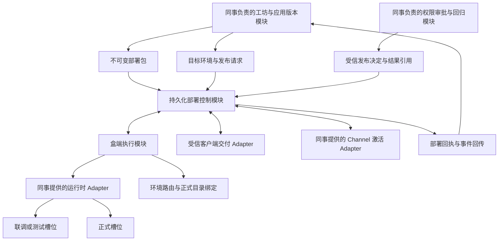

# 万象开物应用部署技术开发方案

> 平台部署设计现由万象仓库维护；从应用开发套件迁入。当前代码位置、实际能力与本轮范围以[Builder 部署接入计划](kaiwu-deployment-ui-integration.md)和[后台实施记录](kaiwu-deployment-backend.md)为准。套件公共合同草案及离线工具仍保留；合同源码引用固定到迁移时的套件提交，公开能力指南使用持续更新的分发入口。

本方案只覆盖部署环节：接收开物团队交付的应用版本及发布决定，将其部署到指定 AI 盒子，完成后端运行绑定、配套客户端交付、环境隔离、版本切换、迁移回滚与运维。规格构建、蓝图、组织权限、业务运行时、回归测试和 Channel 功能由其他同事开发；本方案定义与这些模块的 Interface，不把它们纳入部署团队的实现范围。

部署继续采用持久化控制模块、盒端执行模块和受信客户端管理模块。根据《万象工坊 PRD 应用板块 v0.1》，输入从“必然重建双端代码”调整为“不可变应用版本及部署包”，支持将规格加载到既有运行时，也保留既有代码应用的制品部署能力。两条路径均需完成前后端运行绑定，不强制每个应用独占一个后端进程或重装客户端程序。

按用户补充，应用后端优先支持复用盒端专家实例及现有模型、文件、知识能力；部署负责模板依赖、私有实例与环境绑定，业务专家运行时继续复用平台。model/files/knowledge 已接通原个人工坊部署；新增专家 profile 首版复用默认模型与文本问答，不开放专家工具及任意资源绑定，实施和验收见[专家后端与配套客户端计划](kaiwu-expert-deployment.md)。专家型后端无需先交付任意独立服务安装器；两种后端路径各自验收。

本次修订依据用户确认的“仅负责部署”分工；具体规格字段、审批默认规则及业务能力由对应负责人确定。PRD 为内部讨论稿，其中旧日期的代码现状不作为当前能力证据。变更依据、职责调整和 PRD 对照见[部署环节对照说明](kaiwu-box-deployment-prd-alignment.md)。本方案同时保留后续完整部署设计；当前已实现的专家 profile、目录接口和原开物接入范围见下节及[专家运行合同](../applications/kaiwu-deployment-delivery/expert-profile/README.md)，不据此声称所有后续 Adapter 已可用。

## 一 工作范围与现有能力

### 部署团队交付范围

| 我们负责 | 同事或平台模块负责 | 交接内容 |
| --- | --- | --- |
| 部署请求、幂等、状态与进度 | 规格编辑、模板、蓝图、版本对比、发布页面 | 冻结版本、部署请求、结果与事件 |
| 制品获取、摘要和来源校验、预检 | AppSpec schema、编译／打包、业务契约校验 | 不可变 DeploymentBundle、依赖锁与校验结果 |
| 候选准备、环境切换、后端运行绑定 | 专家／流程业务运行时、数据表业务实现 | Runtime Adapter 与兼容能力声明 |
| 消费发布放行、应用范围和资源绑定 | 组织、角色、审批规则、资料权限、业务审计 | 受信发布决定及可见范围／权限绑定引用 |
| 部署健康检查与连通验证 | 回归题管理、运行回归、业务验收 | 绑定本版本的回归报告与放行结果 |
| 客户端交付和版本激活协调 | 客户端底层管理能力、规格渲染与业务界面 | 受信安装／激活 Adapter 与真实回执 |
| 协调 Channel 路由指向生效版本 | 企业微信接入、成员绑定、卡片与通知 | Channel prepare／activate／inspect Adapter |
| 调用数据迁移、快照、恢复能力 | 数据与任务语义、幂等、人工流程恢复 | 版本化 Data Adapter、任务检查点与流程版本绑定 |
| 运行状态、停启卸载、部署日志及清理 | 用量计费、业务报表、反馈收集、培训与社区 | 部署事件及审计投递回执 |

部署管理不新增人工审批环节，受信执行器自动取得部署所需管理权限。组织业务权限与发布是否允许由同事的模块决定，部署不能以管理权限替应用扩大资料访问范围。PRD 的审批默认仍是待定建议，部署只执行上游决策，不自行制定角色或审批策略。

### 继续保留的约束

- 每次部署到单台指定盒子；联调／测试与正式环境隔离，切盒不改变已提交任务的目标。
- 正式发布复用已验证的不可变版本及依赖，不能改包或临时替换组件版本。
- 有客户端交付要求时，后端可用、客户端安装／加载成功、两端连通均通过才显示整体成功；分项结果分别保留。
- 关闭工坊或网络中断不丢任务；重复请求返回同一操作，同环境修改串行。
- 使用已有 AI 资源；专家型后端可按受信绑定从已有模板准备私有实例。模型、专家模板或技能缺失时明确阻塞，不自动下载未知依赖。
- 卸载默认保留数据，彻底删除单独确认；保留基本操作历史和 7 天运行日志。

### 当前套件事实

| 已有能力或限制 | 对部署的影响 | 依据 |
| --- | --- | --- |
| 应用运行于万象客户端共享 Electron，盒内自建服务需经 Bridge 接入。 | 既有代码应用继续按两端运行位置部署；PRD 新规格运行时另由同事交付。 | [README](https://codeup.aliyun.com/667637d76d5f7b05cc5d9ed7/centuarai/centuarai-wanx-app-dev-kit/blob/master/README.md) |
| 有 check/build/package、协议 3 ZIP 与 SHA-256 输出。 | 可接收此类已构建制品，不能用包生成成功替代安装和真实连通。 | [本地交付](https://codeup.aliyun.com/667637d76d5f7b05cc5d9ed7/centuarai/centuarai-wanx-app-dev-kit/blob/master/docs/developer-guide/local-delivery.md) |
| 本地 ZIP 原生导入只接受同应用更高 SemVer。 | 环境并存、自动安装和旧制品激活需要新受信管理合同，不能改版本号规避。 | [本地交付](https://codeup.aliyun.com/667637d76d5f7b05cc5d9ed7/centuarai/centuarai-wanx-app-dev-kit/blob/master/docs/developer-guide/local-delivery.md) |
| 万象 master 已提供通用、配置驱动的盒端服务注册；套件检查器仍不执行安装或注册。 | 可以复用受信注册和路由；制品安装、客户端交付、数据迁移与完整部署执行 Adapter 仍需接入。 | [独立服务注册](../bridge/independent-service-registration.md) |
| ProjectSpec 只记录项目生成选择及后端接入引用。 | 它不是 PRD 的完整 AppSpec，也不是本方案的部署请求。 | [ProjectSpec](https://codeup.aliyun.com/667637d76d5f7b05cc5d9ed7/centuarai/centuarai-wanx-app-dev-kit/blob/38628494284fab901c4059dfec0c0b0420353afc/contracts/app-builder/project.schema.json) |
| Host 会话随客户端连接失效。 | 部署由后台与盒端持久执行，不能依赖当前 Host token。 | [平台能力](https://codeup.aliyun.com/667637d76d5f7b05cc5d9ed7/centuarai/centuarai-wanx-app-dev-kit/blob/master/docs/developer-guide/platform-capabilities.md) |
| 普通本地 ZIP 的专家／技能自动绑定未支持。 | 必须验证已有资源真实可调用，不能删除依赖声明后声称接通。 | [平台能力缺口](https://codeup.aliyun.com/667637d76d5f7b05cc5d9ed7/centuarai/centuarai-wanx-app-dev-kit/blob/master/docs/developer-guide/platform-gaps.md) |

正式部署前端位于万象 `apps/builder/ui/deployment/`，部署后台位于 `apps/builder/backend/wanx_studio/deployment/`，个人工坊复用 Builder 工作台及受信请求通道。应用开发套件仓库仅消费公共合同、SDK 与工具，不维护平台产品前端。设备执行能力及公开指南状态须以真实验收为准。

### 当前原开物接入与验收边界

最终验收入口改为原开物 `StudioService`（`/api/app-studio`、`.wanx-app-studio`），保留原生管理员及团队权限规则。个人工坊（`.wanx-workshop`）继续兼容，两个入口共用部署执行模块但各自保留 Store、Coordinator 和资源数据。原开物本次只启用 `wanx-expert-app-v1`；不将个人工坊的旧 miniapp 或 model/files/knowledge 支持范围顺带扩展到原开物，也不把 Studio 伪装成 PersonalWorkshop。

当前交付路径为：原项目显式选择真实专家模板与文本验收合同 → 沿用准备、生成、验证及采用流程 → 导出已完成且已采用的冻结成果 → 同标准目录入库 → dev 部署及双端验证 → 同一发布转 prod。项目提供 `GET/PUT /projects/{pid}/deployment/expert` 和 `POST /projects/{pid}/deployment/release`，相对于原开物 API 前缀；具体输入及摘要定义见[专家运行合同](../applications/kaiwu-deployment-delivery/expert-profile/README.md)。部署不重建编辑器、不临时编译工作区、不自动采用成果。

选定模板和验收说明冻结在 `artifact.snapshot.contracts.foundation.expertDeployment`，新增专家成果的版本 hash 覆盖该合同；恢复历史版本保留原冻结值。导出核对采用 hash、修订、任务完成状态、源码／编译成果及模板依赖，再生成携带来源记录的标准目录。Builder 谱系 hash、便携客户端 payload hash 和目录原始字节摘要分别计算，不能互相替换。选择变更不会改写旧成果，旧成果也不会被追补专家合同。

`runtimeNamespace` 仅由服务端可信装配确定：原开物为 `studio`、个人工坊为 `workshop`，入库严格匹配所属入口；请求正文不能另报 `sourceNamespace` 改变归属。部署仍要求 SSO；原开物后台及 runtime 持久重验当前启用的管理员身份，Local Trust 保持明确不支持。受管客户端只获自身槽位与 runtime session 的有限入口，不获项目、目录或部署管理权限。

盒端根目录增加唯一 SourceRegistry（`.wanx-deployment-sources.sqlite`），按真实 owner 与规范化目标首次记录 `studio`／`workshop` 来源。启动从两个 Store 的旧 binding／preparation 登记归属后才开放能力；prepare、执行检查、激活和 runtime 均核对来源。同源重复可重入，失败不会让另一来源接管。跨入口同目标返回 `DEPLOYMENT_SOURCE_CONFLICT`；旧数据已有双源归属时保持冲突，不按挂载顺序选择。既有槽位和 `organizationId` 不改、不迁移业务库，避免两个独立 Store 的 generation 互相覆盖。

原开物开发预检只覆盖固定模板、能力合同和默认模型真实依赖连通；不会创建／执行部署专家实例，也不证明配套客户端可用。未部署的布局预览调用专家返回 `EXPERT_DEPLOYMENT_REQUIRED`；dev 部署候选需执行冻结文本探测，实际安装客户端并完成 `foundation.invoke` 握手后，才可报告部署成功。业务回归与组织发布范围仍按上游合同另行验收。

本地回归用于验证上述合同与兼容性。按部署团队边界，主验收从原开物标准目录入口完成，输入可由其他团队交付，不以编辑器生成成功为前置。本次已在 102 通过该入口完成独立合成目录的 dev／prod 双端部署与真实问答；项目内选择、生成、采用及导出作为补充集成另记，当前生成链有上游模型通道阻断。不得以目录部署结果冒充项目生成成功，也不能以前次个人工坊结果代替原开物结果。执行与证据见[原开物最终验收接入计划](kaiwu-builder-deployment-entry.md)和[验收记录](../verification/kaiwu-builder-deployment-box102-20261114.md)。

## 二 架构与两类部署载荷

控制模块作为工坊后台的独立 Module，复用已有持久存储与作业设施；部署团队不另建规格构建平台。盒端执行模块通过可信管理链路接收固定 boxId 的任务。两者可同机部署，生命周期仍独立于页面。无需为此强制新建 Kubernetes 或消息中间件。

| 载荷 | 盒端动作 | 客户端动作 | 本期定位 |
| --- | --- | --- | --- |
| `managed-spec` | 校验 AppSpec、锁定依赖与 runtime 兼容性，在已有业务运行时准备应用实例并加载版本。 | 在共享渲染运行时加载匹配规格／界面资源，必要时更新声明的客户端资源。 | 对接 PRD 的主要路径；运行时实现由同事提供。 |
| `packaged-app` | 安装或复用按摘要固定的后端制品，按合同注册、启动和检查。 | 安装／加载已构建客户端包，使用独立环境槽位。 | 保留此前两端代码应用的兼容能力；不因此开放 PRD 的任意代码扩展入口。 |

AppSpec 和 DeploymentBundle 均须标明 runtime 与客户端交付方式。`managed-spec` 也可能引用专用客户端包，不能仅凭载荷类别推断无需安装。`packaged-app` 可采用既有 OCI／ZIP 制品合同，但部署不生成业务代码，也不将每次发布重新构建镜像作为必需步骤。底层运行时升级是独立平台操作，不隐式附带于某个应用的发布。

## 三 与同事对接的最小合同

给开物团队直接使用的目录、必交产物、运行描述和字段要求见[开物应用部署交付标准](../applications/kaiwu-deployment-delivery-standard.md)。该标准定义目录入库输入，与下列三项外层合同分层；专家目录接入器校验、冻结产物并登记真实引用，目录清单不能直接作为 DeploymentBundle 提交。

以下为拟定外层合同；AppSpec 内部字段与组件业务语义由应用模块定义。运行时支持矩阵和 Adapter 合同双方共同确认。部署只消费真实合同，不复制同事内部实现。

| 输入 | 必含信息 | 提供方与部署校验 |
| --- | --- | --- |
| DeploymentBundle | releaseId、applicationId、specVersionId（规格路径）、payloadKind、specRef／制品引用、摘要、依赖锁、来源证明。 | 应用版本／制品模块冻结；部署校验完整性、来源和不可变性。 |
| RuntimeRequirements | runtime 版本范围、前后端运行绑定、平台／架构、资源预算、健康合同、数据兼容声明。 | 同事的运行时模块；部署对目标盒子实际能力预检。 |
| ValidationRef | 本版本的规格与组件契约校验结果、校验器版本。 | 同事校验模块；部署核实引用绑定同一摘要。 |
| RegressionRef | 测试集版本、结果及来源测试环境；正式放行时必需。 | 同事评测模块；部署核验放行引用，不运行或判定业务回归题。 |
| PublishDecisionRef | 允许／拒绝、决策版本、组织／应用／release／box／环境／范围绑定、有效性与撤销检查方式。 | 同事权限／发布模块；允许无人工审批，但必须有明确允许决策，不能自报布尔值。 |
| BindingSet | 可见范围引用、资料权限绑定、模型数据去向、专家与组件固定版本、secretRef。 | 同事组织与应用模块；部署仅验证引用有效并原样交给运行时。 |
| ChannelBindings | 必需 Channel、prepare／activate／inspect 合同、目标版本与路由指向。 | 同事 Channel 模块；部署按声明协调切换，不实现企业微信机器人。 |
| DataPlan | 新建／沿用／导入数据、兼容性、迁移计划与数据来源引用、任务策略。 | 同事数据模块；部署执行允许的计划并记录回执，不自定业务数据结构。 |

发布决定和回归结果不能只绑定 applicationId。回归证据关联不可变版本、测试集及来源测试环境；发布决定关联目标组织、盒子、环境、范围及采用的回归证据。任何影响放行的内容变化需重新取决定，不能改报告中的环境字段冒充正式环境测试。正式切换前再次核实决策未撤销、绑定未变更、expectedGeneration 未过期。回滚也重新按当前政策判断，不能复用历史宽权限的审批结果。

发布策略未定不阻塞接口设计：同事可以返回“仅自己／测试范围无需人工审批”的允许决定，也可以返回“组织范围待审批”。我们不实现审批页面、默认规则或业务回归判分；缺少结果时进入明确阻塞状态。

首次试运行部署可尚无完成的业务回归报告，上游需明确允许以测试用途准备 dev 环境；部署不把“已有完成回归”作为创建测试环境的前置条件。正式激活必须取得对应回归证据和上游明确允许决定。测试报告由同事在试运行后产生，再用于正式放行，避免“先有报告才能部署测试”的循环依赖。

### 三项交接合同的字段归属

以下是待双方冻结的外层字段草案，不要求同事将 AppSpec 改造成部署配置。主方案是接口设计依据，最终字段类型、枚举和必填条件应落为版本化 Schema 与契约样例。

| 合同 | 生产方与消费方 | 最小字段组 | 约束 |
| --- | --- | --- | --- |
| DeploymentBundle 部署包 | 同事的版本／制品模块 → 部署模块 | schemaVersion、releaseId、applicationId、payloadKind、specVersionId／specDigest（规格路径）、artifactDescriptors、dependencyLockDigest、runtimeRequirements、clientDelivery、bundleDigest、provenanceRef。 | 只描述不可变版本内容；每个制品描述符有内容摘要、大小、类型与平台条件。目标盒子、审批、环境密钥引用放入请求，不冻结在包内。 |
| DeploymentRequest 部署请求 | 同事的工坊／发布模块 → 部署模块 | schemaVersion、kind、target（组织／盒子／应用／环境）、releaseRef（ID 与摘要）、expectedGeneration、idempotencyKey、decisionRef，以及按 kind 必填的 validationRef、regressionRef、bindingSetRef、channelBindingsRef、dataPlanRef。 | 引用绑定内容摘要或修订号；请求者身份从受信通道取得，不相信正文自报身份。purge 携带与本次删除范围绑定的确认记录引用。 |
| ActivationReceipt 部署结果回执 | 部署模块 → 同事的应用版本模块 | schemaVersion、receiptId、operationId、operationRevision、kind、target、requestedReleaseRef、previousGeneration、committedGeneration、environmentRevision、commitStatus、outcome、componentResults、observedAt、error／recoveryRef（失败时）、correlationId。 | 成功和失败都回传；尚未提交时 committedGeneration 为空。回执记录本次操作事实，环境当前状态需单独查询。componentResults 包含每项实际版本、结果及是否必需，不用一个总布尔值掩盖局部失败。 |

同一 releaseId 再次登记相同 bundleDigest 返回原记录，不同摘要拒绝。bundleDigest 的覆盖范围、序列化方式与来源证明由制品合同固定，不能将下载地址或临时访问令牌当内容身份；下载凭据单独获取并可续期，续期不得改变摘要。三项合同均显式携带 schemaVersion，遇到不支持的版本或必需能力，在修改目标前返回兼容错误。

不可变依赖锁描述专家／组件的版本；BindingSet 描述该版本在目标环境使用的资源实例。两者不一致时拒绝请求，不能用环境绑定偷偷替换依赖。部署包的保管和归档由制品 owner 负责，部署负责核实可取回性及维持运行／回滚引用。

## 四 身份与持久化对象

- `organizationId` 与 `applicationId` 由上游提供并验证归属，部署不创建组织或决定成员角色。
- `specVersionId` 标识应用定义版本；`runtimeVersion` 标识承载它的引擎版本，两者分开。
- `releaseId` 标识不可变部署包及固定依赖，不随联调转正式改变。
- `environmentKey` 为 `boxId + organizationId + applicationId + environment`；`environment` 为 `dev` 或 `prod`。草稿是上游状态，不因此创建运行槽位。
- 测试成员范围由上游 BindingSet 提供；测试范围不等同于正式灰度，灰度不在本次范围内。
- `generation` 是环境控制面激活代次；`operationId` 是一次部署／管理操作。
- `environmentRevision` 是环境管理状态的单调修订号，激活、停用、卸载和恢复均递增；同一 release 未换版的停用也不能被迟到成功回执覆盖。
- 客户端本地数据额外按设备与平台用户隔离，包可共享只读缓存，数据不能共享可变目录。

| 对象 | 关键内容 |
| --- | --- |
| DeploymentRelease | 不可变 bundle 引用、specVersionId、依赖锁、前后端交付方式、runtime 与数据兼容声明。 |
| Environment | 环境键、activeReleaseId、generation、runtimeBinding、配置／权限／密钥引用、dataSetRef、状态。 |
| Operation | kind、idempotencyKey、expectedGeneration、状态／阶段、租约和 fencing token、分项结果。 |
| OperationStep | stepKey、输入摘要、执行意图、回执与对账结果。 |
| DecisionSnapshot | 校验、回归、发布决定及范围绑定的引用与版本；业务真源仍属同事模块。 |
| SnapshotSet | 盒端数据／文件／配置／密钥版本／任务检查点、旧版本、恢复校验与时间。 |
| ClientReceipt | operationId、一次性挑战、设备／用户／环境、releaseId、generation、localDataRef、安装加载及握手结果。 |
| ActivationReceipt | 生效版本、代次、运行时／客户端／Channel 分项结果、目录绑定、对上游回调状态。 |

环境数据与规格版本分开；配置、权限与密钥只通过受信上下文或引用注入。部署层不修改 AppSpec 来更换版本、身份或发布范围。当前 ProjectSpec 与新合同分别演进，不向现有禁止额外字段的 schema 中强塞 AppSpec 字段。

## 五 部署流程与状态

1. 同事提交冻结的 DeploymentBundle，明确目标盒子、组织、应用、环境及 expectedGeneration。构建若尚未完成，上游先完成，不由部署读取可变工作区即时构建。
2. 控制模块以幂等键创建任务，验证校验／回归／发布决定引用。业务放行不足进入 `blocked`，不修改目标运行状态。
3. 预检目标版本、runtime、架构、客户端、Channel Adapter、数据计划、依赖和资源。资源预算包含旧实例与候选、下载解压、迁移快照及本地数据副本，实际预留峰值资源。
4. 下载并验证全部必要制品。任何目标状态修改前取得持久环境租约并复查 expectedGeneration；此后的快照、迁移、客户端切换、Channel 激活、补偿和提交全程受同一 fencing token 保护。通过 Runtime Adapter 准备 dev／prod 候选槽位；兼容旧 schema 时可提前启动，否则先执行第八节维护和迁移协议。
5. 准备客户端交付并取得真实安装／加载回执；候选使用独立数据副本。按 ChannelBindings 调用同事的 prepare／inspect，验证当前候选版本的通路。
6. 校验候选健康、版本握手和端到端连通。候选不得领业务任务、执行定时调度或产生不可回滚的外部写；应用不支持候选模式时预检失败。
7. 在同一环境租约内重新验证发布决定和 expectedGeneration，持久化唯一提交决定；切换运行绑定、generation、前后端槽位及 Channel／目录指向，完成实际状态对账。
8. 所有必需分项检查通过才进入 `succeeded`，回传 ActivationReceipt。同事的应用版本模块据此更新“测试／已发布”状态；不能以按钮点击或请求已接收作为已发布。

同一 release 从测试转正式保持 spec、依赖锁与制品摘要不变。环境资源实例和正式配置可由新的 BindingSet 提供，但需按目标配置重新预检和取得放行。部署健康检查验证运行与连通，不替代同事的业务回归。

### 持久化状态与断线

主流程为 `queued → validating → preflight → preparing → verifying → committing → succeeded`。另设 `blocked`、`waiting_box`、`waiting_client`、`reconciling`；分项状态不能合并成一个含糊的成功标记。

提交前失败进入 `compensating`，恢复后为 `failed_recovered`；恢复失败进入 `recovery_required`。已提交但某 Channel 尚未对账完成时继续 `reconciling`，不能显示整体成功；重新运行提交协调，不重建应用版本。超过约定恢复期限后以 `failed_degraded` 结束本次操作，环境保持 degraded／维护状态，后续恢复使用关联的新操作，不能自动恢复历史数据库覆盖新写入。

Operation 的终态为 `succeeded`、`rejected`（未修改目标即拒绝）、`failed_recovered`、`failed_degraded`、`recovery_required`，终态回执不可改写。任务成功后发生的运行故障记录为 Environment.health 变化及独立事件，不把历史成功改成失败；回调发送失败只影响 deliveryStatus，也不重复执行部署。

安全终态不等待回执投递即可释放操作租约。failed_degraded／recovery_required 先持久化恢复检查点和环境阻断标记，再由恢复操作以更高 fencing token 接管；普通新部署仍被阻断，但环境不能永久锁死在已结束任务上。恢复成功后由新操作更新环境状态，原失败回执保留。

关闭工坊不取消任务。发起客户端准备阶段离线时，后端可继续下载并等待客户端，旧正式版本继续服务。进入维护前确认验收客户端与必需 Adapter 可用；维护后失联按检查点恢复或等待，不能开放与当前 schema 不兼容的旧服务。

步骤超时先对账，不把“没收到回执”当成“没执行”。至少一次投递下，盒端按 operationId、stepKey、输入摘要和实际状态逐步幂等执行；迁移、Channel 激活和外部副作用不得重放整个脚本。

等待客户端、等待盒子和提交后对账均有由 D0 固定的期限及处理策略。提交前超时先补偿候选、恢复原状态，再释放资源与环境锁；无法证明安全恢复则进入 recovery_required，并只允许受控恢复操作接管。单纯网络超时不能释放仍在迁移的环境供下一次部署使用。

## 六 运行时与 Channel 激活

业务运行时由同事提供以下 Interface：`prepare(release, bindings)`、`inspect(candidate)`、`quiesce(environment)`、`activate(candidate, generation)`、`recover(checkpoint)`，以及应用级 stop／restart／uninstall。Interface 须包含候选无副作用、持久回执、旧执行器拒绝及恢复语义。规格加载失败与服务启动失败都必须可定位。

Bridge、Host 与 Channel 根据受信运行绑定路由，不能由 renderer 或 IM 消息自报环境和身份。组织、成员和资料权限的实际判断由对应运行时完成；部署只保存其绑定引用，不另造角色系统。

企业微信作为首批 IM，只对接同事提供的 Channel Adapter，不研究或重写机器人、卡片和通讯录。多个必需入口不构成跨系统原子事务：盒端保存目标版本与提交决定，各 Adapter 幂等激活，持续 inspect 对账。短暂不同步通过版本绑定和入口栅栏处理，禁止把旧入口消息送到不兼容的新流程。未恢复时保留具体分项故障。

提交后的部分激活以完成既定提交为优先恢复方向；尚未匹配版本的入口保持阻断或合同允许的排队，不回送不兼容旧版。若已有入口开放真实写入，任何后续回退都遵循保数据回滚合同。回执必须明确“已提交但未全部就绪”，避免上游把失败误解为旧版本仍在服务。

### 在途流程的版本绑定

新请求使用当前 activeRelease；已有业务流程通过同事运行时提供的 `workflowInstanceId + specVersionId + dependencyLock` 继续执行。人工审核、等待与超时节点不能因部署 generation 变化被重建、重复执行或丢弃。部署需保留在途实例依赖的运行版本，直到运行时明确释放引用。

generation 用于控制面、客户端启动和新请求更新校验，不无差别杀死合法旧流程。继续旧流程须持有平台签发的实例绑定，并重新验证当前成员及资源权限；停用、撤权或强制维护仍优先生效。流程内部如何兼容旧节点、重试和人工回执由同事实现，部署不修改其业务状态。

## 七 客户端交付与组织目录

由 DeploymentBundle 声明 `clientDelivery`：加载共享渲染资源，或安装指定 ZIP。两者都要验证匹配版本及真实 Host 连通；没有安装动作时记录“复用运行时／已加载”，不能伪造安装回执。首次联调使用发起／验收客户端，其他成员离线不阻塞发布。

客户端槽位按组织、盒子、应用和环境隔离。原有 ZIP 同应用递增 SemVer 的导入方式不足以承担本流程，需平台提供受信 prepare／verify／activate／inspect／rollback 能力，按 release 与摘要激活而非改 manifest。管理凭据保留在可信模块，不交给 renderer。

正式目录与可见范围由同事模块定义；部署仅上报“目标版本已可用”并更新对应运行绑定。客户端查询目录时必须走上游可见范围过滤，不能把“已部署到盒子”视作全体连接者都可见。其他客户端点击后，取得匹配资源、安装／加载并打开。

正式切换前提示保存，切换后旧客户端暂停新业务操作并提示重开，旧代次请求返回 `UPDATE_REQUIRED`。离线客户端重连先核对当前版本；已存在流程使用第六节的实例续办合同，不能以普通旧客户端会话绕过版本校验。切盒使旧 Host 会话失效，部署任务仍固定原 boxId。

### 客户端本地数据

同事的 clientLocalSchema Adapter 提供兼容声明、备份与迁移。切换前冻结本地写入并排空本地任务，建立快照，在 staging 副本迁移和验证后切换 localDataRef；候选不能修改当前目录。失败保留原数据，不启动不兼容业务。

其他设备在更新或下次启动时各自执行，不等待全部设备在线，也不使用发起客户端快照覆盖别人数据。已有离线写队列按业务合同迁移、重验证与对账，不能向新版本直接重放。MVP 正常规格回滚要求本地数据保持可读，破坏性本地 schema 变更不进入普通发布路径。

## 八 数据迁移与版本回滚

### MVP 发布与数据保留

PRD 要求应用数据表仅允许新增字段，不删除、不改类型；应用定义回滚不丢会话、表单和产出。数据模块提供可执行 MigrationPlan 与向前／向后兼容证明，部署拒绝破坏性或不明确的计划。新增必填、唯一约束或默认值也可能影响兼容性，不能只凭“新增字段”字符串放行。

正常规格升级与回滚沿用 dataSetRef，不恢复旧数据库快照，不删除新增字段。旧版本由运行时兼容处理不认识的新字段；兼容证明需覆盖历史已发布规格及在途实例，不能只检查上一版。缺少兼容或依赖保障时阻止正式激活，交给同事修正契约，不能发布后将该版本排除出可回滚集合。应用回滚不顺带降级全局 runtime。

### 迁移执行与提交前恢复

执行顺序为 `prepared → write_fenced → snapshot_ready → migrated → health_verified → committed → serving`：

1. 准备期间旧版继续服务；迁移前通过 Runtime Adapter 停止新写入和任务领取，排空在途操作。读取若不兼容也进入维护状态。
2. 调用 Data Adapter 创建可恢复的盒端 SnapshotSet，固定数据、文件、任务检查点、配置及密钥版本和旧 release；验证恢复能力。客户端本地数据独立处理。
3. 执行允许的兼容迁移，检查 schema、数据和候选健康；不开放真实业务写入或外部副作用。
4. 持久提交唯一决定，切换运行绑定、generation 和入口，恢复业务及任务；重启后根据日志与实际状态完成提交或恢复。

quiesce 只排空正在执行的数据库事务、短调用和任务步骤。等待人工、定时唤醒等长期 workflow 保存持久检查点并暂停唤醒，不要求业务实例结束；提交或恢复后按原 specVersionId 继续。正在执行的步骤若无法在合同期限内安全停稳，迁移不得继续，按未提交失败路径处理，不能丢弃其外部回执。

只有提交前且没有新版本真实业务写入时，失败才自动恢复快照。恢复失败维持维护并进入 recovery_required；提交后异常走应用版本回滚，不能自动覆盖新数据。快照用于部署恢复，不当作应用版本数据仓，也不能撤销外部已完成的写操作。

共享数据库的快照与恢复必须限定于目标应用环境。Data Adapter 若只能恢复整个共享 runtime 数据库，无法保证其他应用数据不被覆盖，则不满足本方案合同；不能用环境操作锁代替跨应用数据隔离。

### 回到任意已发布版本

上游通过 releaseRef 指定目标版本，并提供当前有效的回滚放行决定。部署从已发布归档取得原始规格／制品及固定依赖，校验 runtime、配置、密钥、Channel、数据兼容性后激活新 generation；dataSetRef 与业务数据保持不变。不能只支持上一版，也不能复用历史审批绕过当前政策。

runtime／组件版本与旧规格的兼容由对应负责人承诺并提供支持矩阵；仍被历史可回滚版本或在途实例引用的依赖不可删除。若只能回退应用但其必要依赖已丢失，不能宣称实现了“任意已发布版本回滚”。

此前方案中“恢复旧数据库并接受新数据损失”的能力保留为独立灾难恢复／既有代码应用兼容议题，不作为 PRD MVP 的一键回滚，也不是普通发布的前置工作。本轮不实现其产品入口；未来需要时另行评审数据损失选择与恢复范围。

## 九 Fork 与初始化数据的交接

Fork 的规格复制、应用身份生成、来源署名和产品页面由同事负责，完整 Fork 编排移出部署主线。我们只接收已有目标应用身份，以及 DataPlan 指定的新建、沿用或受信 initialDataRef。

此前确认的内部完整复制需求未被社区 Fork 的无数据规则自动取消：若上游明确请求内部数据库、业务密钥、任务复制，数据模块需提供一致性导出、来源实例清单、受信导入与任务策略。部署仅调用 Adapter，保证目标隔离、导入完整、密钥在可信域重加密、目标任务先暂停；不复制 Host 令牌、原任务租约或进程内存。

来源继续运行，目标数据独立演进；任务检查点、外部副作用幂等和未知回执对账由同事任务模块实现。来源客户端本地数据若属于复制清单，必须逐实例取得；缺少不可静默跳过。此内部复制能力不再是首个正式部署的必需前置。

社区／跨盒子分享按 PRD 另期建设，部署不提供把组织数据、密钥和运行任务打入分享包的入口。首次正式环境默认新建空业务库，可按上游明确 DataPlan 导入联调内容；部署不自行选择复制哪些数据或扩大业务权限。

## 十 拟建接口与并发

本节接口由部署团队实现，不是当前 Host SDK 已有路径。业务规格、校验、回归、审批与 Fork 创建接口由同事负责，不在此重复定义。

| 接口 | 作用 |
| --- | --- |
| `POST /deployment/releases` | 登记已冻结部署包及来源，不从可变源码生成业务应用。 |
| `POST /deployment/operations` | 提交 deploy、promote、rollback、restart、stop、uninstall 或 purge。 |
| `GET /deployment/operations/{operationId}` | 查询持久任务与后端／客户端／Channel 分项结果。 |
| `GET /deployment/operations/{operationId}/events?after=…` | 按事件序号补拉进度、脱敏日志及放行阻塞原因。 |
| `GET /deployment/environments/{environmentId}` | 查询真实运行版本、generation、依赖与恢复状态。 |
| `GET /deployment/environments/{environmentId}/logs` | 运行日志游标、保留期与脱敏输出。 |
| ActivationReceipt 回调或事件 | 按上游合同回传部署结果；operationId 幂等，回调失败持久重试并可主动查询对账。 |

操作请求包含目标组织／盒子／应用／环境、releaseId、expectedGeneration、idempotencyKey、决策／回归引用、BindingSet 与 DataPlan。相同幂等键同参数返回原操作，参数不同返回冲突。操作被接受只代表排队，不代表应用已经发布。

幂等键作用域为组织、受信调用方与目标环境；请求按合同规定的规范化字段计算摘要，包含所有影响执行的引用修订。首次环境创建使用 expectedGeneration=0，必须以不存在环境的条件创建；后续操作比较实际代次。传输重试复用原键，即使原操作已失败也返回原结果；明确再次尝试使用新键与 retryOf，并重新读取环境状态。原操作尚在对账或恢复时，新的同环境修改不得启动。

blocked 状态只允许重新查询原引用并校验最新有效性；更换制品、范围或证明引用须提交新请求。原 blocked 操作在确认未修改目标后以 rejected／SUPERSEDED 结束，新请求与其建立关联。不能修改原请求后继续沿用旧幂等键。

字段必填性按 kind 定义：正式 deploy／promote／rollback 需明确目标版本及对应发布放行与回归证据；首次 dev 按测试用途允许决定执行。restart／stop／uninstall／purge 只需针对该管理动作的有效授权，不要求业务回归报告，release 可由受信环境当前状态解析。数据删除仍执行先前约定的明确确认，不能因为发布审批默认未定而无法停用应用。

恢复接管使用内部 `recover` kind，只由受信协调器根据持久恢复记录和当前恢复授权创建，携带 recoveryOf、checkpointRef 及已知提交状态；公共提交入口不接受任意 recover 或外部快照路径。恢复操作复用查询、事件与回执合同，提交前可执行已记录补偿，提交后仅完成提交／保数据恢复；需要业务版本回滚时另走已授权 rollback，不能借恢复绕过放行。

部署、迁移、回滚、停启、卸载和数据删除共用环境锁。租约与 fencing token 防止过期执行器恢复后继续修改；Adapter 也需校验代次。不同环境可并发但共同遵守设备资源预留。涉及来源快照的内部复制不得与来源迁移／卸载交错。

上游撤权或紧急停用的入口禁用标记不排在长部署任务之后：运行时与 Channel 先按受信撤销修订拒绝新业务和新任务领取，提交步骤也必须检查该标记。物理停进程、清理和迁移恢复仍在环境锁下串行，不能强杀正在进行的数据恢复；进度区分“入口已禁用”和“运行资源停止完成”。盒子失联时显示待送达／待确认，不声称远端已经停用。

### 回执交付与乱序处理

受理请求返回 operationId 和查询地址，HTTP 受理成功不携带伪造的部署成功。部署终态与待投递回执在同一持久化提交中保存，再通过受信回调或事件投递；回调地址使用平台登记目标，不能从任意请求正文接收外发地址。

消费者按 receiptId 去重，按 operationRevision 忽略同操作旧消息。跨操作按 generation 判断生效版本，按 environmentRevision 判断包括停用在内的管理状态；旧操作的迟到成功只能补历史，不能覆盖更新版本或重新开放已停用应用。commitStatus 区分 not_committed、committed 与 unknown；遇到 unknown、事件缺口或修订冲突，查询环境与操作真源后再条件更新业务状态，不能把未知当作未执行。事件有独立单调序号，游标过期需返回快照重新同步。

回执确认投递与环境激活是两种状态。持续重试的回执保留到受信消费者确认，不能按 7 天运行日志策略删除；投递失败提供查询对账及重投入口，不触发再次部署。

错误区分 `UPSTREAM_DECISION_REQUIRED`、`REGRESSION_EVIDENCE_MISMATCH`、`RUNTIME_INCOMPATIBLE`、`CHANNEL_NOT_READY`、`BOX_UNREACHABLE`、`CLIENT_UNAVAILABLE`、`INSUFFICIENT_RESOURCES`、`DEPENDENCY_UNAVAILABLE`、`MIGRATION_NOT_COMPATIBLE`、`GENERATION_CONFLICT`、`UPDATE_REQUIRED`、`RECOVERY_REQUIRED`。每项返回责任模块、阶段、可重试性及处理入口，不返回凭据。

## 十一 运维审计与保留

停止先拒绝新业务并停领任务，按运行时合同排空或保存检查点；重启保留 release 和数据。共享 runtime 的停启和卸载只作用于目标应用，不停止其他应用共用的进程。卸载撤销运行、入口与目录可用绑定，默认保留数据及恢复元信息；彻底删除独立确认。业务权限撤销由同事模块发起，部署消费停用指令，不能等待下一次正常发布才生效。

部署记录请求者、执行身份、组织／目标、版本、决策引用、每步结果与恢复动作，并把事件投递给同事审计模块。审计不可用按其已约定策略执行；部署至少持久保存本地事件及投递进度，不能静默丢失审计，也不实现业务读写与模型调用审计。

保留策略调整为：最近 5 个成功版本是本地热缓存目标，不是历史可回滚上限。所有已发布规格、部署记录及可恢复的依赖／制品来源均需保存；可按摘要去重与冷热归档。默认归档在组织受信存储，不因此新增向公共云上传组织数据的链路。归档可读、可取回、可在支持 runtime 上激活，才满足任意历史版本回滚。

当前在用、在途实例、回滚和运行中操作引用的对象不可 GC。保留最近一次有效升级前 SnapshotSet、7 天运行日志和基本历史；新快照未验证前不淘汰旧有效快照。空间不足时阻止新部署并给清理入口，不以删除不可重取的历史版本或业务数据、停止其他应用腾空间。

## 十二 仅部署范围的开发阶段

使用 D0 至 D4 标识部署内部里程碑，避免与 PRD 的组织 P0、产品阶段一至三混淆。不估算尚无目标代码和环境支持的固定工期。

| 阶段 | 我们的交付 | 同事或平台前置 | 门槛 |
| --- | --- | --- | --- |
| D0 对接合同与能力核实 | DeploymentBundle、DeploymentRequest、ActivationReceipt；责任人和能力矩阵；目标设备及真实管理链路核实。 | AppSpec、runtime、组织放行、回归、Channel 与数据模块的 owner 和最小合同。 | 明确哪些复用、哪些补齐；PRD 旧代码描述重新核实，不要求部署团队建设整套组织底座。 |
| D1 单盒测试闭环 | 包登记、校验、预检、持久任务、盒端候选、客户端交付与日志进度。 | 一个可运行的样板规格或既有双端应用、Adapter、测试范围允许决定。 | 真实盒子部署并连通；页面关闭任务不丢，客户端缺席不假成功。 |
| D2 正式激活与联调 | 消费放行／回归、版本切换、客户端与企业微信入口对账、幂等结果回传。 | 同事组织范围、回归结果、Channel 路由和可见目录合同。 | 同一部署包转正式；无效放行不执行；必需入口指向同一版本，上游据回执更新发布状态。 |
| D3 数据保留与历史回滚 | 兼容迁移执行、提交前快照恢复、任意历史版本激活、归档取回和在途版本引用保护。 | 数据兼容 Adapter、历史依赖可用性、运行时流程版本绑定。 | 版本回滚不丢数据，人工待办不中断或重复；不支持破坏性迁移明确拒绝。 |
| D4 运维与故障验收 | 停启卸载／删除、清理配额、重启对账、断线恢复、日志和审计事件投递。 | 停用／审计合同，目标客户端与盒端支持矩阵。 | 完成第十三节；首版包含 D0 至 D4。内部完整克隆仅按上游另行排期接入。 |

代码分工为：部署后台与盒端执行代码由部署负责人整合；客户端、Bridge、runtime 和 Channel 的底层改动由对应 owner 实现，部署团队交付契约测试并联调。正式前后端统一在万象 Builder 中实现，平台底层协作目录沿用万象既有分工。应用开发套件仓库只消费公共部署合同、SDK 和工具，不把平台内部实现塞入应用模板。

本次仅调整方案并新增 PRD 对照说明，不修改运行代码、固定 SDK、模板或当前平台能力状态。

## 十三 部署验收与产品验收的关系

部署测试通过 Module 的 Interface 验证，分合同／状态机测试、Adapter 集成测试与真实客户端／盒子联调。桩可用于前期独立开发，不能作为最终平台能力证据。

| 场景 | 部署验收标准 | 与 PRD 的关系 |
| --- | --- | --- |
| 接收规格与代码制品 | 两类载荷可按已交付 Adapter 准备，不强制规格路径生成独立镜像；摘要与依赖不漂移。 | 支撑 A1／A2，构建体验由同事验收。 |
| 放行绑定 | 首次 dev 可按测试决定先部署再产出回归；正式要求对应报告与允许决定。修改版本、范围、模型／资料绑定后旧放行不能复用。 | 支撑 A3／A5／A6，不实现审批和回归业务。 |
| 环境与目标 | dev／prod 与本地数据隔离；切盒不改变已有任务，测试成员由上游限制。 | 支撑测试到组织发布。 |
| 真实交付 | 后端、客户端及声明的企业微信通路均有实际回执；其他成员离线不阻塞，任一必需分项失败不报整体成功。 | 支撑 A3，机器人业务由同事验收。 |
| 可见范围 | 已部署不等于全盒可见；集成上游目录与权限后，未授权成员不可发现或使用。 | A3／A6 联合验收。 |
| 历史回滚保数据 | 发布多个版本后激活早于最近 5 个的已发布规格，新增会话／表单／产出仍在；归档可取回。 | A4 联合验收，版本人话对比归同事。 |
| 兼容迁移 | 只接受合规新增字段，删除／改型与不兼容新增约束被拒；迁移失败在提交前恢复。 | 满足 MVP 数据约束。 |
| 在途人工流程 | 升级／回滚后人工节点可按原实例继续，不重发通知、不重复写回；停用撤权仍即时生效。 | 支撑 A2／A4／A6，业务语义归同事。 |
| 维护排空 | 存在等待人工的长期实例时仍可完成迁移准备，只暂停唤醒与排空执行中的短步骤；无法停稳明确失败。 | 同事 Runtime Adapter 与部署联合验收。 |
| 客户端更新 | 候选用本地副本，每设备独立迁移；旧普通会话不能写新版本，流程续办走受信实例绑定。 | 支撑 A4，不覆盖其他用户数据。 |
| 故障与幂等 | 页面关闭、客户端离线、盒子重启、提交回执丢失后可对账；重复提交不重复迁移或激活。 | 部署自身完成标准。 |
| 合同与回执 | 同 releaseId 异摘要拒绝；首次创建并发仅一个成功；回执重复、跨操作乱序不把目录改回旧版；成功后的健康告警不改历史结果。 | 三项交接合同验收。 |
| 局部失败与停用 | 某入口提交后激活失败时显示实际版本并阻断不匹配入口；等待有期限；部署中撤权能先禁入口，数据恢复保持串行。 | 部署与运行时／Channel 联合验收。 |
| 依赖更新 | 专家／模板／runtime 升级不自动改已发布依赖，仍在用的历史版本可运行及回滚。 | A8 联合验收。 |
| 运维与审计 | 停启卸载可恢复，GC 不删受保护对象，事件可交付上游审计，不泄漏密钥。 | 支撑治理，非业务模型审计实现。 |

A1／A2 的非工程师构建效率、A7 的需求引导和超界解释由同事负责；其余产品验收也需跨模块共同完成。不能把“部署成功”当作 PRD A1 至 A8 全部通过。

验收记录目标版本、架构、组织与环境、release／spec／runtime、摘要、generation、放行引用及实际回执。设备和数据规模核实后再确定部署时间、恢复耗时与并发指标。

## 十四 下一步对接清单

开始实现前与同事确认以下技术事实，不重新讨论其产品功能：

1. 首个可交接载荷是 AppSpec 加共享 runtime、既有双端包，还是两者都有；部署只需要受信不可变引用和可运行 Adapter。
2. 规格、运行时、组件与专家版本如何固定；后端和客户端的 prepare／inspect／activate／recover 合同由谁交付。
3. 放行与回归结果的查验方式，以及目标组织、范围、配置变化后如何失效；审批默认由产品负责人另定。
4. 企业微信 Channel 与客户端目录的激活／检查／回退接口，跨入口版本不一致时的栅栏和恢复语义。
5. Data Adapter 的兼容新增字段、提交前恢复、历史版本读取新数据、在途人工流程版本固定和引用释放合同。
6. 所有已发布版本与固定依赖的归档位置、资源配额及取回能力，不能只有最近 5 个版本的实际制品。

D0 完成需双方为三项外层合同提供版本化 Schema、按 kind 的必填矩阵、成功与失败样例，并固定错误可重试性、等待期限、回执确认与乱序规则；为各 Adapter 指定 owner 和最小契约测试。本文字段草案经双方对齐后再冻结，不把文档评审通过当成接口已实现。

先冻结这些交接合同，再用同事交付的一份样板版本完成真实单盒部署；规格编辑、组织系统、回归平台和企业微信业务不作为部署团队的新开发任务。
