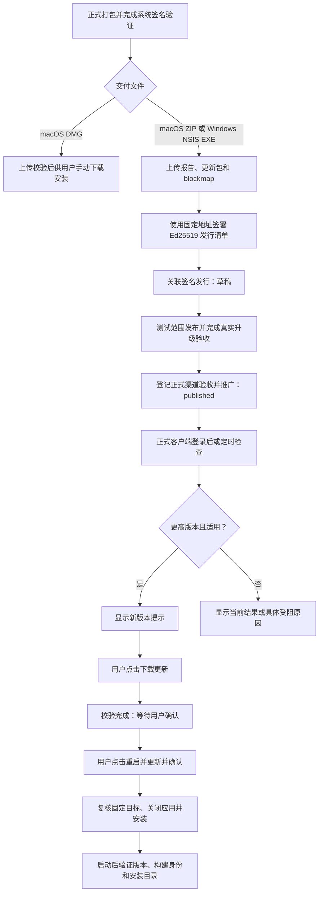

# 万象客户端发布与更新流程

核对日期：2026-10-29。适用于个人版、团队版桌面客户端；描述当前源码行为，不表示某个线上发行已经完成推广或实装验收。本文说明客户端自身更新，盒子服务 OTA 是另一条流程。

## 1. 先回答：上传完成后会发生什么

**上传完成不等于发布。当前机制是自动检查、用户主动下载、用户确认重启安装。**

| 问题 | 当前行为 |
| --- | --- |
| Admin 上传 DMG 后，客户端会升级吗？ | 不会。DMG 是手动安装包，可通过上传记录下载后手工安装，不能关联在线更新发行。 |
| 正式 ZIP 上传成功后，会立即通知用户吗？ | 不会。还需签署发行、关联草稿、完成验收并推广。 |
| 用户登录会自动检查版本吗？ | 会。已安装、具备更新信任配置的正式客户端在登录成功或启动后恢复登录成功时检查。 |
| 登录后持续使用会继续检查吗？ | 会。每轮自动检查结束后约一小时再检查，应用需保持运行并能联网；不是整点执行。 |
| 发现新版会自动下载吗？ | 不会。显示新版本通知，用户到设置点击“下载更新”。 |
| 下载后会自动安装，或退出时自动安装吗？ | 不会。用户点击“重启并更新”，确认后才进入安装流程。 |
| 勾选“强制升级”会静默安装吗？ | 不会。它实施最低版本要求，用户仍需下载并确认重启。 |
| 重新打一个相同版本号的包能更新吗？ | 不能。同版本换 buildId 不触发升级；例如已安装 1.0.1，下一次应发布更高版本，如 1.0.2。 |

### 当前截图对应的下一步

截图是个人版 `1.0.1 / macOS / arm64 / DMG 手动安装包`，状态为“文件完整性已校验”。这表示文件与报告中的大小、摘要一致；“报告声明为正式构建”也不等于发行已经发布。

- **只需要交付手动安装包**：从该记录下载 DMG，交付用户手工安装即可。
- **希望具备应用内更新**：在同一入口另外上传同次构建的 `verification-client.json`、`万象个人版-1.0.1-arm64-mac.zip` 和 `万象个人版-1.0.1-arm64-mac.zip.blockmap`，再完成第 3 节的发行流程。原文件与报告仍匹配时，无需为了补传 ZIP 重新打包。
- **用户已装 1.0.1**：发布 1.0.1 不会让其再安装一次。它可以作为后续升级的安装基线，后续发布更高版本。
- **用户装的是旧 `--local` 包或缺少更新功能的历史包**：先手动安装包含更新协议和生产公钥的正式包，不能仅靠上传新版本使旧包自动获得更新能力。

## 2. 两端的完整流程



这里的“自动”只覆盖查询和提示。Admin 推广不会向客户端下达无须确认的安装命令；客户端通过候选查询获取发行。

## 3. 发布人员操作流程

### 3.1 正式构建与产物

macOS 正式打包示例（在仓库根目录执行，版本应按实际发行调整）：

```sh
rtk proxy ./apps/personal-client/package-client.sh --version 1.0.2 --arch arm64 --formal
```

团队版增加 `--edition team`；同时构建两版使用 `--edition all`。默认公证配置、证书位置和公钥信任文件见 [根 README](../../README.md)。生产源码应已提交且干净，正式构建成功后保留原始产物和验证报告。

| 平台 | 手动安装 | 应用内更新 | 随更新包提交 |
| --- | --- | --- | --- |
| macOS | 已签名、公证的 DMG | 已签名、公证应用的最终 ZIP | ZIP 的 `.blockmap`、`verification-client.json` |
| Windows | 已签名的 NSIS EXE | 同一份 NSIS EXE | EXE 的 `.blockmap`、`verification-client.json` |

macOS 上传在线更新时选择 ZIP 的 map，不是 DMG 的 map。新报告包含 blockMap 时，不能省略对应文件。Windows 还要求客户端信任配置中有准确的程序签名发布者名称。

### 3.2 上传并校验

进入 **Admin → 版本与升级 → 客户端安装包**，选择对应版别，上传同一次构建的报告、更新包和 `.blockmap`，点击“上传并校验”。

服务端校验后保存不可覆盖的制品，并提供更新包与 map 的固定地址。此时仅完成制品存储：用户可手动下载，但客户端候选查询不会因此返回新版。

### 3.3 签署并关联发行

对正式 ZIP / EXE 记录点击“复制签名命令模板”。发行负责人在保存原构建产物的机器上补齐以下信息并签署：

- 正确版别的签名工具：个人版 `apps/personal-client/tools/sign-client-release.mjs`，团队版 `apps/team-client/tools/sign-client-release.mjs`。
- 生产 Ed25519 发行私钥及 key ID；客户端内置公钥与 Admin 的 `WANX_UPGRADE_RELEASE_PUBLIC_KEYS` 必须信任相应公钥。
- 更新包与 map 的**固定地址**，不能使用“下载”按钮取得的临时地址。
- 唯一发行 ID、对应渠道递增的 `metadataSequence`、有效期、实测系统与应用兼容表。
- 如需强制升级，签名中的 `forceUpdate` 必须与上传时的选择一致；不能事后手改已签名 JSON。

点击“关联签名发行”，导入生成的完整 JSON。Admin 核验签名及版别、版本、buildId、平台、地址、摘要、大小和 map，登记为 **draft（草稿）**。草稿尚不可用于正式客户端更新。

Apple Developer ID 签名、公证与 Ed25519 发行签名各有用途：前者证明应用可被系统接受，后者让客户端和 Admin 验证发行清单。它们不能相互替代，也不能使用 Admin 的升级许可私钥代替发行私钥。

完整签名命令和兼容表格式见 [客户端版本与受控更新](../clients/wanx-client-updates.md#固定制品签名登记和推广)。

### 3.4 测试、验收、正式推广

到 **发行目录** 执行：

1. 为同一制品签署测试渠道发行，在精确测试客户端范围发布；使用订阅该测试渠道的旧客户端完成真实下载、签名安装、重启和既有业务验证。
2. 为同一制品签署并关联正式渠道发行：个人版 `stable`，团队版 `stable-studio`。测试和正式发行使用不同发行 ID、各自渠道序号，制品保持一致；团队版测试渠道以 `-studio` 结尾。
3. 登记真实验收证据，覆盖实际要支持的升级前版本、已安装应用及既有数据。客户端验收包含 `signedInstall` 和 `restartIdentityVerified`，不能仅用构建成功或上传成功替代。
4. 由有推广权限的管理员点击“推广”，核对当前渠道修订号；成功后发行状态为 **published**。未覆盖的旧版本仍可能被拒绝，需要补充该基线验收后重新推广。

签名工具的 `--channel` 只改变发行元数据，不修改包内渠道。测试源客户端要订阅测试渠道；升级后的目标包仍使用构建时固化的渠道。普通正式用户不能仅靠管理员上传一个测试渠道发行就接收它。

| Admin 阶段 | 是否进入正式客户端候选 |
| --- | --- |
| DMG 文件完整性已校验 | 否，仅手动安装 |
| ZIP / EXE 文件完整性已校验 | 否，尚未登记发行 |
| 已关联签名发行，draft | 否，尚未推广 |
| 测试渠道 published | 仅适用的测试范围，不是正式用户发布 |
| 正式渠道 published | 适用客户端下次检查时可以获取；仍须用户下载、安装 |
| 已撤回或过期 | 不可作为有效更新目标；下载或安装前复核也会阻止 |

## 4. 用户侧触发与界面

入口为 **个人菜单 → 设置 → 版本与更新**，两版采用相同的更新机制。

### 自动检查

- 仅针对已安装、`distributionClass=formal`、更新配置可用且已登录的客户端；源码运行、内部包、身份不明包不参加正式自动检查。
- 登录成功或启动后恢复登录成功会检查。这里是万象云账号会话，不要求先连接盒子，也不是操作系统登录事件。
- 同一账号的常规 token 刷新不会重复触发。退出账号取消定时检查，切换身份重新检查。
- 自动检查结束后约一小时再次尝试；网络失败等待后续周期，也可手动点击“检查更新”。电脑休眠或应用关闭时没有后台服务替它持续检查。
- 正在检查、下载、等待安装或安装时，普通定时检查跳过，避免覆盖已有目标。服务端 HTTP 426 / `CLIENT_UPDATE_REQUIRED` 会触发受节流保护的策略重查，可以更新待安装的可选候选，但不会中断正在下载或安装的操作。

### 下载与安装

发现适用新版后，通知中心显示“万象有新版本”，引导用户到设置。用户点击“下载更新”后，客户端重新确认目标有效，再下载并校验。下载完成显示“万象更新已下载”和“重启并更新”。

点击“重启并更新”会弹出确认框，提示保存工作并关闭应用。确认后，客户端重新核对固定发行、已装应用兼容性和文件，再进入关闭与安装流程。普通退出应用不会自动安装已下载包。

下载完成不等于升级成功。新程序启动后，只有实际版本、构建 ID、安装目录符合目标且 Host 基本初始化完成，才记录成功。中断或启动旧副本会显示恢复指引。用户账号、应用包和业务数据保留；应用数据兼容性仍须纳入发行验收，不能假定版本回退等同数据回退。

## 5. 为什么发布了仍可能查不到更新

服务端通过 `POST /app-api/v1/upgrades/candidates` 返回候选，客户端还会独立验签和检查本机条件。适用性不只是比较版本号：

| 检查项 | 要点 |
| --- | --- |
| 客户端身份 | 正式包、可信更新公钥；Windows 还需支持的安装位置和发布者配置 |
| 版别与渠道 | 个人版 `stable`、团队版 `stable-studio`，不能跨版更新 |
| 发行状态 | 已推广、未撤回、未过期、签名有效 |
| 版本与防回退 | 目标 SemVer 更高；安全代次与已接受的元数据序号不能倒退 |
| 平台 | OS、CPU 架构匹配；新策略按产品大版本/桌面构建范围，旧版继续精确 OS 列表 |
| 升级前基线 | 当前旧版本已包含在正式推广锁定的验收范围内 |
| 已安装应用 | 显式 Host 向后兼容策略检查实际应用协议；缺少新策略的发行继续全量应用白名单 |

macOS 的 `supportedOsVersions` 保留 Darwin 精确值作为旧版过渡；新版个人版通过单独签名的 `clientOsPolicy` 声明产品大版本。不同架构分别构建、验证和登记，完整约束及 1.0.4 过渡限制见[客户端 OTA 兼容性契约](../wanx-client-ota-compatibility.md)。

同版本同构建可显示“最近检查未发现适用更新”；同版本不同构建会阻止覆盖。没有候选、验证失败或系统不支持时应读取具体错误，不能解释为“已是最新版”。

## 6. 普通更新、强制更新与增量下载

**普通更新**允许用户选择下载和安装时机。**强制更新**在有效签名发行完成验收、推广后形成最低版本要求，限制新应用启动、部分新 AI 业务等操作，并引导用户更新；已有应用不会因此被立即杀掉，用户可先保存工作。设置、账号、诊断和更新入口仍可使用。两种策略都需要用户确认重启。

后来发布普通版本不会自动取消仍有效的强制门槛。需要解除时，应按发行管理流程撤回相应强制发行，客户端成功检查收到明确策略结果后解除；已缓存证明到期也不再生效。临时断网不等于撤销要求。尚未实现该协议的旧客户端，不能靠后台勾选强制更新获得此能力。

`.blockmap` 用于减少下载量，不改变确认方式。客户端有可验证旧包和配对 map 时优先复用相同块；首次更新、缓存缺失或差分不可用时下载全量。最终仍重建和验证完整 ZIP / EXE，不承诺每次都会节省固定比例的流量。

## 7. 发布后的排查顺序

1. **看文件类型**：是否只有 DMG？若是，补传同次构建 ZIP、map 和报告。
2. **看发行状态**：是否仍是上传完成或 draft？到发行目录核实对应正式渠道是否已推广。
3. **看用户安装身份**：版本、版别、架构、渠道、formal 状态、公钥是否正确；旧 local 包先手动安装正式包。
4. **看触发条件**：客户端是否登录并联网；到设置点击“检查更新”，不必等待一小时。
5. **看具体阻止原因**：如 `RELEASE_UNAVAILABLE`（无有效候选）、`UPGRADE_BASELINE_UNVERIFIED`（旧版本未验收）、`UNSUPPORTED_PLATFORM`、`DEPENDENCY_CONFLICT`、`UPDATE_SAME_VERSION_BUILD`、`UPDATE_NOT_CONFIGURED`。
6. **有新版但没安装**：区分“可下载”“下载中”“已下载等待确认”和“已重启验证成功”；仅看到“已下载”不能报升级完成。

## 8. 实现依据与维护入口

客户端代码位于当前仓库；Admin 引用路径相对于 `nexusaos-admin` 仓库。核查时 Admin 远程 master 为 `4d5e649`，线上是否已部署相同代码需另行核实。

| 内容 | 实现位置 |
| --- | --- |
| 登录后、每小时、426 重查调度 | [update-checks.mjs](../../apps/personal-client/shell/update-checks.mjs)、[main.mjs](../../apps/personal-client/shell/main.mjs) |
| 候选查询、固定目标复核、成功确认 | [client-service.mjs](../../apps/personal-client/updates/client-service.mjs) |
| 关闭自动下载与退出安装、下载校验 | [electron.mjs](../../apps/personal-client/updates/electron.mjs) |
| 版本、兼容规则与强制门槛 | [contracts.mjs](../../apps/personal-client/updates/contracts.mjs) |
| 设置按钮、安装确认与通知 | [renderer.js](../../apps/personal-client/local-ui/renderer/renderer.js)、[notification-center.mjs](../../apps/personal-client/shell/notification-center.mjs) |
| 发行签署工具 | [sign-client-release.mjs](../../apps/personal-client/tools/sign-client-release.mjs)；团队版同名路径位于 `apps/team-client/` |
| Admin 上传与关联限制 | `admin-backend/module_nexus/service/nexus_client_upload_service.py` |
| Admin 候选、验收与推广 | `admin-backend/module_nexus/service/nexus_upgrade_service.py`、`nexus_upgrade_rollout.py` |
| Admin 操作流程 | `docs/operations/wanx-upgrades.md` |

本说明依据代码与现有自动化用例核对，不能替代两份真实正式安装包之间的升级实装验收。

2026-10-29 文档核对时执行：

```sh
rtk proxy node --test --test-concurrency=4 \
  wanx-{client,team-client}/tests/{update-checks,client-updates,update-control}.test.mjs
```

结果：66 项通过，0 失败、0 跳过，覆盖登录及定时检查、下载与安装分离、固定目标复核、同版本阻止和强制更新边界。本次仅修改文档，未执行正式打包、线上推广或真机更新。
