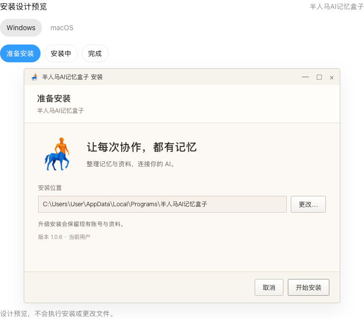
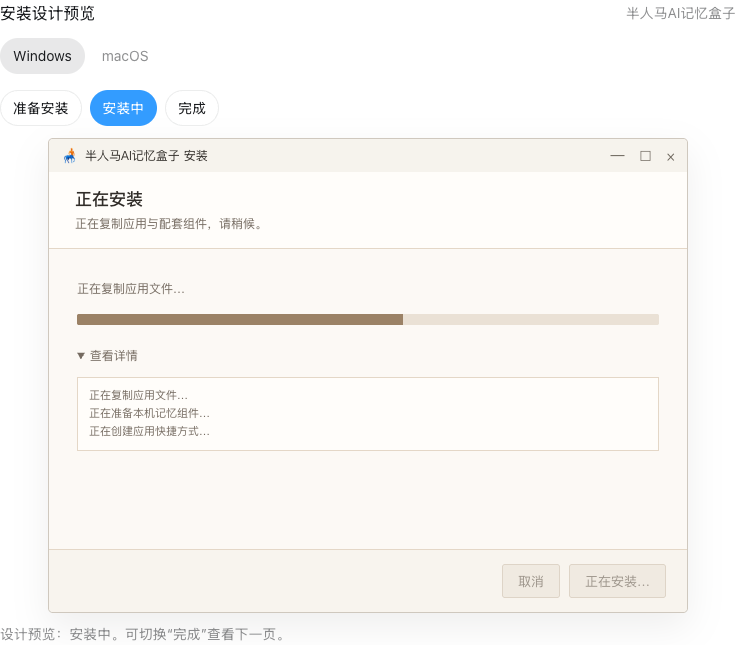
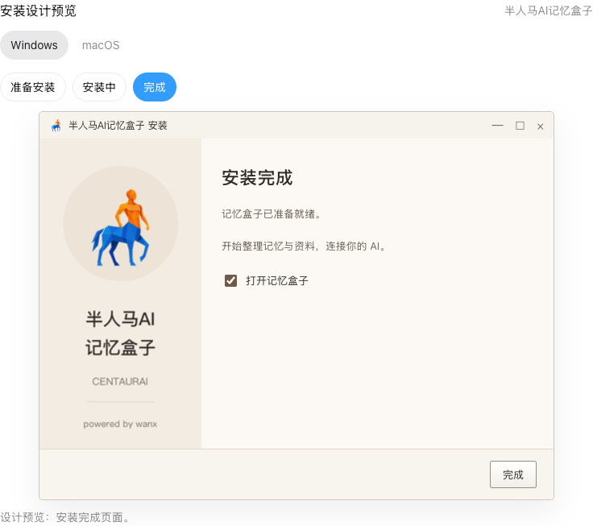

# 半人马AI记忆盒子安装体验改版

Windows 与 Mac 沿用客户端暖白／棕色视觉，保留橙蓝半人马品牌标识。此次已实现安装界面、素材和打包配置，在独立分支交付；没有替换已发布的 `v1.0.6-windows-preview.2`，也没有声明新的 Mac 完整客户端发行。

## Windows

准备安装 → 原生安装进度 → 完成。移除三张产品海报轮播、自动视频、播放控制及重复介绍。欢迎页只保留品牌图、短标题、安装位置与“更改”，以及一条数据保留说明。标准目录向导页关闭，文件夹选择移到欢迎页；进度由 NSIS 真实驱动，详情可展开；完成页保留打开应用选项。

现有安装目录及 `/D` 参数不改。只有用户浏览选择新位置时规范应用子目录；交互路径过长时可回到当前页修改。silent/current-user/85字符限制、NTFS预检、安装目录保护与验证、升级跳过、签名及更新合同保留。标准、预览、内部和正式 Windows 入口都接入同一组新素材及内嵌目录选择配置。

## Mac

单页 DMG：把应用拖入“应用程序”，再从那里打开。采用 760×480 逻辑尺寸、1×／2×背景及两枚原生 Finder 图标；窗口和图标布局在专用模块定义，由原 Mac 打包工具窄接入。保留真实应用文件名、卷名、隔离测试包身份、Developer ID／公证要求及原有更新机制，没有改首次登录、自启动或权限策略。

Mac 现有标准 packager 尚未纳入新版混合记忆 runtime 的生产依赖闭包，因此本轮仅完成安装视觉与配置，不能把换背景视为完整 Mac 版本可发行。正式发行仍须补齐相应运行时、arm64／x64 ABI及包内启动验收，并使用有效签名／公证。

## 可见设计预览

以下图片和 `installer-flow.html` 是设计示意，不是实际 Windows 安装截图。Windows 原生按钮保留系统样式，未承诺网页式无边框或自绘圆角按钮。会话预览支持两平台切换、三个 Windows 页面、目录示意修改、详情和 Mac 拖入演示；不会安装、启动应用或更改文件。

## 验证

- 安装布局／素材／原生编译 13 项通过；其中 Windows UI 与原安全挂钩由真实 NSIS 编译为测试 PE，未执行安装。Mac 背景通过真实 dmg-builder、schema、身份、PNG尺寸及本机 Retina TIFF 转换检查。
- 发布签名与更新合同 11 项，10 通过、1 项 Windows 原生 Authenticode 验证因当前 Mac 环境跳过。涉及的证书、签名与公证调用为合同模拟，不代表新的正式签名产物。
- Windows 打包依赖及复制门禁 19 项通过。以上合计 43 项：42 通过、0 失败、1 跳过。
- 独立临时 Chrome 对 736px、320px 共 8 个视图检查通过，零脚本异常、无横向溢出；步骤、路径、详情、平台状态保留交互通过。
- 用真实 dmg-builder 制作专用非客户端布局测试 DMG，`hdiutil verify` 及只读挂载成功，真实 `.DS_Store`、背景 TIFF 和图标映射存在；没有启动、拖拽安装或修改用户应用，测试卷已卸载。
- 原生界面检查工具当前无法启动（运行环境 ENOENT），因此未声明 Finder 或 Windows 实机 DPI／键盘视觉验收完成。未构建新的完整客户端安装包。

证据位于同名 `installer-experience-20261116/` 目录。新增素材已视检，重复生成字节一致；生产打包只读取已提交图片，不要求 Python 或系统字体。

## 工作区

隔离实现目录：`/tmp/memobox-installer-redesign-20261116`，基于已交付的 `515c9c2`。实际共享源码：`/Users/finewood/Projects/Memobox`。安装器文件与旧发布副本逐字节一致后才开始隔离修改；向共享源码同步时再次检查基线哈希。没有整体覆盖主项目、触碰未完成模型或修改其 Git 索引／分支引用，ORICO 旧副本没有改动。
