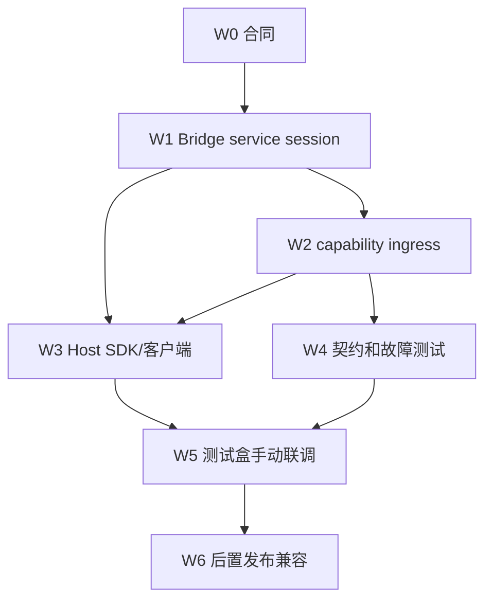

# centaur-WANX 工程任务计划：火花独立盒端服务接入

**总览**：[火花独立盒端服务方案总览](../../../../centaurAI-spark/docs/workbench/huohua-independent-service/wanx-optional-box-service-overview.md)

**本项目目标**：为独立 `huohua-boxd` 提供统一的 Bridge 接入和受控 WANX 能力代理，并验证现有 WANX 客户端/Host SDK 可以承载火花客户端。本期不修改 WANX 客户端。

## 1. 改造边界

本项目只改 WANX 的平台接入能力，不实现火花业务，不把火花重新挂回 WANX 主进程。

| 模块 | 本期任务 | 不做的事情 |
|---|---|---|
| `wanx-bridge` | service session、固定路由、capability ingress、错误隔离、健康和 WS/SSE 转发 | 不访问火花数据库，不实现火花业务 |
| Octop 公共 API | 核对并稳定模型、对话、个人空间公共接口；必要时提供受控 broker | 不把 Provider 私有对象暴露给火花 |
| WANX Host SDK/客户端 | 本期保持稳定，只验证现有 `/api/*` HTTP/SSE、Host session 和既有 Agent chat WS 兼容性 | 不修改客户端、Host SDK 或应用市场运行时 |
| WANX 发布 | 保持 WANX 基础服务独立发布 | 不把火花服务包并入 WANX release |

## 2. 任务拆分

### W0：与火花冻结服务合同

与 `centaurAI-spark` 共同确认：

- `serviceId=huohua.workbench`、协议版本、最低 WANX/Bridge 版本。
- service token 的签名算法、audience、serviceId、userId、spaceId、scope、过期和撤销。
- `/api/huohua/v1` 服务路由、旧路由兼容期和错误码。
- `not_installed`、`starting`、`ready`、`degraded`、`incompatible`、`failed` 状态。
- HTTP、SSE、WebSocket、超时、取消、幂等、大请求体和 503 行为。
- 浏览器 capability 的 HTTP/SSE 和现有 `/api/browser-stream/ws` 复用边界，
  以及登录、验证码和人工介入的责任归属。
- 任务级 token 的创建、续期、轮换、撤销、最长生命周期和 Bridge 重启行为。
- 客户端调用和 boxd 调用的身份差异：Host session 与 Bridge service session 不混用。

交付物：WANX 侧类型/fixture、capability allowlist、版本兼容矩阵和契约测试样例。

### W1：Bridge service session 和固定火花路由

建议落点：

- `server/bridge/wanx_bridge/server.py`
- `server/bridge/wanx_bridge/auth.py`
- `server/bridge/wanx_bridge/upstream.py`
- 新增独立 `server/bridge/wanx_bridge/huohua.py` 或同等模块
- `server/bridge/tests/test_huohua_*.py`

#### W1.0 服务注册记录

首期不做动态注册中心，直接在 Bridge 的受控配置或服务 manifest 中增加火花注册记录。注册内容至少包括：

- `serviceId=huohua.workbench`，service token audience 固定为 `wanx-bridge`。
- 回环 upstream `http://127.0.0.1:8093`、服务 UID 和允许的端口。
- `/api/huohua/v1` 的 HTTP/SSE 路由 allowlist；既有 Agent chat WS 不新增火花路由。
- service token 的 audience、scope、用户/空间上下文和协议版本。
- `/healthz`、`/readyz`、`/version` 检查和状态映射。
- 火花服务版本、Bridge 协议版本和最低 WANX 版本。

这个注册记录用于 Bridge 路由、鉴权、readiness 和版本兼容检查；它不负责启动进程，也不等同于 Admin 应用市场的客户端应用注册。

#### W1.0.1 注册信息的存放位置

首期把注册信息放在 **Bridge 的受控运行时配置** 中，不放在 Octop 数据库，也不放在 Admin 应用市场数据库。

建议结构：

```json
{
  "schemaVersion": 1,
  "services": {
    "huohua.workbench": {
      "enabled": true,
      "upstream": "http://127.0.0.1:8093",
      "uid": 10006,
      "tokenAudience": "wanx-bridge",
      "protocolVersion": 1,
      "minWanxVersion": "<required-version>",
      "routes": [
        {"prefix": "/api/huohua/v1", "methods": ["GET", "POST", "PUT", "DELETE"], "sse": true, "websocket": false}
      ],
      "health": {"liveness": "/healthz", "readiness": "/readyz", "version": "/version"},
      "servicePublicKeyFile": "/etc/wanx/bridge/huohua-workbench.pub"
    }
  }
}
```

文件边界：

- 正式路径由 Bridge 启动参数或环境变量指定，例如 `WANX_BRIDGE_SERVICE_REGISTRY_FILE`，文件由盒端安装流程创建，root/Bridge 用户所有，权限 `0600`。
- 开发测试可在测试盒使用 `/data/wanx-bridge/services.json` 或等价本地路径，手动部署时写入；不提交到 Git。
- 私钥不放在注册表。服务私钥只存在火花服务用户可读的 credential 文件中，注册表只保存公钥路径或公钥指纹。
- 火花服务包中的 `service-manifest.json` 只描述火花自身版本和所需合同；它不能自行改写 Bridge 的权威注册表。

首期不把火花加入 `local_data_config.py` 的 native upstream 列表。该配置当前用于 `octop`、`clipboard`、`semantica` 等本地数据网关和 Unix peer UID 校验；火花首期走 Bridge HTTP service session，避免把业务服务注册和 native local-data gate 混在一起。

#### W1.0.2 谁负责写入和读取

| 动作 | 负责方 | 时机 | 说明 |
|---|---|---|---|
| 生成火花 manifest | 火花工程 | 构建服务包时 | 记录 serviceId、版本、协议和依赖，不写 Bridge 运行配置 |
| 写入 Bridge 注册表 | 开发测试人员手动部署；后续 `centuarai-os` 安装器 | 安装/启用火花服务时 | 只写入已签名、版本匹配的记录 |
| 读取注册表 | `wanx_bridge.__main__` / `ServiceRegistry` | Bridge 启动时 | 解析、校验并建立内存索引 |
| 路由查找 | `huohua` Bridge router | 每次请求 | 按 `serviceId` 和路径前缀查找，不做网络扫描 |
| 服务状态读取 | Bridge readiness/status handler；WANX Host SDK | 客户端启动和刷新时 | 只返回状态、版本和错误码，不返回私钥或内部配置 |
| 服务 token 校验 | `ServiceSessionVerifier` | boxd bootstrap 和每次 capability 请求 | 校验签名、audience、serviceId、过期和 scope |

Bridge 首期启动时加载一次注册表；注册表变化通过重启 Bridge 生效，不做动态热注册。这样可以避免任意本地进程在运行时把自己注册成受信任服务。

#### W1.0.3 Bridge 如何发现服务

发现是**配置索引发现**，不是局域网发现：

1. Bridge 启动读取 `WANX_BRIDGE_SERVICE_REGISTRY_FILE`。
2. `ServiceRegistry` 校验 schema、serviceId、回环 upstream、端口、路由前缀、UID、健康路径、公钥文件和版本字段。
3. 校验通过后建立 `services["huohua.workbench"]` 内存索引。
4. 客户端请求 `/api/huohua/v1/...` 时，Bridge 根据固定路由前缀找到火花注册记录。
5. Bridge 检查 `enabled`、版本兼容和 readiness，再决定转发或返回 `not_installed`/`starting`/`incompatible`/`unavailable`。
6. Bridge 只向注册表中的回环 upstream 转发，禁止请求方提交新的 upstream、端口或 serviceId。

#### W1.0.4 Bridge 如何鉴权

首期拆成两段身份校验：

**A. `huohua-boxd → Bridge` 服务身份**

1. 手动安装时为火花服务生成独立 Ed25519 私钥，私钥仅服务用户可读。
2. Bridge 注册表保存对应公钥/指纹。
3. boxd 向 Bridge 的 `POST /api/bridge/v1/services/{serviceId}/session` 发送 serviceId、协议版本、nonce 和签名证明；该接口只接受注册服务的签名证明，不接受用户 Bearer token。
4. Bridge 根据注册表公钥验证签名，检查 serviceId、nonce 防重放、版本和服务状态。
5. 校验成功后 Bridge 签发短时 service token，claims 至少包含 `iss`、`aud=wanx-bridge`、`serviceId=huohua.workbench`、`boxId`、`protocolVersion`、`iat`、`exp`、`jti` 和允许的 capability scope；建议有效期不超过 5 分钟，过期后重新证明和换取。

**B. 用户请求的委托上下文**

1. 客户端先使用现有 WANX Host session 访问 Bridge。
2. Bridge 校验用户租约，并将经过校验的 `userId/spaceId` 以 Bridge 签名的委托上下文传给 boxd。
3. boxd 只能使用 Bridge 委托的用户和空间上下文，不能采用客户端原始 Authorization/Cookie，也不能自行修改 userId/spaceId。
4. boxd 调用模型、对话和个人空间 capability 时，Bridge 同时校验 service token 和委托 scope，再使用现有 WANX upstream adapter 访问 Octop。

`auth_application.py` 当前只支持 `super-advisory` 应用会话，不作为火花服务注册或鉴权入口；首期新增独立的 service-session verifier，避免把火花伪装成 Admin 应用。

任务：

1. 注册 `huohua.workbench` 服务、回环 upstream、端口、服务 UID 和 manifest 版本。
2. 只允许 Bridge 转发到 `127.0.0.1:8093`，拒绝公网绑定、未知服务和任意上游 URL。
3. 验证 service token 的签名、过期、audience、serviceId、userId/spaceId scope。
4. 将请求上下文转换为 boxd 可验证的服务会话，不透传客户端 Authorization/Cookie。
5. 增加 HTTP/SSE 转发、连接关闭、超时、请求体大小和错误映射；复用现有浏览器
   WebSocket，不增加火花专用 WS 协议。
6. 增加浏览器 capability allowlist，覆盖环境、会话、控制、安装、录制/回放、学习
   和人工 handoff；第三方登录和验证码继续由 WANX 浏览器会话处理。
7. 增加任务级 token lease、续期轮换和撤销，长任务不直接持有不可续期的短期委托 token。
8. 火花服务未安装、启动中、版本不兼容或异常时，Bridge 返回稳定状态，不影响 WANX 其他路由。

完成标准：stub `huohua-boxd` 可以通过 Bridge 完成一条受保护请求；直接访问 Octop 内部端口和伪造 service token 均失败。

#### W1.1 首期文件改造清单

**新增文件**：

| 文件 | 责任 |
|---|---|
| `server/bridge/wanx_bridge/service_registry.py` | 注册记录 schema、文件加载、权限/回环地址/路由/版本校验、内存索引 |
| `server/bridge/wanx_bridge/service_sessions.py` | boxd service-session 签发、验签、过期、nonce 防重放和 scope 校验 |
| `server/bridge/wanx_bridge/huohua.py` | 火花固定路由、状态映射、service session 注入、浏览器和 capability ingress 入口 |
| `server/bridge/deploy/huohua-services.example.json` | 开发/部署配置样例，不包含密钥和真实盒子信息 |
| `server/bridge/tests/test_service_registry.py` | 注册表格式、权限、回环 upstream、未知 service 拒绝 |
| `server/bridge/tests/test_huohua_service_session.py` | 服务 token、nonce、scope、任务续期/撤销、过期和伪造拒绝 |
| `server/bridge/tests/test_huohua_gateway.py` | 路由、readiness、浏览器 allowlist、HTTP/SSE、任务和故障隔离 |

**修改文件**：

| 文件 | 修改内容 |
|---|---|
| `server/bridge/wanx_bridge/__main__.py` | 从 `WANX_BRIDGE_SERVICE_REGISTRY_FILE` 加载注册表，初始化 registry/verifier 并传给 app |
| `server/bridge/wanx_bridge/server.py` | 接入火花 router、固定 upstream 转发、service session 和状态接口 |
| `server/bridge/wanx_bridge/upstream.py` | 增加受控 capability adapter 或复用现有 `OctopAdapter` 的公共 API 请求能力 |
| `server/bridge/wanx_bridge/version.py` | 在状态结果中返回 Bridge 协议/构建版本，供兼容检查使用 |
| `server/bridge/README.md` | 记录注册表格式、手动部署、服务 token 和排障方式 |
| `server/bridge/tests/test_runtime.py` | 注册表路径、启动失败、未知服务和版本配置测试 |
| `server/bridge/tests/test_upstream.py` | 公共模型/对话/空间 capability 的真实合同测试 |

**首期明确不改的文件**：

- `octop/src/octop/api/routers/auth_application.py`：不把火花注册为 `super-advisory` 应用。
- `server/bridge/wanx_bridge/local_data_config.py`、`local_data_broker.py`、`local_data_gateway.py`：不把火花混入 native local-data upstream 列表。
- `server/bridge/wanx_bridge/auth.py`：保留现有用户平台租约；服务 token 逻辑放在独立 `service_sessions.py`。

如果 W2 评估发现现有公共 API 不足，再单独列出 Octop 需要修改的具体 router；首期默认不改模型/空间 API 的业务语义。

### W2：capability ingress 和公共 WANX API

首期建议使用固定 capability 入口 `POST /api/bridge/v1/capabilities/{capability}`。请求体只允许合同定义的参数，Bridge 根据 capability 名称映射到固定 Octop API；不接受火花提交任意 upstream path、host、provider 凭据或用户身份字段。

相关公共接口：

- `octop/src/octop/api/routers/dialogue.py`
- `octop/src/octop/api/routers/personal_space.py`
- `octop/src/octop/api/dialogue_gateway.py`
- `octop/src/octop/api/common/workspace.py`
- `octop/src/octop/api/device_models.py`

首期复用并通过 Bridge 受控代理：

- `GET /api/dialogue/models`
- `GET /api/providers/resolved`
- `GET /api/providers/active-model`
- `/api/dialogue/sessions*`
- `/api/agents/{agent_id}/chat/ws`
- `/api/personal-space/overview`
- `/api/personal-space/files`
- `/api/personal-space/folders`
- `/api/personal-space/uploads`
- `/api/personal-space/trash`

任务：

- 为每个 capability 定义允许的方法、路径、scope、上下文和返回错误。
- Bridge 只接受来自已认证 `huohua-boxd` 的 capability 请求。
- 用户和空间上下文由 Bridge 绑定，拒绝火花自行指定其他用户/空间。
- 对模型和 provider 只提供查询和受控调用能力，不暴露 Provider 凭据管理接口。
- 如果后台任务确实需要脱离 Agent 的模型调用，新增受控 broker；不让火花复制 `ProviderStore` 或 `build_chat_model`。
- 通过真实 Octop fixture 验证权限、空间边界和流式返回。

完成标准：火花可以使用已有模型、对话和空间 API；WANX 不增加一套火花专属模型/空间 API。

### W3：现有 WANX 客户端兼容性验证（不改客户端）

WANX 客户端和 Host SDK 作为稳定运行时，本期不修改代码。只核对现有能力是否可以承载火花客户端：

- `apps/personal-client/app-host/session.mjs`
- `apps/personal-client/applications/manifest.mjs`
- `apps/personal-client/applications/compatibility.mjs`
- Host 网关、应用 relay 和现有客户端测试

验证内容：

1. 现有 `host.request('/api/...')` 可以承载 `/api/huohua/v1` 的 HTTP 请求。
2. 火花客户端的 SSE 使用现有 HTTP 流式响应能力，不新增 WANX 客户端路由。
3. 实时 Agent 对话复用现有 `/api/agents/{id}/chat/ws` 合同；不新增火花专用 WS allowlist。
4. 现有 Host session 仍只用于客户端调用链，不能传给 boxd。
5. 客户端只更新时，未安装火花服务的盒子仍能正常运行 WANX；服务状态和提示由火花客户端处理。
6. 如果发现现有 Host SDK 确实无法承载 HTTP/SSE，再单独提交兼容性问题，不在本期直接修改 WANX 客户端。

完成标准：现有 WANX 客户端无需升级代码，能够打开火花客户端并把 `/api/*` 请求送达 Bridge。

### W4：测试和故障隔离

新增或扩展 Bridge 测试：

- service token 签名、过期、错 audience、错 serviceId、越权 scope。
- 火花服务未安装、启动中、readiness 失败、进程退出和端口不可达。
- HTTP、SSE、断线、超时、取消、重试和 503；对既有 Agent chat WS 做回归，不新增火花专用 WS 路由。
- 模型列表、当前模型、对话 session、个人空间文件/文件夹/上传。
- 直接访问 `18088/18089`、Octop 数据库和未知内部路径。
- Bridge 重启、WANX 重启、火花单独升级和火花回滚。
- 火花故障不影响 WANX 登录、P2P、其他应用和基础健康检查。

优先复用现有测试模式：

- `server/bridge/tests/test_application_session.py`
- `server/bridge/tests/test_upstream.py`
- `server/bridge/tests/test_readiness.py`
- `server/bridge/tests/test_clipboard_gateway.py`
- `server/bridge/tests/test_delivery_readiness.py`

### W5：支持测试盒手动联调

本阶段不改 `centuarai-os`。WANX 工程需要提供：

- 测试盒所需的 Bridge 配置样例、服务端口和回环 upstream 说明。
- service token fixture 或测试签发方式。
- Bridge 日志中的 requestId、serviceId、userId/spaceId 脱敏字段。
- 服务状态和错误码排查命令。
- 与火花工程共同完成一条真实模型/对话/空间请求链路。

### W6：后置发布兼容

火花手动联调和全链路验收通过后，再确认 WANX 基础发布对独立火花服务的兼容：

- WANX 升级不自动安装或启动火花。
- WANX 基础服务回滚不删除火花服务数据。
- Bridge 对没有安装火花的盒子返回 `not_installed`。
- WANX 版本变化时，兼容矩阵能阻止不兼容火花服务接入。

该任务用于支持后续 `centuarai-os` 自动部署，不是前期火花开发的阻塞条件。

## 3. 交付顺序



## 4. 项目完成标准

- WANX Bridge 可以安全识别和代理 `huohua-boxd`。
- boxd 只能通过 Bridge 访问模型、对话、个人空间和其他允许的 capability。
- 客户端可通过 Host SDK 查询服务状态并访问火花路由。
- 火花服务故障不会导致 WANX 基础服务退出。
- WANX 基础 release 与火花服务 release 保持独立。
- 手动测试盒联调通过，后续可以把同一合同交给 `centuarai-os` 自动部署。
